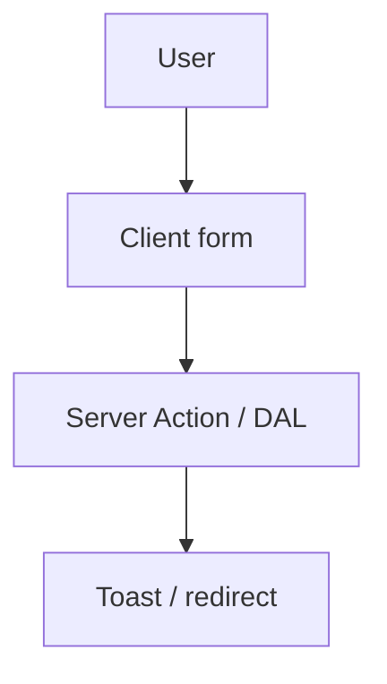

# Form handling pattern — Sunday School

Client forms: **`Field`** / **`Label`** / **`Input`** from `@/components/ui`, **`sonner`** for feedback, **Server Actions** for mutations. Prefer **`useActionState`** when server returns validation state; otherwise **`useTransition`** + toast. **Busy UI** while in flight — §4.

**Methodology:** [`docs/meta/ai_first_project_methodology.md`](../../meta/ai_first_project_methodology.md)  
**Stack:** Next.js **16.4**, React 19, `@sunschool/domain` `MutationResult`  
**Cursor rules:** **ui-mutation-pending**, **ui-toast-mutations**, **ios-safari-mutation-transport** (Class B critical forms)



---

## 1. Server Action

```ts
'use server'

import { redirect } from 'next/navigation'
import type { MutationResult } from '@sunschool/domain'

export async function createLesson(
  _prev: MutationResult<{ id: string }> | null,
  formData: FormData
): Promise<MutationResult<{ id: string }>> {
  // 1. requireActiveUser() — userId only from the session
  // 2. Zod parse (schema from @sunschool/domain) → fields errors in MutationResult.fields
  // 3. DAL use-case: domain rules + transaction + audit record
  // Codes come from @sunschool/domain (CHECK_*, SCHOOL_*, …), text from @/lib/messages
  const result = await createLessonUseCase(formData)
  if (result.ok) redirect(`/lessons/${result.data.id}`)
  return result
}
```

Mutations live in **`apps/web/src/data/**`**; actions stay thin. See [ai_nextjs_db_data_handle.md](../nextjs/ai_nextjs_db_data_handle.md).

---

## 2. Client form with `useActionState`

```tsx
'use client'

import { useActionState } from 'react'
import { createLesson } from '@/actions/lessons'
import { Field, FieldLabel, FieldError } from '@/components/ui/field'
import { Input } from '@/components/ui/input'
import { Button } from '@/components/ui/button'
import { MESSAGES } from '@/lib/messages'

export const LessonForm = () => {
  const [state, formAction, pending] = useActionState(createLesson, null)

  return (
    <form action={formAction} aria-busy={pending}>
      <Field data-invalid={state && !state.ok}>
        <FieldLabel htmlFor="topic">{MESSAGES.teacher.lesson.topicLabel}</FieldLabel>
        <Input id="topic" name="topic" required disabled={pending} />
        {state && !state.ok ? <FieldError>{state.fields?.topic ?? state.message}</FieldError> : null}
      </Field>
      <Button type="submit" disabled={pending} aria-busy={pending}>
        {pending ? MESSAGES.teacher.lesson.saving : MESSAGES.teacher.lesson.save}
      </Button>
    </form>
  )
}
```

---

## 3. Controlled field + `useTransition` + toast

Use when calling imperative APIs or Route Handlers without `ActionState`.

---

## 4. Mutation pending (busy) UI

Applies to **any server mutation**. Distinct from route **`loading.tsx`** — see [ai_loading_patterns.md](../nextjs/ai_loading_patterns.md).

### Required

1. **`pending`** from `useActionState`, `useFormStatus`, or `useTransition`
2. **`disabled={pending}`** on submit (and inputs if form locked)
3. **`aria-busy={pending}`** on submit or `<form>`
4. **Label change** — gerund from **`@/lib/messages`**

### Recommended

- Inline **`Loader2Icon`** on primary submit (`aria-hidden` with visible text)

### Relation to toasts

- Busy until settle; then **ui-toast-mutations** (`PRODUCT_TOAST_DURATION_MS`)

---

## 5. Optimistic actions (not forms)

Toggles without a form (e.g. mark a notification read) — **`useOptimistic`** — see [`ai_optimistic_ui_pattern.md`](./ai_optimistic_ui_pattern.md) and §7 in Pulse reference.

---

## 6. Dates and timezone

- Lesson dates and deadlines are interpreted in the **school time zone** (`app_setting`, [ADR-004](../../prds/07_governance/adr_004_timezone_scheduling_model.md)) — never the server or browser default alone; `computeLate` takes the zone as input.
- Store UTC in DB (or a calendar date where the schema says `date`); format with **`date-fns`** + explicit locale from the app language.
- See [database_schema_v1.md](../../prds/03_data_model/database_schema_v1.md) and [`forms_and_validation_ux.md`](../../design/forms_and_validation_ux.md) (F1–F12, form catalog).

---

## 7. iOS Safari — critical submit transport (Class B)

Mobile Safari can throw **`TypeError: Load failed`** on Server Action POST without a server error. **Mandatory** for conversion-critical forms on canonical routes.

**Docs:** rule **ios-safari-mutation-transport** · [`ai_nextjs_db_data_handle.md`](../nextjs/ai_nextjs_db_data_handle.md) §7 · Pulse incidents in `docs/examples/pulse/`

### When required

| Flow | Route | Class |
|------|-------|-------|
| Registration (consent + name) | `/register` | B |
| Access request approve / reject | admin access screen | B |
| Homework check save | lesson check screen | B |
| Lesson create / edit | `/lessons/new`, `/lessons/[lessonId]/edit` | B |
| Profile save (single submit) | `/profile` | B |

Routes — [`canonical_routes.md`](../../design/canonical_routes.md). Toggles / debounced saves → **Class A** (Route Handler primary) — [`ai_optimistic_ui_pattern.md`](./ai_optimistic_ui_pattern.md), not this section.

### Rules

1. **`useActionState`** / `<form action={…}>` stays the default UX on non-iOS browsers.
2. On **`isIosSafari()`** (or after `Load failed` retry): call **`POST /api/...`** with **`resilientPostFetch`**, same **`MutationResult`** shape.
3. **Pending UI unchanged** — `disabled`, `aria-busy`, gerund from `@/lib/messages` on both paths.
4. **Toasts / redirect:** Action path uses `redirect` + query toast (I2); fallback path uses `router.push('/lessons/[id]')` + client toast component.
5. **Do not** fork validation — single DAL in `src/data/**`.

### Hook sketch (transport selection)

Wrap submit in `useTransition`; branch on `isIosSafari()` before calling Action vs `/api/...`. See full example in pattern doc § «Client fallback».

### Checklist (Class B forms)

- [ ] DAL shared between Action and Route Handler
- [ ] iOS Safari fallback implemented or documented exception in PR
- [ ] `submit_transport` Sentry tag (when Sentry enabled)
- [ ] Verified pending + toast contract on both paths

---

## Checklist

1. **`'use client'`** on interactive forms
2. **Labels** + **`FieldError`** / `aria-invalid`
3. **Pending:** `disabled` + `aria-busy` + messages
4. **Toasts** after completion (**ui-toast-mutations**)
5. **Cache:** `updateTag` / `revalidatePath` in action after mutation (ADR-002)
6. **Class B critical form:** iOS Safari fallback per §7 and **ios-safari-mutation-transport**

**Reference:** Pulse snapshot [`ai_form_handling_pattern.md`](../../examples/pulse/docs/guidelines/react/ai_form_handling_pattern.md)
