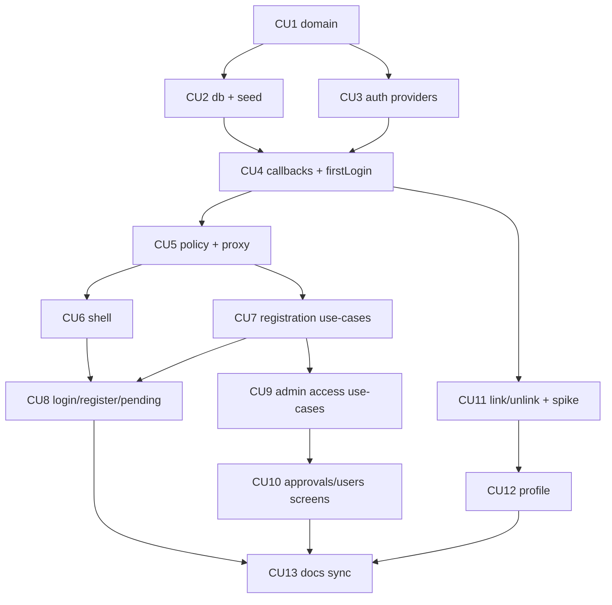

# P01 — Фундамент: данные, вход, оболочка, регистрация и доступ

**Тип:** Phase Description  
**Статус:** Canonical  
**Прогресс фазы:** Не начата (0 из 13 CU; обновлено 2026-10-11). Готов каркас bootstrap P5/P6 (монорепо, схема БД v1 с миграцией, Auth.js-скелет, Design Lab, T2-правила); код задач P01 — частично, см. пометки «Статус» в [`P01_tasks.md`](../tasks/P01_tasks.md). Следующий шаг: Phase DoR audit и P01-CU1.  
**Версия:** 1.0  
**Дата:** 2026-10-11  
**Волна:** W11-01  
**Зависит от:** bootstrap P5 (scaffold) и P6 (Design Lab) завершены — gates G4, G5 ([`prompts/00-orchestration.md`](../../../../prompts/00-orchestration.md)); [`monorepo_boundaries_contract.md`](../contracts/monorepo_boundaries_contract.md), [`access_requests_and_roles_contract.md`](../contracts/access_requests_and_roles_contract.md), [`change_log_contract.md`](../contracts/change_log_contract.md), [`auth_runtime_spec.md`](../../../prds/05_runtime/auth_runtime_spec.md), [`authorization_matrix.md`](../../../prds/04_authorization_privacy/authorization_matrix.md), [`global_shell_spec.md`](../specs/global_shell_spec.md), [`access_and_registration_spec.md`](../specs/access_and_registration_spec.md), [`seed_data_spec.md`](../../../prds/03_data_model/seed_data_spec.md)  
**Связанные документы:** [`P01_tasks.md`](../tasks/P01_tasks.md), [`P02_phase_description.md`](./P02_phase_description.md), [`architecture_master_index.md`](../../../prds/architecture_master_index.md)

---

## Purpose

Фаза даёт **рабочий вход в пустое приложение**: БД со справочниками, вход через Google и Telegram, первый admin, регистрация и заявка, одобрение и роли, оболочка с навигацией и запись журнала изменений. После P01 admin может принять учителей, а teacher — войти и увидеть пустой «Сегодня» (D1/D2). Читает фазу исполнитель P01 (агент или разработчик); результат — вход в P02.

Каркас монорепо, зависимости, CI, Prisma-схема и первая миграция, Design Lab и токены выполнены в **bootstrap P5/P6** и здесь **не повторяются**.

---

## Agent context budget

**MUST read (≤ 8):**

| # | Документ | Зачем |
|---|----------|-------|
| 1 | [`P01_tasks.md`](../tasks/P01_tasks.md) | Чек-лист и commit units |
| 2 | [`monorepo_boundaries_contract.md`](../contracts/monorepo_boundaries_contract.md) | Пакеты, use-case, `MutationResult`, коды |
| 3 | [`auth_runtime_spec.md`](../../../prds/05_runtime/auth_runtime_spec.md) | Callbacks, Telegram, привязка |
| 4 | [`access_requests_and_roles_contract.md`](../contracts/access_requests_and_roles_contract.md) | Операции регистрации и ролей |
| 5 | [`authorization_matrix.md`](../../../prds/04_authorization_privacy/authorization_matrix.md) | Права и перенаправления |
| 6 | [`global_shell_spec.md`](../specs/global_shell_spec.md) | Оболочка |
| 7 | [`access_and_registration_spec.md`](../specs/access_and_registration_spec.md) | Экраны входа и профиля |
| 8 | [`seed_data_spec.md`](../../../prds/03_data_model/seed_data_spec.md) §4–§6 | Справочники, маркер окружения |

По требованию (читать нужный `§`): [`change_log_contract.md`](../contracts/change_log_contract.md) §3–§5, [`adr_003`](../../../prds/07_governance/adr_003_auth_oidc_jwt_rbac.md), [`database_schema_v1.md`](../../../prds/03_data_model/database_schema_v1.md) §5.1, [`ui_states_contract.md`](../../../design/ui_states_contract.md), [`forms_and_validation_ux.md`](../../../design/forms_and_validation_ux.md).

**MUST NOT read** другие `P*_phase_description.md` в той же сессии; границы — «Cross-phase dependencies».

---

## Scope / Out of scope

### In scope

| Область | Результат |
|---------|-----------|
| `packages/domain` | Константы ролей и статусов, реестр кодов отказов и `AUDIT_ACTION`, схемы входов регистрации, правила переходов статусов |
| `packages/db` | Клиент с driver adapter, проверка `APP_ENV` и маркера БД, `writeAudit`, `seed:reference` (организация, настройки, справочники, каталог достижений) |
| Auth | Google и Telegram (OIDC), обход `state ≤ 256` и `userinfo_endpoint`, callbacks, `login_identity`, первый admin, ленивая очистка регистрации |
| Policy | `policy-edge` (префиксы маршрутов по статусу и роли), `policy-server` (`PolicySessionContext`, `requireActiveUser`, `requireRole`), `proxy.ts` |
| Оболочка | `(auth)` / `(app)`, header, drawer, topnav, меню пользователя, бейджи, баннеры, `global-error`, `not-found`, 403, словарь `common` и `auth` |
| Регистрация и доступ | `submitRegistration`, `resubmitRegistration`, `updateOwnName`, `approveRequest`, `rejectRequest`, `changeRoles`, `disableAccess`/`enableAccess`, `updateUserName`, `mergeUsers`, `purgeExpiredRegistration` |
| Экраны | `/login`, `/privacy`, `/register`, `/pending`, `/profile`, `/approvals`, `/users`, `/users/[userId]` |
| Привязка входа | `startLinkProvider`, `unlinkProvider`, спайк Q-02 (ADR-003) |

### Out of scope

- Год, группы, ученики → **P02**; `/settings` и `/school` → P02/P05.
- Загрузка Библии → **P03** (`seed:bible`).
- Запросы на удаление и профильный блок удаления → **P06**; просмотр журнала (`/audit`) → P06 (запись — здесь).
- Уроки, проверка, кирпичики → P03–P05.
- Переключатель роли «смотреть как» — dev-инструмент без серверных прав; реализуется с оболочкой, механизм dev-входа — Q-03 [`global_shell_spec.md`](../specs/global_shell_spec.md).

---

## UI Catalog (эта фаза)

Каталог — [`design_system_lab_spec.md`](../specs/design_system_lab_spec.md) §5.

| Действие | Компонент | Примечание |
|----------|-----------|------------|
| **USE** | `Button`, `Card`, `Input`, `Field`, `Checkbox`, `Badge`, `CountBadge`, `Skeleton`, `Dialog`, `Sheet`, `Toast`, `PageHeader`, `EmptyState`, `ErrorState`, `Banner` | из P6; новый вариант — сначала Lab |
| **CREATE** (L4) | `ProviderButton`, `ConsentBlock`, `LinkedIdentityRow`, `ApprovalRow`, `UserRow`, `RoleSelector` | по секциям Lab-first; якоря: `login`, `vRegister`, `approvals`, `users` |
| **CREATE** (shell) | `AppShell`, `AppHeader`, `TopNav`, `NavDrawer`, `UserMenu`, `NavBadge` | [`global_shell_spec.md`](../specs/global_shell_spec.md) §4 |
| **MUST NOT** | импорт `components/design-lab/**`; `role="menu"` для навигации; hex/`.dark` | UX-03, global_shell_spec §19 |

---

## Cross-phase dependencies

| Зависимость | Блокирует? | Примечание |
|-------------|-----------|------------|
| Bootstrap P5 (scaffold, Prisma schema + миграция) | **Да** | без них нет `packages/*` и схемы |
| Bootstrap P6 (Design Lab) | **Да** | G5: каталог и токены |
| Правила T1 активированы (P4) | Да | `auth-security`, `policy-packages`, `data-server-actions-and-api` |
| Решения ADR-003 Q-01…Q-03 | Нет | значения по умолчанию приняты; Q-02 закрывается спайком CU11 |
| Настройка Google OAuth и Telegram-бота dev | **Да** (для smoke) | [`telegram_authjs_oidc_portable_guide.md`](../../../my_specs/telegram_authjs_oidc_portable_guide.md) §2; HTTPS-origin для Telegram |
| Текст `/privacy` (v1) | Да | содержимое — владелец; черновик в коде |

---

## In-scope routes

Инвентарь — [`canonical_routes.md`](../../../design/canonical_routes.md) §4.1, §4.2 (`/profile`), §4.4 (`/approvals`, `/users`, `/users/[userId]`). Дублировать список запрещено. Особые правила: перенаправления — [`authorization_matrix.md`](../../../prds/04_authorization_privacy/authorization_matrix.md) §6; `/design-system` — только dev.

---

## Implementation sequence (рекомендуемая)

---

## Happy path smoke

1. Пустая dev-БД: `db:migrate` → `seed:reference` → приложение стартует; `APP_ENV` и маркер совпали.
2. Google-вход пользователя с `FIRST_ADMIN_EMAIL` → экран согласия → `/school` (пока каркас), роль `ADMIN`.
3. Новый пользователь входит через Telegram → `/register` → ФИО + согласие → `/pending`.
4. Admin видит заявку в `/approvals` с бейджем и одобряет её с ролью `TEACHER` без групп (предупреждение `NO_GROUPS`, группу назначит в P02) либо `ADMIN`.
5. Одобренный пользователь при следующем заходе попадает на `/school` (каркас).
6. Пользователь привязывает второй способ входа в `/profile`.

## Negative path smoke

| Сценарий | Ожидаемо |
|----------|----------|
| Отмена согласия у провайдера | `/login?error` с «Вход отменён» |
| `DISABLED` пользователь входит | отказ, `auth.login.denied` |
| Согласие не отмечено | кнопка неактивна; сервер при обходе — `VALIDATION` |
| Заявка с `PARENT` | `ACCESS_ROLE_UNAVAILABLE` |
| Снятие `ADMIN` у последнего | `ACCESS_LAST_ADMIN` |
| `APP_ENV=prod` + маркер `dev` | приложение не стартует |
| Привязка чужого Telegram id | `AUTH_LINK_CONFLICT`, пользователи не слиты |

## Security smoke

| Проверка | Ожидаемо |
|----------|----------|
| Teacher открывает `/approvals` | 403 (AZ-D3) |
| Чужой `/users/[id]` для teacher | 403/404 по матрице |
| JWT не содержит ФИО и email | декодирование cookie |
| Устаревший JWT после снятия роли | серверная проверка отказывает (AZ-D5) |
| `callbackUrl` на внешний хост | игнорируется |
| `state` Telegram | `length ≤ 256` (TG-5) |
| `proxy.ts` | не импортирует `policy-server`/`db` (lint) |

## Concurrency & race check

| Сценарий | Ожидаемо |
|----------|----------|
| Два admin решают одну заявку | один успех, второй `ACCESS_REQUEST_DECIDED` |
| Двойной первый вход одного человека | одна запись `login_identity` (UNIQUE) |
| Снятие `ADMIN` у двух последних параллельно | не остаётся ноль admin (R-8) |
| Две отвязки способов входа параллельно | остаётся ≥ 1 способ (`FOR UPDATE`) |
| Двойная отправка регистрации | одна заявка |

---

## Drift risks & guards

| Риск | Guard |
|------|-------|
| Промпт P5 описывает «Credentials scaffold» — противоречит ADR-003 | Auth в P01 по `auth_runtime_spec`; Credentials и `@auth/prisma-adapter` не добавлять |
| Роли и статусы inline-строками | `domain-literals-and-codes`; lint |
| `status`/`roles` из JWT для доступа к данным | `requireActiveUser()` по БД; review S |
| Журнал не пишется в транзакции | тест use-case; `writeAudit` — единственная точка |
| Схема Prisma ≠ `database_schema_v1.md` | правка схемы начинается с документа |
| Lab отстаёт от компонентов | Lab-first (design_system_lab_spec §9) |

---

## Definition of done

- [ ] Все CU закоммичены; у каждого trace `Review: …`
- [ ] Вход Google и Telegram в dev проходит; первый admin создаётся один раз
- [ ] Регистрация → заявка → одобрение → доступ по ролям работает
- [ ] Оболочка соответствует [`global_shell_spec.md`](../specs/global_shell_spec.md) §16
- [ ] `npm run typecheck` + `npm run lint` + `npm run test` (root)
- [ ] Smoke H/N/S выше пройден
- [ ] Docs sync: контракты/spec без расхождений с кодом (CU13)

---

## Open questions фазы

| ID | Вопрос | Предложение | Блокирует |
|----|--------|-------------|-----------|
| Q-01 | ✔ **Решено 2026-10-11.** Одобрение `TEACHER` без групп (расхождение контракта W8-03 и `admin_flow` §4.2) | Принят вариант `admin_flow`: одобрение без групп **разрешено с предупреждением** `NO_GROUPS`; группа назначается позже в `/groups/[groupId]`; контракт W8-03 §5.4/§6 и lifecycle §5.1 исправлены | — |
| Q-02 | Dev-вход «смотреть как» | Решить в CU6 по Q-03 `global_shell_spec`; до решения — только просмотр NAV | CU6 |

---

## Related documents

| Document | Relationship |
|----------|--------------|
| [`P01_tasks.md`](../tasks/P01_tasks.md) | Чек-лист |
| [`P02_phase_description.md`](./P02_phase_description.md) | Следующая фаза |
| [`ai_agent_model_routing.md`](../../../meta/ai_agent_model_routing.md) | DoR, tiers, CU |

**Registry:** [`documentation_creation_registry.md`](../../../meta/documentation_creation_registry.md) — wave W11-01

## Agent notes

- Одна сессия = P01 only; не начинать P02 до DoD.
- Не добавлять Credentials, `@auth/prisma-adapter`, `middleware.ts`.
- Не принимать `userId`/роль/статус с клиента.
- Все мутации — через use-case с записью журнала в той же транзакции.
- Не создавать страниц вне `canonical_routes`.

## Acceptance criteria

- [ ] Happy + negative + security smoke пройдены
- [ ] CREATE-компоненты есть в Lab (390 px, `md`)
- [ ] Нет дубля инвентаря маршрутов; нет inline-кодов и ролей

## Change log

| Date | Change |
|------|--------|
| 2026-10-11 | v1.0 — Canonical (W11-01) |
