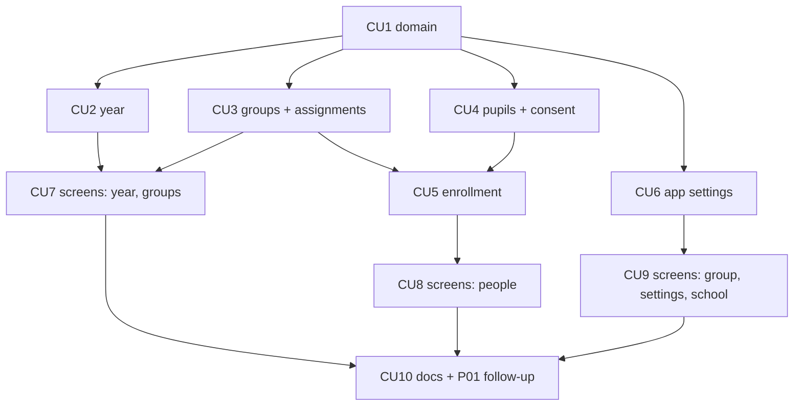

# P02 — Учебный год, группы, ученики, настройки

**Тип:** Phase Description  
**Статус:** Canonical  
**Версия:** 1.0  
**Дата:** 2026-10-11  
**Волна:** W11-03  
**Зависит от:** [`P01_phase_description.md`](./P01_phase_description.md) (DoD), [`school_year_and_groups_contract.md`](../contracts/school_year_and_groups_contract.md), [`monorepo_boundaries_contract.md`](../contracts/monorepo_boundaries_contract.md), [`authorization_matrix.md`](../../../prds/04_authorization_privacy/authorization_matrix.md) (AZ-10…AZ-15, AZ-20…AZ-23), [`adr_004_timezone_scheduling_model.md`](../../../prds/07_governance/adr_004_timezone_scheduling_model.md), [`adr_008_i18n_ru_en_dictionary_slices.md`](../../../prds/07_governance/adr_008_i18n_ru_en_dictionary_slices.md), [`admin_flow.md`](../../../prds/01_product_scope/user_flows/users_mvp/admin_flow.md) §4.4–§4.5, §4.7  
**Связанные документы:** [`P02_tasks.md`](../tasks/P02_tasks.md), [`P03_phase_description.md`](./P03_phase_description.md), [`architecture_master_index.md`](../../../prds/architecture_master_index.md)

---

## Purpose

Дать admin **структуру школы**: учебный год, группы с языком и настройками оценивания, назначения учителей, карточки учеников, бумажные согласия, зачисление и перевод; дать teacher экран «Моя группа»; вынести в интерфейс язык приложения и часовой пояс школы. После P02 в школе есть активный год, группы и дети — можно создавать уроки (P03).

---

## Agent context budget

**MUST read (≤ 8):**

| # | Документ | Зачем |
|---|----------|-------|
| 1 | [`P02_tasks.md`](../tasks/P02_tasks.md) | Чек-лист и CU |
| 2 | [`school_year_and_groups_contract.md`](../contracts/school_year_and_groups_contract.md) | Операции, отказы, гонки |
| 3 | [`monorepo_boundaries_contract.md`](../contracts/monorepo_boundaries_contract.md) §5–§9 | Слои, use-case, коды |
| 4 | [`authorization_matrix.md`](../../../prds/04_authorization_privacy/authorization_matrix.md) §7.2–§7.3 | Права |
| 5 | [`admin_flow.md`](../../../prds/01_product_scope/user_flows/users_mvp/admin_flow.md) §4.4–§4.5, §4.7 | Сценарии экранов |
| 6 | [`ui_states_contract.md`](../../../design/ui_states_contract.md) §5 | D1, D2, D3, D9, D11, D13 |
| 7 | [`forms_and_validation_ux.md`](../../../design/forms_and_validation_ux.md) §5–§6 | Поля и формы |
| 8 | [`adr_004`](../../../prds/07_governance/adr_004_timezone_scheduling_model.md) + [`adr_008`](../../../prds/07_governance/adr_008_i18n_ru_en_dictionary_slices.md) §4.2 | Пояс и язык |

**MUST NOT read** другие `P*_phase_description.md` в той же сессии.

---

## Scope / Out of scope

### In scope

| Область | Результат |
|---------|-----------|
| `domain` | `validateYearDates`, `canActivateYear`, `canEnroll`, схемы настроек оценивания и входов, коды `SCHOOL_*`, `AUDIT_ACTION` (`school.*`, `settings.*`) |
| Год | `createYear`, `activateYear`, `closeYear`, копирование настроек и назначений |
| Группы | `createGroup`, `updateGroup`, `deactivateGroup`/`activateGroup`, `setGroupLanguage`, `updateGradeSettings` |
| Назначения | `assignTeacher`, `unassignTeacher` |
| Ученики | `createPupil`, `updatePupil`, `deactivatePupil`, `recordPaperConsent`, `revokeConsent` |
| Зачисление | `enrollPupil`, `unenrollPupil`, `transferPupil` |
| Настройки приложения | `updateAppLanguage`, `updateSchoolTimezone` (admin), проверка IANA |
| Экраны | `/year`, `/groups`, `/groups/[groupId]`, `/people`, `/group`, `/settings`, `/school` (каркас) |
| Оболочка | баннеры D1, D3, D13 уровня оболочки |
| P01 follow-up | сквозной smoke одобрения `TEACHER` с группами; решение по Q-01 P01 |

### Out of scope

- Уроки, золотые стихи, календарь → **P03**; проверка → **P04**; кирпичики, аналитика, показатели `/school` → **P05**.
- Электронное согласие опекуна, семьи, родитель → post-MVP.
- Запросы на удаление данных ребёнка → **P06** (отзыв согласия в P02 лишь уведомляет admin).
- Загрузка Библии → P03; в P02 язык `EN` недоступен, пока перевод не `READY`.

---

## UI Catalog (эта фаза)

| Действие | Компонент | Примечание |
|----------|-----------|------------|
| **USE** | `Button`, `Card`, `Input`, `Select`, `Field`, `Checkbox`, `Switch`, `SegmentedControl`, `Dialog`, `Table`, `Badge`, `EmptyState`, `Banner`, `PageHeader`, `ConfirmDialog`, `Skeleton` | из P6 |
| **CREATE** (L4) | `YearCard`, `GroupCard`, `GroupSettingsForm`, `TeacherAssignmentList`, `PupilRow`, `PupilCardForm`, `ConsentDialog`, `EnrollDialog`, `TransferDialog`, `RosterTable`, `SettingsLanguageForm`, `TimezonePicker` | Lab-first; якоря: `year`, `groups`, `groupEdit`, `people`, `group`, `settings` |
| **MUST NOT** | собственные радиокнопки вместо `SegmentedControl`; `role="menu"` | UX-03, global_shell_spec |

---

## Cross-phase dependencies

| Зависимость | Блокирует? | Примечание |
|-------------|-----------|------------|
| **P01** завершена (DoD) | Да | вход, роли, оболочка, `writeAudit`, policy |
| Решение Q-01 P01 (учитель без групп) | Нет | если принято «одобрять с предупреждением» — правка W8-03 в CU10 |
| Seed справочников (P01) | Да | `bible_translation` для выбора языка группы, `app_setting` |
| `group_and_pupils_spec` (W9-05) на lean нет | Риск DoR | экраны строятся по контракту, admin_flow, прототипу; недостающее — spec-gap по месту (Phase DoR audit) |

---

## In-scope routes

Инвентарь — [`canonical_routes.md`](../../../design/canonical_routes.md) §4.3 (`/group`), §4.4 (`/school`, `/people`, `/groups`, `/groups/[groupId]`, `/year`, `/settings`). Дублировать список запрещено.

---

## Implementation sequence

---

## Happy path smoke

1. Admin создаёт год `2026–2027`, активирует; видит баннер D1 исчезает.
2. Создаёт группу «Средняя», язык `RU`, настройки по умолчанию; назначает teacher.
3. Создаёт ученика, отмечает бумажное согласие, зачисляет в группу.
4. Teacher открывает `/group` и видит состав; исключает и возвращает ученика.
5. Admin выбирает часовой пояс в `/settings`; предупреждение D13 пропадает; меняет язык на `en` — виден после перезагрузки.

## Negative path smoke

| Сценарий | Ожидаемо |
|----------|----------|
| Активация второго года | `SCHOOL_YEAR_ACTIVE_EXISTS` |
| Зачисление без согласия | `SCHOOL_CONSENT_REQUIRED` |
| Второе активное зачисление | `SCHOOL_ALREADY_ENROLLED` |
| Язык `EN` без `READY` перевода | `SCHOOL_LANGUAGE_UNAVAILABLE` |
| Teacher в закрытом году | `FORBIDDEN`, форма скрыта (D3) |
| Неизвестное IANA-имя пояса | `VALIDATION`, значение не меняется |

## Security smoke

| Проверка | Ожидаемо |
|----------|----------|
| Teacher открывает `/year`, `/groups`, `/people`, `/settings` | 403 (AZ-D3) |
| Teacher зачисляет в чужую группу | `NOT_FOUND` (AZ-D4) |
| Teacher видит о согласии только «есть/нет» (СО-7) | детали недоступны в DTO |
| Журнал записывает каждое изменение | `school.*`, `settings.*` без ФИО |

## Concurrency & race check

| Сценарий | Ожидаемо |
|----------|----------|
| Две активации годов параллельно | partial unique (R-1): один успех |
| Два зачисления одного ученика | partial unique (R-2): второй отказ |
| Перевод и исключение параллельно | блокировка ученика; второй `CONFLICT` |
| `closeYear` во время зачисления | второй получает `FORBIDDEN`/`CONFLICT` |

---

## Drift risks & guards

| Риск | Guard |
|------|-------|
| Уроки/зачисления в `CLOSED` год | проверка статуса года внутри транзакции; тест |
| `lead_teacher_id` без назначения после `unassignTeacher` | предупреждение; тест R-4 |
| Настройки года не скопированы | тест `createYear` |
| Язык группы `EN` без перевода после перезагрузки | предупреждение D9; тест |
| Пояс хранится вне `app_setting` | ADR-004; ревью |

---

## Definition of done

- [ ] Все CU закоммичены; trace `Review: …`
- [ ] Smoke H/N/S пройден; сквозное одобрение `TEACHER` с группами работает
- [ ] `npm run typecheck` + `lint` + `test`
- [ ] Docs sync: контракт, admin_flow, schema (при расхождениях)
- [ ] Lab содержит CREATE-компоненты (390 px)

---

## Open questions фазы

| ID | Вопрос | Предложение | Блокирует |
|----|--------|-------------|-----------|
| Q-01 | Деактивация группы с активными зачислениями | Разрешена с подтверждением (решено 2026-10-11) | CU3 |
| Q-02 | Показатели `/school` до P05 | Каркас: счётчики (группы, ученики, заявки), без средних | CU9 |
| Q-03 | Ввод подписанта согласия — только текстом | Да (MVP, `signer_name`) | CU4 |

---

## Related documents

| Document | Relationship |
|----------|--------------|
| [`P02_tasks.md`](../tasks/P02_tasks.md) | Чек-лист |
| [`P01_phase_description.md`](./P01_phase_description.md), [`P03_phase_description.md`](./P03_phase_description.md) | Соседние фазы |

**Registry:** [`documentation_creation_registry.md`](../../../meta/documentation_creation_registry.md) — wave W11-03

## Agent notes

- Одна сессия = P02 only.
- Не создавать уроки, проверки, кирпичики.
- Не переоткрывать закрытый год; не менять `status` года мимо use-case.
- ФИО детей не пишутся в журнал.

## Acceptance criteria

- [ ] Happy + negative + security smoke пройдены
- [ ] CREATE-компоненты проверены в Lab и на маршруте
- [ ] Нет inline-кодов отказов и ролей

## Change log

| Date | Change |
|------|--------|
| 2026-10-11 | v1.0 — Canonical (W11-03) |
