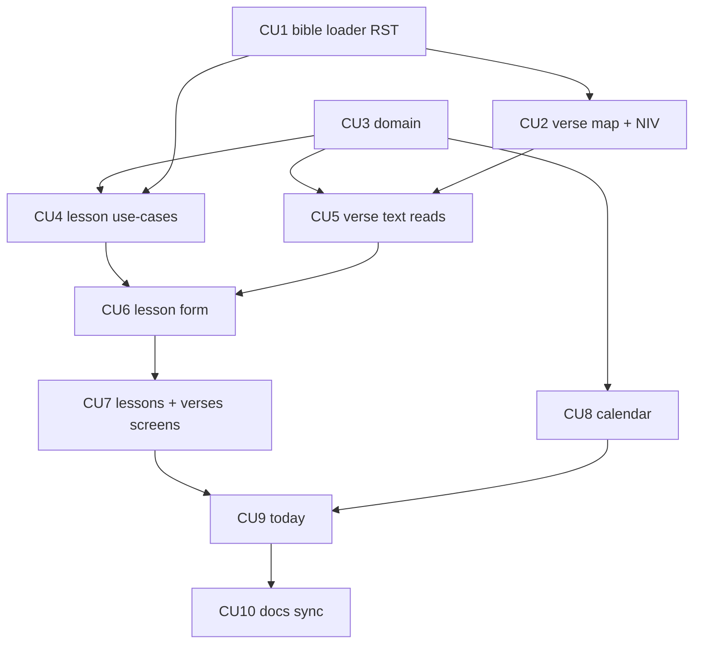

# P03 — Уроки, золотые стихи, календарь

**Тип:** Phase Description  
**Статус:** Canonical  
**Прогресс фазы:** Не начата (обновлено 2026-10-11). Ждёт DoD P02.  
**Версия:** 1.0  
**Дата:** 2026-10-11  
**Волна:** W11-05  
**Зависит от:** [`P02_phase_description.md`](./P02_phase_description.md) (DoD), [`homework_check_contract.md`](../contracts/homework_check_contract.md) §4.1, §5.1–§5.3, [`bible_seed_contract.md`](../contracts/bible_seed_contract.md), [`seed_data_spec.md`](../../../prds/03_data_model/seed_data_spec.md) §7, [`adr_009_bible_translations_and_verse_numbering.md`](../../../prds/07_governance/adr_009_bible_translations_and_verse_numbering.md), [`authorization_matrix.md`](../../../prds/04_authorization_privacy/authorization_matrix.md) (AZ-30…AZ-32, AZ-36, AZ-42, AZ-43), [`teacher_flow.md`](../../../prds/01_product_scope/user_flows/users_mvp/teacher_flow.md) §4.2, §4.6  
**Связанные документы:** [`P03_tasks.md`](../tasks/P03_tasks.md), [`P04_phase_description.md`](./P04_phase_description.md), [`architecture_master_index.md`](../../../prds/architecture_master_index.md)

---

## Purpose

Дать teacher и admin **уроки с золотыми стихами**: загрузить тексты Библии (RST, NIV, карта нумерации), собирать текст стиха в переводе группы, создавать и править уроки, вести календарь событий группы. После P03 группа имеет уроки, готовые к проверке (P04).

---

## Agent context budget

**MUST read (≤ 8):**

| # | Документ | Зачем |
|---|----------|-------|
| 1 | [`P03_tasks.md`](../tasks/P03_tasks.md) | Чек-лист и CU |
| 2 | [`homework_check_contract.md`](../contracts/homework_check_contract.md) §3–§5.3, §8–§10 | Операции урока, отказы |
| 3 | [`bible_seed_contract.md`](../contracts/bible_seed_contract.md) | Загрузка, карта, `buildVerseText` |
| 4 | [`adr_009`](../../../prds/07_governance/adr_009_bible_translations_and_verse_numbering.md) §3 | Нумерация, лицензия |
| 5 | [`seed_data_spec.md`](../../../prds/03_data_model/seed_data_spec.md) §4–§5, §7 | Команды, защита, проверки |
| 6 | [`teacher_flow.md`](../../../prds/01_product_scope/user_flows/users_mvp/teacher_flow.md) §4.2, §4.6 | Сценарии экранов |
| 7 | [`forms_and_validation_ux.md`](../../../design/forms_and_validation_ux.md) §5–§6 | Поля, выбор стиха |
| 8 | [`ui_states_contract.md`](../../../design/ui_states_contract.md) §5 | D1–D4, D10 |

Файлы с текстами: [`Bible/README.md`](../../../my_specs/Bible/README.md) — по требованию.

**MUST NOT read** другие `P*_phase_description.md`.

---

## Scope / Out of scope

### In scope

| Область | Результат |
|---------|-----------|
| Библия | `seed:bible` для RST и NIV (локально), сверка 66/1189/31 166 и 31 103, `bible_verse_map` (Псалмы по правилу, 27 глав — по таблице), статусы `READY` |
| `domain` | `buildVerseText`, `normalizeRange`, `nextRegularLesson`, `previousRegularLesson`, схемы урока, коды `CHECK_*` (урок), `AUDIT_ACTION` (`lesson.*`, `calendar.*`) |
| Уроки | `createLesson`, `updateLesson`, `changeLeadTeacher`, `deleteLesson`, пересчёт `ordinal` |
| Золотые стихи | `golden_verse` по диапазону, `lesson_golden_verse`, неизменность использованного (INV-21) |
| Календарь | `createEvent`, `updateEvent`, `deleteEvent` (`grade_event`), связь события «урок» с уроком |
| Экраны | `/today`, `/lessons`, `/lessons/new`, `/lessons/[lessonId]`, `/lessons/[lessonId]/edit`, `/verses`, `/calendar` |
| Dev | фикстуры `seed:dev`: уроки 1–9 с обзорным, события календаря |

### Out of scope

- Проверка ДЗ, `/check`, `/lessons/[id]/check`, `/lessons/[id]/table` → **P04** (в P03 кнопки ведут на заглушки с D5).
- Кирпичики, рейтинг, аналитика → P05.
- Прогресс проверки на «Сегодня» — только заглушка «N из M» (данные приходят в P04).
- Голосовая проверка, достижения → post-MVP.
- Правка текстов Библии через интерфейс — запрещена (ПБ-2).

---

## Экранные требования (spec-gap закрыт здесь, W9-03 на lean нет)

### Форма урока (`/lessons/new`, `/lessons/[id]/edit`)

| Блок | Содержимое | Правило |
|------|------------|---------|
| Группа | выбор из своих групп активного года (teacher), любая (admin) | по `teacher_assignment` |
| Тема, дата | `title` 1–200, дата в границах года | INV-02 |
| Тип | «Обычный» / «Обзорный»; смена только пока нет проверок | при «Обзорный» блоки стихов и теста скрыты |
| Ведущий | выбор из назначенных на группу; по умолчанию текущий пользователь | УЧ-1, УЧ-2 |
| Тест | переключатель «Тест на уроке» (только обычный) | `hasTest` |
| Золотые стихи | список выбранных; «Добавить»: книга → глава → стих «с» → («по» ≥ «с»); ≤ лимита группы; показ текста выбранного в переводе группы | ПБ-5, R-9 |
| Содержание | текст урока (форматированный — простой редактор: абзацы, списки) | необязательно |
| Действия | «Сохранить», «Отмена» | UX-06 F7, F8 |

Недостающие стихи в переводе группы — список под блоком стихов; сохранение запрещено (`CHECK_VERSE_MISSING`). Выбор книги — по названиям языка группы (ЯГ-2). Ссылки отображаются в языке группы, хранятся в Синодальной нумерации.

### `/lessons`, `/lessons/[id]`, `/verses`, `/calendar`, `/today`

| Экран | Состав |
|-------|--------|
| `/lessons` | список уроков группы/года: №, дата, тема, тип, ведущий, статус проверки; фильтр по группе (admin) |
| `/lessons/[id]` | карточка: тема, дата, ведущий, стихи (с текстом), тест, содержание; действия: «Проверить» (→ P04), «Правка», «Удалить» (если нет проверок) |
| `/verses` | справочник золотых стихов, использованных в группе/школе: ссылка, текст в переводе группы, где использован |
| `/calendar` | месяц/список событий группы: урок, выезд, отмена; создание/правка/удаление (teacher своя группа; admin любая) |
| `/today` | ближайший/текущий урок, «Новый урок», блок «Проверено N из M» (до P04 — «проверка будет доступна»), состояния D1, D2 |

---

## UI Catalog (эта фаза)

| Действие | Компонент | Примечание |
|----------|-----------|------------|
| **USE** | `Button`, `Card`, `Input`, `Textarea`, `Select`, `Switch`, `SegmentedControl`, `Dialog`, `Table`, `Badge`/`RefBadge`, `EmptyState`, `Banner`, `PageHeader`, `ConfirmDialog`, `Skeleton` | из P6 |
| **CREATE** (L4) | `LessonForm`, `VersePicker`, `VerseRefList`, `LessonCard`, `LessonListRow`, `CalendarMonth`, `CalendarEventForm`, `TodayLessonCard` | Lab-first; якоря: `lessonForm`, `lesson`, `lessons`, `verses`, `calendar`, `today` |
| **MUST NOT** | редактор HTML с произвольной вставкой; `dangerouslySetInnerHTML` для содержания без санитизации | S |

---

## Cross-phase dependencies

| Зависимость | Блокирует? | Примечание |
|-------------|-----------|------------|
| **P02** завершена | Да | активный год, группы, назначения, язык группы |
| Данные Bible (`RelSQLData/*` RST; NIV локально) | Да (RST), NIV — нет для dev | NIV не в git (ADR-009 §3.2) |
| `versification.json` | Нет для RST; **да** для `en-niv` как `READY` | architect готовит; владелец сверяет выборочно до prod |
| `lesson_form_and_golden_verses_spec` | — | закрыт разделом «Экранные требования» выше |
| P04 | Нет | заглушки «Проверить» |

---

## In-scope routes

[`canonical_routes.md`](../../../design/canonical_routes.md) §4.2 (`/calendar`, `/verses`), §4.3 (`/today`, `/lessons*`). Дублировать запрещено.

---

## Implementation sequence

---

## Happy path smoke

1. `seed:bible` загружает RST: 66/1189/31 166, перевод `READY`.
2. Teacher создаёт урок: выбирает стихи «Быт. 1:1», «Пс. 18:2»; видит их текст; сохраняет.
3. Admin с группой `EN` создаёт урок: те же ссылки, текст показывается в NIV через `bible_verse_map` (после загрузки NIV).
4. Teacher добавляет событие «Выезд» в календарь; урок появляется в календаре.
5. Teacher меняет ведущего урока; запись в журнале.

## Negative path smoke

| Сценарий | Ожидаемо |
|----------|----------|
| Урок в закрытом/неактивном году | `CHECK_YEAR_NOT_ACTIVE` |
| Диапазон без стиха в переводе | `CHECK_VERSE_MISSING` + список |
| Больше стихов, чем лимит | `CHECK_VERSES_LIMIT` |
| Обзорный урок со стихами | `VALIDATION` |
| Правка использованного диапазона | `CHECK_VERSE_LOCKED` |
| Teacher удаляет урок с проверками | `FORBIDDEN` |
| Загрузка NIV в prod без флага | отказ |
| Сверка счётчиков не сошлась | перевод не `READY` |

## Security smoke

| Проверка | Ожидаемо |
|----------|----------|
| Teacher правит урок чужой группы | `NOT_FOUND` |
| Клиент передаёт текст стиха | игнорируется; текст из БД |
| Содержание урока с HTML | санитизируется/экранируется |
| Календарь чужой группы | 404 |

## Concurrency & race check

| Сценарий | Ожидаемо |
|----------|----------|
| Два урока одной даты | допустимы; `ordinal` без дублей |
| Параллельные правки урока | `CONFLICT` по `updated_at` |
| Загрузка перевода во время чтения | чтение консистентно (§10 bible_seed_contract) |
| Удаление урока и начало проверки | блокировка урока; второй получает отказ |

---

## Drift risks & guards

| Риск | Guard |
|------|-------|
| Скрипты Библии используют `bible_edition`/`bible_chapter` | адаптация под схему §5.4; тест схемы |
| NIV попал в git | `.gitignore`, проверка CI |
| Стих хранится текстом | только диапазон; `golden_verse` |
| Нумерация NIV/RST перепутана | тест `Пс. 22` ↔ `Ps. 23` |
| `ordinal` с «дырами» | пересчёт в транзакции; тест |

---

## Definition of done

- [ ] Все CU закоммичены; trace `Review: …`
- [ ] RST загружен и сверен; NIV — в dev (с картой) либо `NO_DATA` с документированной причиной
- [ ] Smoke H/N/S пройден
- [ ] `npm run typecheck` + `lint` + `test`
- [ ] Docs sync: contracts, change_log registry (`calendar.*`)

---

## Open questions фазы

| ID | Вопрос | Предложение | Блокирует |
|----|--------|-------------|-----------|
| Q-01 | Сколько стихов NIV из карты нужно для статуса `READY` | Все 66/1189/31 103; иначе `NO_DATA`/`LOADING` | CU2 |
| Q-02 | Календарь: аудит-коды `calendar.*` | Добавить в реестр [`change_log_contract.md`](../contracts/change_log_contract.md) §4 | CU8 |
| Q-03 | Редактор содержания | Простой текст с абзацами и списками (без HTML) | CU6 |
| Q-04 | Права admin на создание урока без назначения на группу | Выбор ведущего из назначенных; без назначений — отказ с пояснением | CU4 |

---

## Related documents

| Document | Relationship |
|----------|--------------|
| [`P03_tasks.md`](../tasks/P03_tasks.md) | Чек-лист |
| [`P02_phase_description.md`](./P02_phase_description.md), [`P04_phase_description.md`](./P04_phase_description.md) | Соседние фазы |

**Registry:** [`documentation_creation_registry.md`](../../../meta/documentation_creation_registry.md) — wave W11-05

## Agent notes

- Одна сессия = P03 only.
- Не писать текст стиха клиентом; не коммитить NIV.
- Не создавать проверок и баллов.
- Стих хранится в Синодальной нумерации; показывается в языке группы.

## Acceptance criteria

- [ ] Happy + negative + security smoke пройдены
- [ ] CREATE-компоненты в Lab (390 px)
- [ ] NIV не в `git ls-files`

## Change log

| Date | Change |
|------|--------|
| 2026-10-11 | v1.0 — Canonical (W11-05) |
