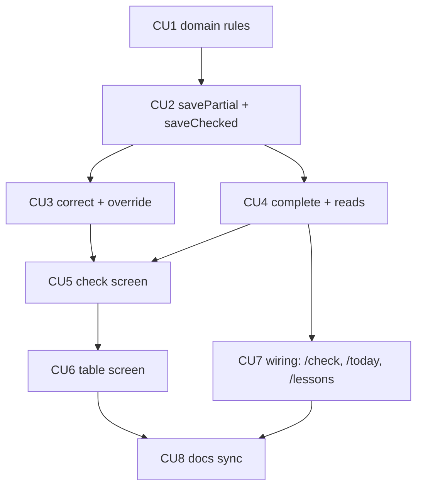

# P04 — Проверка домашних заданий

**Тип:** Phase Description  
**Статус:** Canonical  
**Прогресс фазы:** CU1–CU8 реализованы (обновлено 2026-10-17); коммит CU8 — docs sync. Ручной smoke H/N/S — владельцу перед prod.  
**Версия:** 1.0  
**Дата:** 2026-10-11  
**Волна:** W11-07  
**Зависит от:** [`P03_phase_description.md`](./P03_phase_description.md) (DoD), [`homework_check_contract.md`](../contracts/homework_check_contract.md) §3–§13, [`homework_check_flow_spec.md`](../specs/homework_check_flow_spec.md), [`adr_004_timezone_scheduling_model.md`](../../../prds/07_governance/adr_004_timezone_scheduling_model.md), [`authorization_matrix.md`](../../../prds/04_authorization_privacy/authorization_matrix.md) (AZ-33…AZ-36, AZ-P5, AZ-P6), [`domain_invariants.md`](../../../prds/02_domain_model/domain_invariants.md) (INV-11…INV-15)  
**Связанные документы:** [`P04_tasks.md`](../tasks/P04_tasks.md), [`P05_phase_description.md`](./P05_phase_description.md), [`architecture_master_index.md`](../../../prds/architecture_master_index.md)

---

## Purpose

Дать учителю **основной рабочий процесс школы**: последовательно проверить домашние задания учеников урока, сохранить оценки с замороженными баллами и меткой «сдано позже», исправить ранее проверенное и увидеть сводную таблицу. После P04 в системе есть оценки и баллы — основа для кирпичиков и аналитики (P05).

---

## Agent context budget

**MUST read (≤ 8):**

| # | Документ | Зачем |
|---|----------|-------|
| 1 | [`P04_tasks.md`](../tasks/P04_tasks.md) | Чек-лист и CU |
| 2 | [`homework_check_contract.md`](../contracts/homework_check_contract.md) | Операции, баллы, `late`, отказы |
| 3 | [`homework_check_flow_spec.md`](../specs/homework_check_flow_spec.md) | Экраны проверки и таблицы |
| 4 | [`domain_invariants.md`](../../../prds/02_domain_model/domain_invariants.md) §4.4 | INV-11…INV-15 |
| 5 | [`adr_004`](../../../prds/07_governance/adr_004_timezone_scheduling_model.md) | Пояс школы |
| 6 | [`forms_and_validation_ux.md`](../../../design/forms_and_validation_ux.md) §5, §7.2 | Поля, проверка ДЗ |
| 7 | [`ui_states_contract.md`](../../../design/ui_states_contract.md) §5 | D3…D7, D14 |
| 8 | [`authorization_matrix.md`](../../../prds/04_authorization_privacy/authorization_matrix.md) §7.4 | Права |

**MUST NOT read** другие `P*_phase_description.md`.

---

## Scope / Out of scope

### In scope

| Область | Результат |
|---------|-----------|
| `domain` | `computePoints`, `computeLate`, `nextLessonDate`, схемы входов проверки, `resolveVersesToRecite` (БП-2) |
| Проверка | `savePartialCheck`, `saveChecked`, `correctCheck`, `overrideVerseScore`, `completeLessonCheck` |
| События оценок | `homework_score_event` на каждое изменённое поле; вычисление `late` по поясу школы |
| Чтение | roster урока, стихи предыдущего обычного урока, прогресс «N из M», сводные данные |
| Экраны | `/check`, `/lessons/[lessonId]/check`, `/lessons/[lessonId]/table`; прогресс на `/today`; статусы в `/lessons` |
| Dev | фикстуры: проверки уроков 1–7, частичная проверка урока 8, «сдано позже» |

### Out of scope

- Кирпичики и их выдача → **P05** (баллы вычисляются здесь, остаток — там).
- Аналитика, средние по БП-1 → P05.
- Достижения и штрафы, голосовые оценки → post-MVP (блоки не показываются).
- Журнал изменений (просмотр) → P06; запись — `writeAudit` из P01.

---

## UI Catalog (эта фаза)

| Действие | Компонент | Примечание |
|----------|-----------|------------|
| **USE** | `Button`, `Card`, `Input`, `Select`, `Switch`, `SegmentedControl`, `ScoreSelector`, `Progress`, `Badge`, `Table`, `Banner`, `Dialog`, `ConfirmDialog`, `EmptyState`, `Skeleton`, `Toast` | из P6 |
| **CREATE** (L4) | `CheckPupilList`, `CheckCard`, `CheckCardHeader`, `ScoreGroup`, `LateBadge`, `CheckProgress`, `CheckBottomBar`, `LessonCheckTable`, `LessonCheckTableRow`, `CheckFinishedCard` | Lab-first; якоря: `check`, `lessonTable` |
| **MUST NOT** | блок достижений/штрафов на экране завершения; вычисление `late` и итога записи на клиенте для отправки | spec §13 R-2 |

---

## Cross-phase dependencies

| Зависимость | Блокирует? | Примечание |
|-------------|-----------|------------|
| **P03** (уроки, стихи, календарь) | Да | урок `HELD`, диапазоны, переводы |
| **P02** (зачисление, настройки оценивания) | Да | roster, веса, лимиты |
| Часовой пояс школы (ADR-004) | Нет | до выбора — UTC; тест границ полуночи для обеих |
| P05 | Нет | баллы читаются там; здесь — только запись |

---

## In-scope routes

[`canonical_routes.md`](../../../design/canonical_routes.md) §4.3 (`/check`, `/lessons/[lessonId]/check`, `/lessons/[lessonId]/table`). Дублировать запрещено.

---

## Implementation sequence

---

## Happy path smoke

1. Teacher открывает «Сегодня» → «Проверить ДЗ» → первый непроверенный ученик.
2. Вносит присутствие, оценки стихов, тест, тетрадь, спевку → «Сохранить и далее».
3. На последнем — «Завершить проверку» → экран завершения; урок `CHECK_COMPLETED`.
4. Через неделю исправляет оценку («Сдал позже») → `late` + метка «сдано <дата>»; журнал.
5. Сводная таблица показывает значения и метки; правка ячейки сохраняется.

## Negative path smoke

| Сценарий | Ожидаемо |
|----------|----------|
| Сохранение без присутствия | `VALIDATION` у блока, не сохранено |
| Тест/тетрадь вне 0–10; стих вне 0–2 | `VALIDATION`, форма сохранена |
| Параллельная правка | `CONFLICT`, «Загрузить актуальное» |
| Teacher правит закрытый год | форма скрыта; `FORBIDDEN` при обходе |
| Admin правит закрытый год без причины | `VALIDATION` (`reason`) |
| Завершение без проверенных записей | `CHECK_NOTHING_CHECKED` |

## Security smoke

| Проверка | Ожидаемо |
|----------|----------|
| Чужой урок / ученик | 404 |
| Клиент передаёт `late`, баллы, автора | игнорируется |
| Teacher меняет присутствие «задним числом» из-за поздней сдачи | не меняется автоматически (БП-12) |
| Журнал корректировки | значения полей, без ФИО |

## Concurrency & race check

| Сценарий | Ожидаемо |
|----------|----------|
| Двойное «Сохранить» | один результат (идемпотентно) |
| Два учителя одного ученика | один успех, второй `CONFLICT` |
| `closeYear` во время сохранения | `FORBIDDEN` |
| `completeLessonCheck` + `savePartialCheck` | согласованный статус |

---

## Drift risks & guards

| Риск | Guard |
|------|-------|
| `NULL` превращён в 0 | тест INV-11; тип `number | null` |
| Баллы пересчитаны при смене весов | тест INV-13 |
| `late` вводится вручную | DTO без поля; тест |
| Присутствие влияет на баллы | тест `computePoints` (INV-12) |
| Пояс браузера используется | `computeLate` принимает пояс школы аргументом; тест |

---

## Definition of done

- [ ] Все CU закоммичены; trace `Review: …`
- [ ] Smoke H/N/S пройден; тесты INV-11…INV-14 зелёные
- [ ] `npm run typecheck` + `lint` + `test`
- [x] Docs sync: контракт, flow spec, ui_states, lifecycle (CU8)

---

## Open questions фазы

| ID | Вопрос | Предложение | Блокирует |
|----|--------|-------------|-----------|
| Q-01 | ✔ **Решено 2026-10-17.** «Сохранить и далее»: всегда `saveChecked` | Реализовано; автосохранение `savePartial` при уходе без сохранения — не в MVP | CU5 |
| Q-02 | ✔ **Решено 2026-10-17.** Правки в таблице: сразу по ячейке | Реализовано (flow spec §7.2) | CU6 |
| Q-03 | Нужна ли предзагрузка следующего ученика | SHOULD (flow spec R-7), без блокировки MVP | CU5 |

---

## Related documents

| Document | Relationship |
|----------|--------------|
| [`P04_tasks.md`](../tasks/P04_tasks.md) | Чек-лист |
| [`P03_phase_description.md`](./P03_phase_description.md), [`P05_phase_description.md`](./P05_phase_description.md) | Соседние фазы |

**Registry:** [`documentation_creation_registry.md`](../../../meta/documentation_creation_registry.md) — wave W11-07

## Agent notes

- Одна сессия = P04 only.
- Не вычислять баллы и `late` на клиенте для отправки; не принимать их с клиента.
- «Не оценивалось» ≠ 0.
- Не показывать достижения/штрафы.

## Acceptance criteria

- [ ] Happy + negative + security smoke пройдены
- [ ] CREATE-компоненты в Lab (390 px)
- [ ] Тесты границ `computeLate` (полночь, DST) зелёные

## Change log

| Date | Change |
|------|--------|
| 2026-10-11 | v1.0 — Canonical (W11-07) |
| 2026-10-17 | v1.1 — Docs sync P04 (контракт §12, flow §5–6, ui_states D5, lifecycle §5.6, open questions) |
