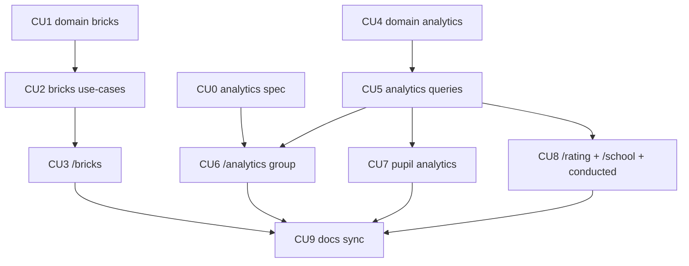

# P05 — Кирпичики, рейтинг, аналитика

**Тип:** Phase Description  
**Статус:** Canonical  
**Версия:** 1.0  
**Дата:** 2026-10-11  
**Волна:** W11-09  
**Зависит от:** [`P04_phase_description.md`](./P04_phase_description.md) (DoD), [`bricks_ledger_contract.md`](../contracts/bricks_ledger_contract.md), [`homework_check_contract.md`](../contracts/homework_check_contract.md) §6–§7, [`sunday_school_data_analytics_spec.md`](../../../my_specs/sunday_school_data_analytics_spec.md) §5, §8, §9, [`authorization_matrix.md`](../../../prds/04_authorization_privacy/authorization_matrix.md) (AZ-40, AZ-41, AZ-44…AZ-47), [`ui_states_contract.md`](../../../design/ui_states_contract.md) (D6, D8, D12), [`domain_invariants.md`](../../../prds/02_domain_model/domain_invariants.md) (INV-10, INV-17, INV-18)  
**Связанные документы:** [`P05_tasks.md`](../tasks/P05_tasks.md), [`P06_phase_description.md`](./P06_phase_description.md), [`architecture_master_index.md`](../../../prds/architecture_master_index.md)

---

## Purpose

Превратить оценки в то, чем школа пользуется: **баланс и выдача кирпичиков**, **рейтинг** и **аналитика** группы, ученика и школы. После P05 teacher видит, кому и сколько выдать, как идёт группа; admin — состояние школы и качество данных.

---

## Agent context budget

**MUST read (≤ 8):**

| # | Документ | Зачем |
|---|----------|-------|
| 1 | [`P05_tasks.md`](../tasks/P05_tasks.md) | Чек-лист и CU |
| 2 | [`bricks_ledger_contract.md`](../contracts/bricks_ledger_contract.md) | Остаток, выдача, компенсация |
| 3 | [`analytics_screens_spec.md`](../specs/analytics_screens_spec.md) | Экраны аналитики (создаётся в CU0) |
| 4 | Спец. [§5](../../../my_specs/sunday_school_data_analytics_spec.md), [§8–§9](../../../my_specs/sunday_school_data_analytics_spec.md) | Метрики, рейтинг, графики |
| 5 | [`homework_check_contract.md`](../contracts/homework_check_contract.md) §6–§7 | Баллы, «сдано позже» |
| 6 | [`ui_states_contract.md`](../../../design/ui_states_contract.md) §5 | D6, D8, D12 |
| 7 | [`authorization_matrix.md`](../../../prds/04_authorization_privacy/authorization_matrix.md) §7.5 | Права |
| 8 | [`forms_and_validation_ux.md`](../../../design/forms_and_validation_ux.md) §5 | Форма выдачи |

**MUST NOT read** другие `P*_phase_description.md`.

---

## Scope / Out of scope

### In scope

| Область | Результат |
|---------|-----------|
| Spec-gap (CU0) | `analytics_screens_spec.md` (W9-07): экраны, фильтры, графики, методология — **создаётся первым CU** |
| `domain` | `computeBalance`, `canIssue`, слои выборки A/B/C/D (БП-1), средние (БП-2…БП-4), посещаемость, нормированный балл, сглаживание, тренд, метрика рейтинга |
| Кирпичики | `getBalance`, `listLedger`, `issueBricks`, `compensateBricks` |
| Рейтинг | `getGroupRating`, `getSchoolRating` (метрика — см. Q-01) |
| Аналитика | группа, ученик (с динамикой 9.1.3), школа, «кто какие уроки провёл» (9.1.4), строка качества данных |
| Экраны | `/bricks`, `/rating`, `/analytics`, `/analytics/pupils/[pupilId]`, показатели `/school` |
| Dev | фикстуры: журнал кирпичиков с выдачами и компенсацией |

### Out of scope

- Достижения, штрафы, бонусные баллы, голосовые метрики (9.3–9.4) → post-MVP; в MVP слагаемые = 0.
- Отчёты родителю, `/child`, `/verse` → post-MVP.
- Экспорт/печать отчётов — вне MVP.
- Удаление данных ребёнка и пометка «данные изменены» на экранах → **P06** (место под пометку резервируется).
- Рейтинг для проектора — не реализуется (РТ-5).

---

## Экранные требования: `/bricks` и `/rating` (spec-gap закрыт здесь)

### `/bricks`

| Блок | Содержимое | Правило |
|------|------------|---------|
| Фильтр | группа (admin — любая; teacher — свои), год (по умолчанию активный) | AZ-41 |
| Таблица учеников | ФИО, набрано, выдано, **остаток**, статус «требует внимания» при `< 0` | INV-18 |
| Действия | «Выдать» (количество > 0, дата, примечание), «Исправить» (количество < 0, примечание обязательно) | bricks_ledger §5 |
| Журнал | записи ученика: дата, количество, кто, примечание; отрицательные — компенсация | INV-17 |
| Пусто | нет учеников — D2/состав; нет баллов — «Баллов пока нет» | UX-05 |

Выдача сверх остатка — отказ с актуальным остатком (`BRICKS_INSUFFICIENT`); закрытый год — выдача допустима (БП-6).

### `/rating`

| Блок | Содержимое | Правило |
|------|------------|---------|
| Фильтр | группа/школа (admin), год | РТ-1: только teacher (своя) и admin |
| Таблица | место, ФИО, значение метрики, число штрафов (post-MVP — колонка скрыта) | РТ-3 |
| Метрика | **по умолчанию:** сумма баллов за год по проверенным записям группы (Q-01) | пересмотр владельцем |
| Запрещено | режим показа детям/проектор | РТ-5 |

---

## UI Catalog (эта фаза)

| Действие | Компонент | Примечание |
|----------|-----------|------------|
| **USE** | `Button`, `Card`, `Input`, `Select`, `SegmentedControl`, `Table`, `Dialog`, `Banner`, `EmptyState`, `Progress`, `Badge`, `Skeleton`, `Toast`, `PageHeader` | из P6 |
| **CREATE** (L4) | `BalanceTable`, `IssueBricksDialog`, `CompensateBricksDialog`, `LedgerList`, `RatingTable`, `AnalyticsKpiRow`, `SampleCompositionRow`, `LineChart`, `BarChart`, `ChartTableToggle`, `MethodologyNote`, `PupilLessonTable`, `DynamicsBlock`, `ConductedLessonsTable`, `DataQualityNote` | Lab-first; якоря: `bricks`, `rating`, `analytics`, `pupil`, `school` |
| **MUST NOT** | две оси Y на одном графике; цвет как единственный носитель смысла; 3D/градиенты | спец. §9.5 |

Библиотека графиков — Q-02; выбор фиксируется на CU6 после проверки по документации.

---

## Cross-phase dependencies

| Зависимость | Блокирует? | Примечание |
|-------------|-----------|------------|
| **P04** (проверки, баллы) | Да | источник «набрано» и наблюдений |
| **P02** (зачисления) | Да | дата отсчёта БП-1, слои выборки |
| **P03** (уроки, ведущие) | Да | блок «кто какие уроки провёл» |
| Метрика рейтинга (спец. 12.2 п. 5) | Нет | значение по умолчанию принято, пересмотр — владелец |
| `analytics_screens_spec` | Да (экраны) | создаётся в CU0 фазы |
| P06 | Нет | пометка «данные удалены» подключится позже |

---

## In-scope routes

[`canonical_routes.md`](../../../design/canonical_routes.md) §4.2 (`/rating`, `/analytics`, `/analytics/pupils/[pupilId]`), §4.3 (`/bricks`), §4.4 (`/school`). Дублировать запрещено.

---

## Implementation sequence

---

## Happy path smoke

1. Teacher открывает `/bricks`: у ученика набрано 18, выдано 10, остаток 8; выдаёт 5 → остаток 3; запись в журнале.
2. Teacher исправляет ошибочную выдачу компенсацией −2 с примечанием.
3. Teacher открывает `/analytics`: видит среднюю посещаемость, средние, состав выборки A/B/C/D, графики и таблицу.
4. Открывает ученика: слой выборки и причина, график, таблицу по урокам, динамику.
5. Admin открывает `/school` и `/rating` школы.

## Negative path smoke

| Сценарий | Ожидаемо |
|----------|----------|
| Выдача больше остатка | `BRICKS_INSUFFICIENT` |
| Количество 0 или дробное | `VALIDATION` |
| Компенсация без примечания | `VALIDATION` |
| Мало данных для графика/тренда | «Пока мало данных» (D12), не нули |
| Нет проверенных уроков | пусто с объяснением |
| Teacher открывает рейтинг школы | 403 |

## Security smoke

| Проверка | Ожидаемо |
|----------|----------|
| Чужая группа/ученик | 404 |
| Журнал кирпичиков | нет `UPDATE`/`DELETE` у роли приложения |
| ФИО ученика в журнале изменений | нет (ссылки) |
| Рейтинг | недоступен родителю и режим проектора отсутствует |

## Concurrency & race check

| Сценарий | Ожидаемо |
|----------|----------|
| Две параллельные выдачи | вторая видит уменьшенный остаток (R-7) |
| Выдача и правка проверки (баллы уменьшились) | отрицательный остаток допустим, виден teacher/admin |
| Двойной клик «Выдать» | одна запись (`requestId`) |

---

## Drift risks & guards

| Риск | Guard |
|------|-------|
| Остаток хранится колонкой | вычисляется; тест |
| Группа в расчёте остатка | тест INV-10 (перевод не меняет) |
| `NULL` в среднем как 0 | тест INV-11 |
| Присутствие влияет на баллы | тест INV-12 |
| Метод расчёта не показан пользователю | `MethodologyNote` на каждом отчёте (9.6) |
| Малая выборка раскрывает удалённых детей | пороги < 3 (спец. 9.1), тест P06 |

---

## Definition of done

- [ ] Все CU закоммичены; trace `Review: …`
- [ ] Smoke H/N/S пройден; тесты INV-10, INV-11, INV-12, INV-17, INV-18 зелёные
- [ ] `npm run typecheck` + `lint` + `test`
- [ ] На каждом отчёте есть «как мы считали»
- [ ] Docs sync

---

## Open questions фазы

| ID | Вопрос | Предложение | Блокирует |
|----|--------|-------------|-----------|
| Q-01 | Метрика рейтинга (РТ-3, 12.2 п. 5) | Сумма баллов за год по проверенным записям | CU8 |
| Q-02 | Библиотека графиков | Выбрать по документации на CU6 (лёгкая, SSR-friendly, доступная); без 3D | CU6 |
| Q-03 | Порог явки 50% и тренд ±1 п.п. — константы или настройка | Константы домена; настройка — post-MVP | CU4 |
| Q-04 | Период: год / месяц / диапазон | Год по умолчанию; месяц и диапазон — фильтр | CU5 |

---

## Related documents

| Document | Relationship |
|----------|--------------|
| [`P05_tasks.md`](../tasks/P05_tasks.md) | Чек-лист |
| [`P04_phase_description.md`](./P04_phase_description.md), [`P06_phase_description.md`](./P06_phase_description.md) | Соседние фазы |

**Registry:** [`documentation_creation_registry.md`](../../../meta/documentation_creation_registry.md) — wave W11-09 (+W9-07 как CU0)

## Agent notes

- Одна сессия = P05 only.
- Остаток только вычисляется; журнал только добавление.
- Не смешивать две величины на одном графике; не показывать рейтинг детям.
- Метрики — в `@sunschool/domain`, чистые функции с тестами.

## Acceptance criteria

- [ ] Happy + negative + security smoke пройдены
- [ ] CREATE-компоненты в Lab (390 px)
- [ ] Графики имеют табличное представление и «как считали»

## Change log

| Date | Change |
|------|--------|
| 2026-10-11 | v1.0 — Canonical (W11-09) |
