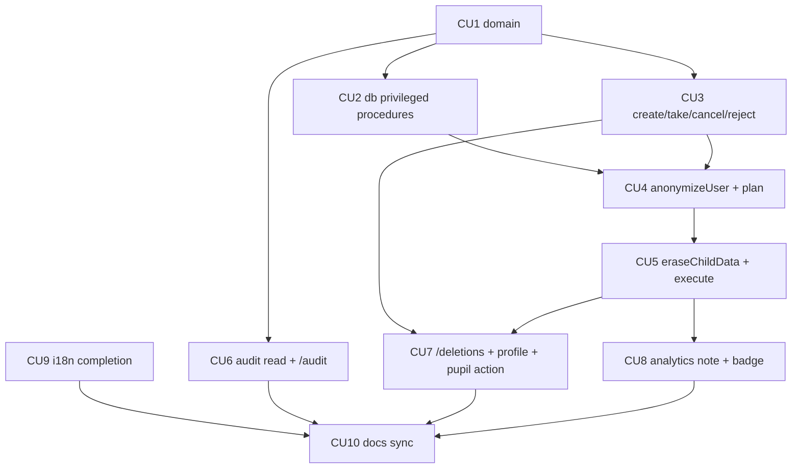

# P06 — Журнал изменений, запросы на удаление, локализация

**Тип:** Phase Description  
**Статус:** Canonical  
**Версия:** 1.0  
**Дата:** 2026-10-11  
**Волна:** W11-11  
**Зависит от:** [`P05_phase_description.md`](./P05_phase_description.md) (DoD), [`change_log_contract.md`](../contracts/change_log_contract.md), [`deletion_requests_contract.md`](../contracts/deletion_requests_contract.md), [`adr_008_i18n_ru_en_dictionary_slices.md`](../../../prds/07_governance/adr_008_i18n_ru_en_dictionary_slices.md), [`authorization_matrix.md`](../../../prds/04_authorization_privacy/authorization_matrix.md) (AZ-06, AZ-07, AZ-08, AZ-P7), [`database_schema_v1.md`](../../../prds/03_data_model/database_schema_v1.md) §5.6, §9, [`sunday_school_data_analytics_spec.md`](../../../my_specs/sunday_school_data_analytics_spec.md) §2.5 (УД-1…УД-11)  
**Связанные документы:** [`P06_tasks.md`](../tasks/P06_tasks.md), [`P07_phase_description.md`](./P07_phase_description.md), [`architecture_master_index.md`](../../../prds/architecture_master_index.md)

---

## Purpose

Закрыть **обязательства перед людьми и перед данными**: показать admin журнал изменений, дать пользователям и admin механизм запросов на удаление с безопасным выполнением («удалить или обезличить»), и довести интерфейс до полной ru/en-локализации. После P06 приложение соответствует решениям по ПД и готово к миграции и prod (P07).

---

## Agent context budget

**MUST read (≤ 8):**

| # | Документ | Зачем |
|---|----------|-------|
| 1 | [`P06_tasks.md`](../tasks/P06_tasks.md) | Чек-лист и CU |
| 2 | [`deletion_requests_contract.md`](../contracts/deletion_requests_contract.md) | Процедура, план, защиты |
| 3 | [`change_log_contract.md`](../contracts/change_log_contract.md) | Формат, реестр, чтение |
| 4 | [`database_schema_v1.md`](../../../prds/03_data_model/database_schema_v1.md) §5.6, §9 | Классификация ПД |
| 5 | [`adr_008`](../../../prds/07_governance/adr_008_i18n_ru_en_dictionary_slices.md) | Словари, плюрализация, `Intl` |
| 6 | [`authorization_matrix.md`](../../../prds/04_authorization_privacy/authorization_matrix.md) §7.1 | AZ-06…AZ-08 |
| 7 | [`forms_and_validation_ux.md`](../../../design/forms_and_validation_ux.md) §6–§7 | Подтверждение словом |
| 8 | [`ui_states_contract.md`](../../../design/ui_states_contract.md) §5 | D15, D12 |

**MUST NOT read** другие `P*_phase_description.md`.

---

## Scope / Out of scope

### In scope

| Область | Результат |
|---------|-----------|
| `domain` | `buildDeletionPlan`, `computeDueOn`, `canExecute`, коды `DELETION_*`, `AUDIT_ACTION` (`deletion.*`) |
| `db` | привилегированные процедуры (функции БД `SECURITY DEFINER`/эквивалент) для `DELETE` по `brick_ledger` и обезличивания текста `audit_log`; миграция |
| Запросы | `createDeletionRequest`, `createChildDeletionRequest`, `takeRequest`, `cancelRequest`, `rejectRequest`, `previewDeletionPlan`, `executeDeletion`, `anonymizeUser`, `eraseChildData` |
| Журнал | `listAuditLog`, `getEntityHistory`; экран `/audit` |
| Экраны | `/audit`, `/deletions`, блок удаления в `/profile`, действие «Запрос на удаление» у ученика (admin), история в профиле пользователя |
| Аналитика | пометка «данные изменены по запросу опекуна» (порог < 3) |
| Оболочка | бейдж «Люди»: заявки + открытые запросы на удаление |
| Локализация | полные словари `common`, `auth`, `teacher`, `admin`, `analytics` на ru и en; сверка ключей типами; формы слов и `Intl` |
| P01 follow-up | `mergeUsers` использует `anonymizeUser` |

### Out of scope

- Электронный запрос опекуна и страница «Данные и согласия» → post-MVP.
- Семьи, голос, достижения: процедуры дополняются при включении волн.
- Перенос данных из старого приложения → **P07**.
- Экспорт журнала, поиск по значениям — вне MVP.

---

## UI Catalog (эта фаза)

| Действие | Компонент | Примечание |
|----------|-----------|------------|
| **USE** | `Button`, `Card`, `Input`, `Select`, `Table`, `Dialog`, `ConfirmDialog`, `Banner`, `EmptyState`, `Badge`, `StatusText`, `Skeleton`, `Toast`, `PageHeader`, `SegmentedControl` | из P6 |
| **CREATE** (L4) | `AuditTable`, `AuditFilterBar`, `AuditEntryRow`, `DeletionRequestCard`, `DeletionPlanView`, `DeletionConfirmDialog`, `DeletionStatusBlock`, `EntityHistoryList` | Lab-first; якоря: `audit`, `deletions`, `profile` |
| **MUST NOT** | показ ФИО в `old_value`/`new_value`; кнопки редактирования записей журнала | INV-16, INV-23 |

---

## Cross-phase dependencies

| Зависимость | Блокирует? | Примечание |
|-------------|-----------|------------|
| **P01** `writeAudit`, `mergeUsers` | Да | журнал пишется с P01; merge переходит на `anonymizeUser` |
| **P02** `revokeConsent` | Да | уведомление admin ведёт к созданию запроса |
| **P04/P05** данные ребёнка | Да | процедура удаляет `homework_*`, `brick_ledger` |
| Юридическая проверка срока 15 дней | Нет для dev; **да** для prod (P07) | значение в константе домена |
| Окно восстановления Neon (УД-11) | Нет | указывается в тексте согласия на P07 |
| Механизм привилегий БД (Q-03 контракта удаления) | Да | решается в CU2 |

---

## In-scope routes

[`canonical_routes.md`](../../../design/canonical_routes.md) §4.2 (`/profile`), §4.4 (`/audit`, `/deletions`, `/users/[userId]`). Дублировать запрещено.

---

## Implementation sequence

---

## Happy path smoke

1. Teacher в `/profile` запрашивает удаление своей записи; admin видит запрос в `/deletions`, бейдж.
2. Admin берёт запрос, смотрит план (удалить N, обезличить M), вводит слово подтверждения, выполняет: учётная запись → «Удалённый пользователь №N», вход невозможен, авторство в уроках сохранено.
3. Admin создаёт запрос на удаление данных ученика по обращению опекуна, выполняет: ученик, проверки, кирпичики исчезли; журнал содержит ссылку «ребёнок (данные удалены)»; групповые средние пересчитаны.
4. Admin открывает `/audit`, фильтрует по действию и периоду; записи неизменяемы.
5. Admin переключает язык приложения на `en` — все экраны переведены.

## Negative path smoke

| Сценарий | Ожидаемо |
|----------|----------|
| Второй открытый запрос на субъект | `DELETION_ALREADY_OPEN` |
| Выполнение без слова/плана | `VALIDATION` |
| Запрос последнего admin | `DELETION_LAST_ADMIN` |
| Отклонение без причины | `VALIDATION` |
| Отмена выполненного | `DELETION_STATUS_INVALID` |
| Пропуск ключа в `en` | сборка падает (тип) |
| Откат транзакции на середине выполнения | ничего не удалено |

## Security smoke

| Проверка | Ожидаемо |
|----------|----------|
| Teacher открывает `/audit` и `/deletions` | 403 |
| Роль приложения: `UPDATE`/`DELETE` над `audit_log` | отказ БД |
| ФИО в `deletion_request`, `summary`, журнале | нет |
| Выполнение — единственное место `DELETE` по `brick_ledger` | привилегированная процедура |
| `JWT` обезличенного пользователя | серверная проверка отказывает |

## Concurrency & race check

| Сценарий | Ожидаемо |
|----------|----------|
| Два admin выполняют один запрос | один успех |
| Выполнение и отмена автором | второй `DELETION_STATUS_INVALID` |
| Выполнение и проверка ДЗ того же ребёнка | блокировка; новая запись → `NOT_FOUND` |
| Повторный `executeDeletion` | идемпотентно возвращает сводку |

---

## Drift risks & guards

| Риск | Guard |
|------|-------|
| Новая таблица с ПД не включена в процедуру | строка в deletion contract §6 и схеме §9 (review) |
| Журнал хранит ФИО | тест сериализации, review |
| Срок 15 дней зашит в UI | константа домена |
| Расхождение en/ru ключей | тип `en` ≡ `typeof ru` |
| Процедуры БД не покрыты миграциями | тесты миграций на копии БД |

---

## Definition of done

- [ ] Все CU закоммичены; trace `Review: …` (T3 — `reviewer`)
- [ ] Smoke H/N/S пройден; план и выполнение удаления покрыты тестами, включая откат
- [ ] `npm run typecheck` + `lint` + `test`
- [ ] Словари ru/en совпадают по ключам; вручную просмотрены ключевые экраны на `en`
- [ ] Docs sync

---

## Open questions фазы

| ID | Вопрос | Предложение | Блокирует |
|----|--------|-------------|-----------|
| Q-01 | Механизм привилегий БД для удаления (контракт Q-03) | Функции `SECURITY DEFINER`, вызываемые только процедурой; миграция + тест | CU2 |
| Q-02 | Показ пометки «данные изменены» | постоянно в периоде, где были данные; порог < 3 | CU8 |
| Q-03 | Перевод en: кто проверяет тексты | владелец сверяет ключевые экраны; машинный черновик допустим | CU9 |
| Q-04 | Роль «последний admin» — как создаётся «другой admin» | админ создаёт запрос; второй admin выполняет; если один — подтверждение УД-9 | CU5 |

---

## Related documents

| Document | Relationship |
|----------|--------------|
| [`P06_tasks.md`](../tasks/P06_tasks.md) | Чек-лист |
| [`P05_phase_description.md`](./P05_phase_description.md), [`P07_phase_description.md`](./P07_phase_description.md) | Соседние фазы |

**Registry:** [`documentation_creation_registry.md`](../../../meta/documentation_creation_registry.md) — wave W11-11

## Agent notes

- Одна сессия = P06 only.
- Удаление — одна транзакция; не удалять частично.
- Не писать ФИО в журнал и сводки; не редактировать журнал вне процедуры.
- Не менять статус запроса по сроку автоматически (INV-25).

## Acceptance criteria

- [ ] Happy + negative + security smoke пройдены
- [ ] CREATE-компоненты в Lab (390 px)
- [ ] Ключи словарей полные; `en` проверен на ключевых экранах

## Change log

| Date | Change |
|------|--------|
| 2026-10-11 | v1.0 — Canonical (W11-11) |
