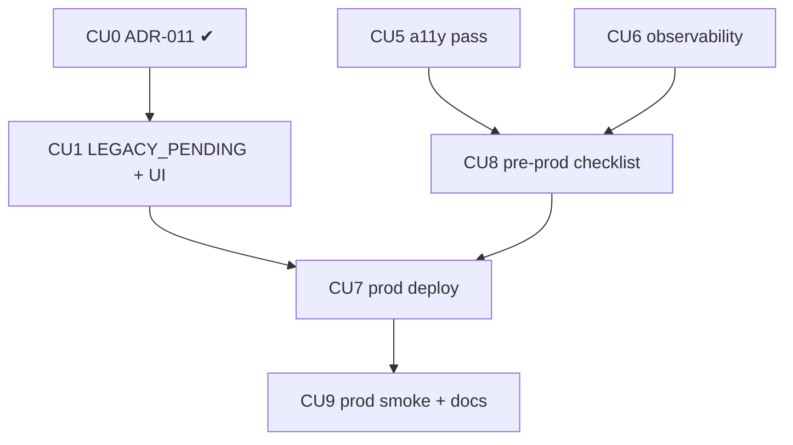

# P07 — Переходный период согласий и prod-готовность

**Тип:** Phase Description  
**Статус:** Canonical  
**Прогресс фазы:** Не начата (обновлено 2026-10-11). Ждёт DoD P06; CU0 (ADR-011) принят, документы W12 существуют; юридическая проверка срока — до prod.  
**Версия:** 1.1  
**Дата:** 2026-10-11  
**Волна:** W11-13  
**Зависит от:** [`P06_phase_description.md`](./P06_phase_description.md) (DoD), [`adr_011_transitional_child_consent.md`](../../../prds/07_governance/adr_011_transitional_child_consent.md), [`migration_runbook.md`](../../../prds/06_operations/migration_runbook.md) §11, [`seed_data_spec.md`](../../../prds/03_data_model/seed_data_spec.md), [`adr_001_stack_and_runtime.md`](../../../prds/07_governance/adr_001_stack_and_runtime.md) §3.4, [`adr_009`](../../../prds/07_governance/adr_009_bible_translations_and_verse_numbering.md) §3.2, [`vercel_deploy_guide.md`](../guides/vercel_deploy_guide.md), [`project_quality_profile.md`](../../../meta/project_quality_profile.md) (D8, D9)  
**Связанные документы:** [`P07_tasks.md`](../tasks/P07_tasks.md), [`architecture_master_index.md`](../../../prds/architecture_master_index.md)

---

## Purpose

Довести приложение до **рабочей школы**: принять перенесённых детей в переходный период согласий, пройти доступность и наблюдаемость, развернуть prod и закрыть пред-prod чек-лист (лицензия NIV, юридическая проверка срока удаления, окно резервных копий).

> **Перенос данных из действующего приложения в проект не входит** (решение владельца 2026-10-11): владелец реализует его самостоятельно. Приложение лишь **совместимо** с таким импортом (§Совместимость).

---

## Agent context budget

**MUST read (≤ 8):**

| # | Документ | Зачем |
|---|----------|-------|
| 1 | [`P07_tasks.md`](../tasks/P07_tasks.md) | Чек-лист и CU |
| 2 | [`adr_011`](../../../prds/07_governance/adr_011_transitional_child_consent.md) | Переходный период согласий |
| 3 | [`migration_runbook.md`](../../../prds/06_operations/migration_runbook.md) §9, §11 | Откат, совместимость импорта |
| 4 | [`seed_data_spec.md`](../../../prds/03_data_model/seed_data_spec.md) §4–§6 | Справочники и prod |
| 5 | [`vercel_deploy_guide.md`](../guides/vercel_deploy_guide.md) | Релиз и env |
| 6 | [`auth_runtime_spec.md`](../../../prds/05_runtime/auth_runtime_spec.md) §4, §8 | Prod-вход, ошибки |
| 7 | [`adr_009`](../../../prds/07_governance/adr_009_bible_translations_and_verse_numbering.md) §3.2 | Лицензия NIV |
| 8 | [`visual_identity_contract.md`](../../../design/visual_identity_contract.md) §9 + правило `ui-semantics-a11y` | Доступность |

**MUST NOT read** другие `P*_phase_description.md`.

---

## Scope / Out of scope

### In scope

| Область | Результат |
|---------|-----------|
| Переходный период согласий (ADR-011) | статус `LEGACY_PENDING`, общий срок `legacy_consent_deadline_on`, правила зачисления, UI admin и teacher, решение admin по истечении |
| Совместимость с импортом владельца | требования к данным (§Совместимость), проверка, что приложение корректно работает с такими данными |
| Доступность (D8) | проход по ключевым экранам: клавиатура, фокус, контраст, 390 px, `aria-*` |
| Наблюдаемость (D9) | Sentry (клиент/сервер), `logger.error` для ошибок входа, фильтр ПД, релизы |
| Prod | проект Vercel, Neon prod, секреты, миграции, `seed:reference` + `seed:bible`, первый admin (`db:seed:admin`), домен, Telegram-бот prod |
| Пред-prod чек-лист | лицензия NIV, юр. проверка срока удаления (15 дней) и переходного периода, окно резервных копий в тексте согласия, финальный `/privacy`, security review |
| Smoke prod | вход, регистрация, одобрение, проверка ДЗ, кирпичики, журнал |

### Out of scope

- **Перенос данных из действующего приложения** (маппинг, раннер импорта, сверка сходимости, отчёт сирот) — реализует владелец вне проекта.
- Функциональные расширения (достижения, семьи, голос) → post-MVP.
- Перенос паролей/сессий старого приложения (не переносятся, спец. §13).
- Постоянная синхронизация со старым приложением.

---

## Совместимость с импортом владельца

То, что приложение требует от данных, загруженных скриптом владельца (источник — [`migration_runbook.md`](../../../prds/06_operations/migration_runbook.md) §11):

| # | Требование | Источник |
|---|------------|----------|
| 1 | Импорт выполняется на **копии/ветке Neon**, затем на prod-проекте; реальные данные детей **не попадают** в dev и репозиторий | спец. §15 ОК-4, ОК-6 |
| 2 | Целевая схема и ограничения не обходятся (частичные индексы, `UNIQUE`, FK); схема не меняется вне миграций | [`database_schema_v1.md`](../../../prds/03_data_model/database_schema_v1.md) |
| 3 | Для каждого перенесённого ребёнка — `child_data_consent` со `status = LEGACY_PENDING`, `channel = PAPER`, `signed_on = NULL`, `text_version = 'legacy'`; в `app_setting` задан `legacy_consent_deadline_on` (дата импорта + 60 дней) | ADR-011 §4 |
| 4 | Зачисления перенесённых детей — активные (`ends_on IS NULL`) в группе активного года; один активный на ребёнка | R-2, INV-07 |
| 5 | `audit_log` и `brick_ledger` — только добавление; записи старых выдач кирпичиков переносятся как записи журнала, а не правкой остатков | R-6, БП-11 |
| 6 | Оценки: «не оценивалось» — `NULL`, не 0 (для старых данных, где различия нет, 0 — оценка, БП-4); `points_total` и `scoring_snapshot` заполнены на момент импорта | INV-11, INV-13 |
| 7 | Оценки за стихи: поле i урока N → стих i урока N−1 (принято 2026-10-11) | спец. 12.2 п. 15 |
| 8 | Достижения не начисляются задним числом; штрафов нет | спец. §13 |
| 9 | Ведущий урока — единственный преподаватель группы, иначе пусто (допустимо только для перенесённых уроков) | УЧ-1 |
| 10 | Импорт не создаёт учётных записей входа: пользователи регистрируются сами и проходят заявку | спец. §13 |

Проверка совместимости в приложении (CU1): экран `/people` и `enrollPupil` корректно обрабатывают `LEGACY_PENDING`; тесты используют **синтетические** данные.

---

## UI Catalog (эта фаза)

| Действие | Компонент | Примечание |
|----------|-----------|------------|
| **USE** | существующие | новых экранов немного |
| **CREATE** (L4) | `LegacyConsentBadge`, `LegacyConsentList` (в `/people`), `ConsentDeadlineBanner` | Lab-first; якоря: `people`, `school` |
| **MUST NOT** | переключатель роли «смотреть как» в prod-сборке | ОК-5 |

---

## Cross-phase dependencies

| Зависимость | Блокирует? | Примечание |
|-------------|-----------|------------|
| **P06** (журнал, удаление, i18n) | Да | prod без процедуры удаления недопустим |
| Telegram-бот prod, HTTPS-домен; пароль первого admin prod (оператор, не в репозитории) | Да | [`telegram guide`](../../../my_specs/telegram_authjs_oidc_portable_guide.md) §2 |
| Лицензия NIV (Biblica) | Да для NIV в prod | иначе BSB (ADR-009) |
| Юридическая проверка срока 15 дней и переходного периода | Да для prod | значения в константах домена / `app_setting` |
| Импорт данных владельцем | Нет (для готовности приложения) | к cut-over школы — да, вне проекта |

---

## Implementation sequence

---

## Happy path smoke

1. Миграции + `seed:reference` + `seed:bible` на пустой prod-подобной ветке; приложение стартует с `APP_ENV=prod`.
2. Синтетические перенесённые дети с `LEGACY_PENDING`: у admin список «без согласия (перенесён)», срок, баннер; teacher видит «согласия нет (перенесён)».
3. Admin записывает бумажное согласие → `ACTIVE`; по истечении срока — продлевает с причиной либо создаёт запрос на удаление.
4. Первый admin входит по `FIRST_ADMIN_EMAIL`, одобряет учителей; teacher проверяет ДЗ.
5. Smoke prod по [`vercel_deploy_guide.md`](../guides/vercel_deploy_guide.md) §8.

## Negative path smoke

| Сценарий | Ожидаемо |
|----------|----------|
| Зачисление `LEGACY_PENDING` после срока | `SCHOOL_CONSENT_REQUIRED` |
| Новый ребёнок без `ACTIVE` согласия | `SCHOOL_CONSENT_REQUIRED` |
| Срок истёк, действий нет | данные не удаляются; подсветка «просрочено» |
| NIV без подтверждения лицензии | не загружается в prod |
| `APP_ENV` ≠ маркер | приложение не стартует |
| `seed:dev` в prod | отказ |

## Security smoke

| Проверка | Ожидаемо |
|----------|----------|
| Данные детей в dev | нет (только вымышленные) |
| Секреты | только server env; нет `NEXT_PUBLIC_*` секретов |
| Заголовки/CSP, cookie `Secure/HttpOnly` | проверено |
| `/design-system`, dev-переключатель | 404 / отсутствует в prod |
| Sentry | без ПД и значений форм |
| Роль БД приложения | без `UPDATE`/`DELETE` над журналами |
| Teacher и детали согласия | только «есть/нет» (СО-7) |

## Concurrency & race check

| Сценарий | Ожидаемо |
|----------|----------|
| Миграция схемы и работа приложения | порядок: миграции → деплой; окно обслуживания |
| Первый вход двух «первых admin» | один (блокировка) |
| Продление срока и зачисление параллельно | согласованный срок (чтение внутри транзакции) |

---

## Drift risks & guards

| Риск | Guard |
|------|-------|
| Реальные данные попали в репозиторий/dev | `.gitignore`, `.local`, фикстуры `@example.test` |
| `LEGACY_PENDING` приравнен к `ACTIVE` | тест `canEnroll` (ADR-011 §9) |
| Согласия не получены к концу периода | список и баннер admin; решение по каждому |
| Prod и dev делят секреты | отдельные `AUTH_SECRET`, Telegram-бот и пароль администратора (ОК-1) |
| Лицензия NIV не подтверждена | `--confirm-license`; чек-лист |
| Импорт владельца нарушил инварианты | требования §Совместимость; проверка на копии до prod |

---

## Definition of done

- [ ] Все CU закоммичены; trace `Review: …` (T3 — `reviewer`)
- [ ] Переходный период согласий работает (тесты ADR-011 §9)
- [ ] Доступность и наблюдаемость: чек-листы пройдены
- [ ] Пред-prod чек-лист закрыт (лицензия, юр. срок, backup-текст, privacy v1)
- [ ] Prod развёрнут; smoke H/N/S пройден; старое приложение остаётся до приёмки
- [ ] Docs sync

---

## Open questions фазы

| ID | Вопрос | Предложение | Блокирует |
|----|--------|-------------|-----------|
| Q-01 | ✔ **Решено 2026-10-11.** Модель переходного периода согласий (СО-5) | [ADR-011](../../../prds/07_governance/adr_011_transitional_child_consent.md) | — |
| Q-02 | Юридическая проверка основания обработки данных перенесённых детей | Владелец до prod (ADR-011 Q-01) | CU8 |
| Q-03 | Окно обслуживания при cut-over школы | Короткое, вечером; старое приложение read-only (решение владельца вне проекта) | CU7 |
| Q-04 | Домен prod и preview-хост | Выбор владельца | CU7 |

---

## Related documents

| Document | Relationship |
|----------|--------------|
| [`P07_tasks.md`](../tasks/P07_tasks.md) | Чек-лист |
| [`P06_phase_description.md`](./P06_phase_description.md) | Предыдущая фаза |

**Registry:** [`documentation_creation_registry.md`](../../../meta/documentation_creation_registry.md) — wave W11-13

## Agent notes

- Одна сессия = P07 only.
- Не реализовывать и не описывать перенос данных из старого приложения: вне проекта.
- Реальные ПД детей **никогда** не попадают в репозиторий, dev, логи и чат.
- Не включать NIV в prod без подтверждённой лицензии.
- Не приравнивать `LEGACY_PENDING` к `ACTIVE`.

## Acceptance criteria

- [ ] Happy + negative + security smoke пройдены на ветке Neon
- [ ] Пред-prod чек-лист закрыт

## Change log

| Date | Change |
|------|--------|
| 2026-10-11 | v1.0 — Canonical (W11-13) |
| 2026-10-11 | v1.1 — перенос данных исключён по решению владельца; добавлен раздел «Совместимость с импортом владельца» |
