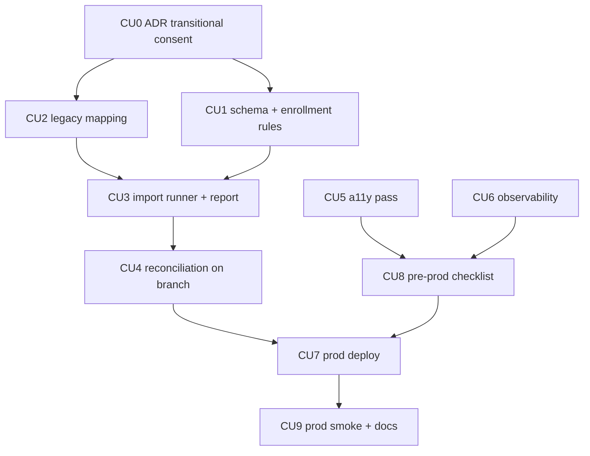

# P07 — Миграция из действующего приложения и prod-готовность

**Тип:** Phase Description  
**Статус:** Canonical  
**Версия:** 1.0  
**Дата:** 2026-10-11  
**Волна:** W11-13  
**Зависит от:** [`P06_phase_description.md`](./P06_phase_description.md) (DoD), [`adr_011_transitional_child_consent.md`](../../../prds/07_governance/adr_011_transitional_child_consent.md), [`sunday_school_data_analytics_spec.md`](../../../my_specs/sunday_school_data_analytics_spec.md) §13 (миграция), §15 (окружения), СО-5, `migration_runbook` (W12-02, *planned*), [`seed_data_spec.md`](../../../prds/03_data_model/seed_data_spec.md), [`adr_001_stack_and_runtime.md`](../../../prds/07_governance/adr_001_stack_and_runtime.md) §3.4, [`adr_009`](../../../prds/07_governance/adr_009_bible_translations_and_verse_numbering.md) §3.2, [`project_quality_profile.md`](../../../meta/project_quality_profile.md) (D8, D9)  
**Связанные документы:** [`P07_tasks.md`](../tasks/P07_tasks.md), [`architecture_master_index.md`](../../../prds/architecture_master_index.md)

---

## Purpose

Довести приложение до **рабочей школы**: перенести данные из действующего приложения с проверкой сходимости, закрыть переходный период согласий, пройти доступность и наблюдаемость, развернуть prod и пройти пред-prod чек-лист (лицензия NIV, юридическая проверка срока удаления, окно резервных копий). После P07 школа переходит на новое приложение, старое остаётся рабочим до приёмки.

---

## Agent context budget

**MUST read (≤ 8):**

| # | Документ | Зачем |
|---|----------|-------|
| 1 | [`P07_tasks.md`](../tasks/P07_tasks.md) | Чек-лист и CU |
| 2 | Спец. [§13](../../../my_specs/sunday_school_data_analytics_spec.md), [§15](../../../my_specs/sunday_school_data_analytics_spec.md), СО-5 | Миграция, окружения, переходный период |
| 3 | [`seed_data_spec.md`](../../../prds/03_data_model/seed_data_spec.md) | Справочники и prod |
| 4 | [`adr_001`](../../../prds/07_governance/adr_001_stack_and_runtime.md) §3.4 | Окружения |
| 5 | [`adr_009`](../../../prds/07_governance/adr_009_bible_translations_and_verse_numbering.md) §3.2 | Лицензия NIV |
| 6 | [`auth_runtime_spec.md`](../../../prds/05_runtime/auth_runtime_spec.md) §4, §8 | Prod-вход, ошибки |
| 7 | [`deletion_requests_contract.md`](../contracts/deletion_requests_contract.md) §14 | Юр. срок, backup |
| 8 | [`visual_identity_contract.md`](../../../design/visual_identity_contract.md) §9 + правило `ui-semantics-a11y` | Доступность |

Гайды W12 (`vercel_deploy_guide`, `neon_prisma_migrations_guide`, `migration_runbook`) — по мере появления.

**MUST NOT read** другие `P*_phase_description.md`.

---

## Scope / Out of scope

### In scope

| Область | Результат |
|---------|-----------|
| Переходный период согласий (СО-5) | решение (ADR) и реализация: перенесённые ученики без бумажного согласия помечены, срок 60 дней, решение admin по каждому |
| Миграция данных | чистые функции отображения «старое → новое», раннер на копии, отчёт сирот и дублей, сверка сходимости (уроки, проверки, суммы баллов, кирпичики) |
| Доступность (D8) | проход по ключевым экранам: клавиатура, фокус, контраст, 390 px, `aria-*` |
| Наблюдаемость (D9) | Sentry (клиент/сервер), `logger.error` для ошибок входа, фильтр ПД, релизы |
| Prod | проект Vercel, Neon prod, секреты, миграции, `seed:reference` + `seed:bible`, первый admin, домен, приложения Google/Telegram prod |
| Пред-prod чек-лист | лицензия NIV, юр. проверка срока удаления (15 дней), окно резервных копий в тексте согласия, финальный текст `/privacy`, security review |
| Smoke prod | вход, регистрация, одобрение, проверка ДЗ, кирпичики, журнал |

### Out of scope

- Функциональные расширения (достижения, семьи, голос) → post-MVP.
- Перенос паролей/сессий Cognito (не переносятся, §13).
- Перенос данных семей (в старом приложении данных нет).
- Постоянная синхронизация со старым приложением — перенос разовый.

---

## UI Catalog (эта фаза)

| Действие | Компонент | Примечание |
|----------|-----------|------------|
| **USE** | существующие | новых экранов немного |
| **CREATE** (L4) | `LegacyConsentBadge`, `LegacyConsentList` (в `/people`), `ConsentDeadlineBanner` | Lab-first; якоря: `people`, `school` |
| **MUST NOT** | переключатель роли «смотреть как» в prod-сборке | ОК-5 |

---

## Cross-phase dependencies

| Зависимость | Блокирует? | Примечание |
|-------------|-----------|------------|
| **P06** (журнал, удаление, i18n) | Да | prod без процедуры удаления недопустим |
| Данные экспорта из старого приложения | **Да** (для миграции) | предоставляет владелец; в репозиторий не попадают |
| Приложения Google/Telegram prod, HTTPS-домен | Да | [`telegram guide`](../../../my_specs/telegram_authjs_oidc_portable_guide.md) §2 |
| Лицензия NIV (Biblica) | Да для NIV в prod | иначе вариант BSB (ADR-009) |
| Юридическая проверка срока 15 дней | Да для prod | значение в константе домена |
| Документы W12 (runbook, guides) | Да | пишутся следующей волной bootstrap |

---

## Implementation sequence

---

## Happy path smoke (prod-подобная ветка Neon)

1. Миграции + `seed:reference` + `seed:bible` на пустой ветке; приложение стартует с `APP_ENV=prod`.
2. Импорт копии старых данных: отчёт «перенесено N, дублей M, сирот K».
3. Сходимость: число уроков, проверок, суммы баллов и кирпичиков по ученику и году совпадают.
4. Первый admin входит по `FIRST_ADMIN_EMAIL`; одобряет учителей; teacher открывает проверку ДЗ.
5. Перенесённые ученики показаны как «нет согласия (перенесён)» с общим сроком.

## Negative path smoke

| Сценарий | Ожидаемо |
|----------|----------|
| Запуск импорта на prod-БД | отказ (маркер БД, подтверждение) |
| Сирота (ссылка на несуществующего) | в отчёте, не отброшена молча |
| Дубликат «урок × ученик» | остаётся проверенная/изменённая позже; число в отчёте |
| Расхождение сумм | импорт не принят; список расхождений |
| NIV без подтверждения лицензии | не загружается в prod |
| `APP_ENV` ≠ маркер | приложение не стартует |

## Security smoke

| Проверка | Ожидаемо |
|----------|----------|
| Данные детей в dev | нет (только вымышленные) |
| Секреты | только server env; нет `NEXT_PUBLIC_*` секретов |
| Заголовки/CSP, cookie `Secure/HttpOnly` | проверено |
| `/design-system`, dev-переключатель | 404 / отсутствует в prod |
| Sentry | без ПД и значений форм |
| Роль БД приложения | без `UPDATE`/`DELETE` над журналами |

## Concurrency & race check

| Сценарий | Ожидаемо |
|----------|----------|
| Повторный запуск импорта на той же копии | идемпотентно (карта старых id → новые) |
| Миграция схемы и работа приложения | окно обслуживания; порядок: миграции → деплой |
| Первый вход двух «первых admin» | один (блокировка) |

---

## Drift risks & guards

| Риск | Guard |
|------|-------|
| Реальные данные попали в репозиторий/dev | `.gitignore`, `.local`, тест фикстур `@example.test`, запрет в runbook |
| Оценки за стихи сдвинуты неверно (поле i урока N → стих i урока N−1) | тест маппинга на синтетике; подтверждение владельцем (12.2 п. 15) |
| Согласия не получены к концу переходного периода | список и баннер admin; решение по каждому |
| Prod и dev делят секреты | отдельные `AUTH_SECRET`, приложения Google/Telegram (ОК-1) |
| Лицензия NIV не подтверждена | `--confirm-license`; чек-лист |

---

## Definition of done

- [ ] Все CU закоммичены; trace `Review: …` (T3 — `reviewer`)
- [ ] Миграция прошла на копии: сходимость подтверждена, отчёт утверждён владельцем
- [ ] Доступность и наблюдаемость: чек-листы пройдены
- [ ] Пред-prod чек-лист закрыт (лицензия, юр. срок, backup-текст, privacy v1)
- [ ] Prod развёрнут; smoke H/N/S пройден; старое приложение остаётся до приёмки
- [ ] Docs sync

---

## Open questions фазы

| ID | Вопрос | Предложение | Блокирует |
|----|--------|-------------|-----------|
| Q-01 | ✔ **Решено 2026-10-11.** Модель переходного периода согласий (СО-5) | [ADR-011](../../../prds/07_governance/adr_011_transitional_child_consent.md): статус `LEGACY_PENDING`, общий срок 60 дней в `app_setting.legacy_consent_deadline_on`, зачисление допускает его только для перенесённых до срока; решение по истечении — admin | — |
| Q-02 | Где хранить карту «старый id → новый» | Файл в `.local/` (вне git) + таблица не вводится | CU3 |
| Q-03 | ✔ **Решено 2026-10-11.** Оценки за стихи: поле i урока N → стих i урока N−1 (12.2 п. 15) | Принято владельцем; сверка на выборке при репетиции импорта | — |
| Q-04 | Баллы за старые выдачи достижений задним числом | Не начислять (спец. §13) | — |
| Q-05 | Окно обслуживания при cut-over | Короткое, вечером; старое приложение read-only | CU7 |

---

## Related documents

| Document | Relationship |
|----------|--------------|
| [`P07_tasks.md`](../tasks/P07_tasks.md) | Чек-лист |
| [`P06_phase_description.md`](./P06_phase_description.md) | Предыдущая фаза |

**Registry:** [`documentation_creation_registry.md`](../../../meta/documentation_creation_registry.md) — wave W11-13

## Agent notes

- Одна сессия = P07 only.
- Реальные ПД детей **никогда** не попадают в репозиторий, dev, логи и чат; импорт — только на копии и в prod.
- Не начислять баллы задним числом за старые достижения без решения владельца.
- Не включать NIV в prod без подтверждённой лицензии.

## Acceptance criteria

- [ ] Happy + negative + security smoke пройдены на ветке Neon
- [ ] Сходимость и отчёт утверждены владельцем
- [ ] Пред-prod чек-лист закрыт

## Change log

| Date | Change |
|------|--------|
| 2026-10-11 | v1.0 — Canonical (W11-13) |
