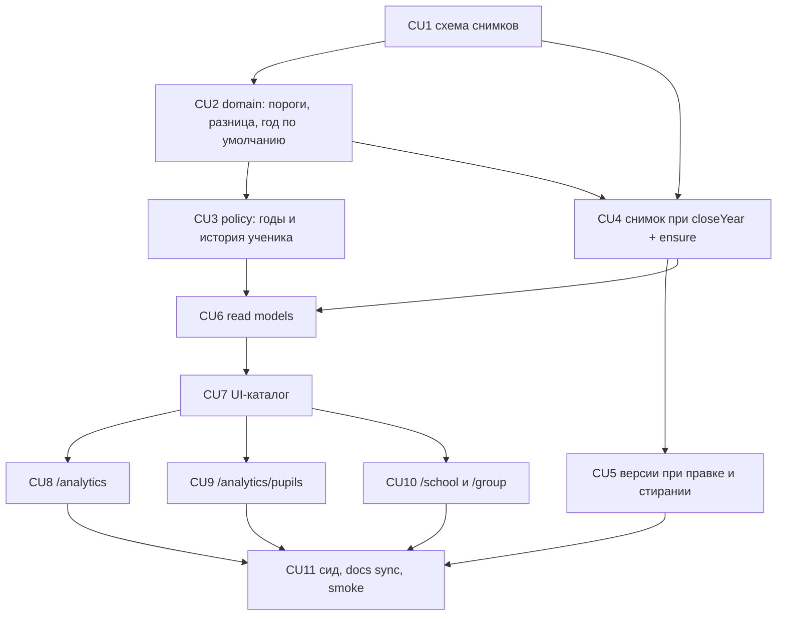

# P08 — Аналитика по учебным годам

**Тип:** Phase Description  
**Статус:** Canonical  
**Прогресс фазы:** документы готовы (контракт, spec v1.2, схема, AZ, инварианты); код не начат (2026-10-19).  
**Версия:** 1.0  
**Дата:** 2026-10-19  
**Волна:** W11-15  
**Зависит от:** [`P07_phase_description.md`](./P07_phase_description.md) (DoD), [`P05_phase_description.md`](./P05_phase_description.md) (аналитика одного года — **единственный разрешённый** `P*_phase_description` кроме этого, только §Scope), [`multi_year_analytics.md`](../../../prds/01_product_scope/multi_year_analytics.md), [`analytics_year_snapshots_contract.md`](../contracts/analytics_year_snapshots_contract.md), [`analytics_screens_spec.md`](../specs/analytics_screens_spec.md) v1.2, [`project_quality_profile.md`](../../../meta/project_quality_profile.md) (D4, D6, D8)  
**Связанные документы:** [`P08_tasks.md`](../tasks/P08_tasks.md), [`architecture_master_index.md`](../../../prds/architecture_master_index.md), [`sunday_school_prototype.html`](../../../prototypes/sunday_school_prototype.html) (блок «ГОДЫ»)

---

## Purpose

Дать учителю и администратору **аналитику по учебным годам**: итоги по годам, разницу с прошлым годом (с порогами достоверности), закрытые годы в режиме чтения, историю ученика по годам, итоги года и «Все годы» на странице группы. Итоги закрытого года фиксируются **снимком** в транзакции закрытия года. Экраны и тексты — по статическому прототипу; правила данных — по контракту.

Функционал внутри фазы **одной поставкой**: снимки → чтение → экраны.

---

## Agent context budget

**MUST read (≤ 8):**

| # | Документ | Зачем |
|---|----------|-------|
| 1 | [`P08_tasks.md`](../tasks/P08_tasks.md) | Чек-лист и CU |
| 2 | [`analytics_year_snapshots_contract.md`](../contracts/analytics_year_snapshots_contract.md) | Данные, операции, видимость, пороги |
| 3 | [`analytics_screens_spec.md`](../specs/analytics_screens_spec.md) §4–§7.1, §9, §14–§16 | Экраны и состояния |
| 4 | [`multi_year_analytics.md`](../../../prds/01_product_scope/multi_year_analytics.md) | Продуктовые правила |
| 5 | [`sunday_school_prototype.html`](../../../prototypes/sunday_school_prototype.html) | Блок «ГОДЫ» (`yearChips`, `yearsTable`, `kpiTiles`, `diffBadge`, `analyticsClosedView`, `pupilYearsSection`, `pupilClosedYear`, `schoolClosedBlock`, `groupYearSummary`) — **визуальный эталон** |
| 6 | [`authorization_matrix.md`](../../../prds/04_authorization_privacy/authorization_matrix.md) §7.5 (AZ-44…AZ-51) | Доступ |
| 7 | [`school_year_and_groups_contract.md`](../contracts/school_year_and_groups_contract.md) §5.1 | `closeYear` |
| 8 | [`ui_states_contract.md`](../../../design/ui_states_contract.md) D3, D12, D19–D21 | Состояния |

**MUST NOT read** другие `P*_phase_description.md`.

---

## Scope / Out of scope

### In scope

| Область | Результат |
|---------|-----------|
| Снимки итогов | две таблицы, создание при `closeYear`, версия при правке закрытого года, удаление при стирании данных ребёнка, `ensureYearSnapshots` |
| Домен | пороги N/M, версия методологии, `computeYearDiff`, `isComparisonReliable`, `resolveDefaultYear`, видимость лет |
| Доступ | проверки лет и истории ученика (AZ-48…AZ-50); запись снимков только системой (AZ-51) |
| Чтение | загрузчики экранов с параметром года; год по умолчанию; итоги по годам группы / ученика / школы |
| UI | полоса лет, таблица итогов, разница, KPI, закрытый год read-only, «По годам» у ученика, `/school` за год, «Итоги года» + «Все годы» на `/group` |
| Dev-данные | `seed:dev` досоздаёт снимки закрытых лет; `delete-academic-year` удаляет снимки года |

### Out of scope

- Режим «сравнить два выбранных года»; экспорт и печать; родительский просмотр; штрафы и достижения.
- Перенос исторических данных из старого приложения (вне проекта).
- Пересчёт закрытых лет при смене методологии (снимки не пересчитываются).
- Поимённые таблицы закрытых лет из снимков (считаются по записям года, как для активного).

---

## UI Catalog (эта фаза)

| Действие | Компонент | Примечание |
|----------|-----------|------------|
| **USE** | `Card`, `Table`, `Button`, `PageHeader`, `EmptyState`, `Banner`, `NumberDisplay`, `BarChart`, `ChartTableToggle`, `MethodologyNote` | существующие |
| **CREATE** (L4) | `YearStrip`, `YearTotalsTable`, `DiffBadge`, `KpiTiles`, `PupilYearsSection`, `ReadOnlyYearNote`, `MethodologyVersionNote` | Lab-first: секция в `/design-system` до маршрутов; якоря — функции прототипа |
| **EXTEND** | `BarChart` / `ChartTableToggle` | подпись оси X и заголовок таблицы «Год» вместо «Урок» (`xLabel`) |
| **MUST NOT** | импорт `@/components/design-lab/**` в маршрутах; новые цвета; режим «сравнить два года» | |

---

## UX/UI verification loop (обязательно для всех UI-CU: CU7–CU10)

Требование владельца (2026-10-19). Агент **сам** проверяет реализованный интерфейс против прототипа и исправляет расхождения до review и коммита. Это явный запрос владельца на runtime-проверку (`next-dev-loop`, dual-view) и **исключение** из правила «runtime-проверка только по запросу» в `AGENTS.md` — действует **только для UI-CU P08**; lab PSI не включается.

**Учётные данные (dev):** `TEACHER_EMAIL` / `TEACHER_PASSWORD` (учитель Старшей 2) и `FIRST_ADMIN_EMAIL` / `ADMIN_PASSWORD` (администратор) — из `.env` или git-ignored `.local/dev-secrets.json`. Значения паролей **не копируются** в документацию, код, коммиты, логи и чат; в отчёте — только «учитель», «админ».

**Данные:** dev-БД после `npm run db:seed:dev` (3 года, 2 группы, 46 учеников; teacher@ ведёт «Старшую 2», видит годы 2025–2026 и 2026–2027; admin — все три).

**Цикл (повторять до нулевых расхождений):**

1. Запустить `next dev` (preview), войти под нужной ролью.
2. Открыть сценарий в **прототипе** (`docs/prototypes/sunday_school_prototype.html`, роль teacher / admin, соответствующая функция блока «ГОДЫ») и тот же сценарий в приложении.
3. Сверить: структуру и порядок секций; тексты (ru) и ключи; состояния (год по умолчанию после закрытия года, «мало данных для сравнения», read-only, пометка методологии, «мало уроков», «В этом году группы не было»); разницу (значение, стрелка, слова); таблицы (колонки, caption, переходы строк); график по годам (одна ось, таблица к графику, переключатель показателя); токены и компоненты Lab; ширины **390 px, `md`, `lg`**; консоль и сеть без ошибок; фокус и `aria-checked` у полос.
4. Проверить роли: под **teacher** — только годы 2025–2026 и 2026–2027, чужая группа недоступна (404), в карточке переведённого ребёнка строки лет и название чужой группы без перехода; под **admin** — все годы, группы, `/school`.
5. При расхождении — править код (не прототип, если нет согласованного изменения), перезапустить шаг 2–4.
6. В trace CU записать одну строку: `UI-verify: <экраны>, <роли>, <viewport>, расхождений 0` и список исправленных расхождений.

**Критерий приёмки UI-CU:** UI-verify выполнен, расхождений с прототипом нет; без этого CU не коммитится.

---

## Cross-phase dependencies

| Зависимость | Блокирует? | Примечание |
|-------------|-----------|------------|
| **P05** (аналитика одного года, `packages/domain/src/analytics/*`, `data/analytics/*`) | Да | формулы и загрузчики переиспользуются |
| **P02** (годы, зачисления, `closeYear`) | Да | точка интеграции снимка |
| **P04** (проверки, `correctCheck`, `overrideVerseScore`) | Да | правка закрытого года версионирует снимок |
| **P06** (стирание данных ребёнка) | Да | удаление снимков ученика |
| **P07** | Нет | prod-готовность не меняется |
| Утверждение N/M владельцем | Нет (значения по умолчанию заданы) | Q-01 |

---

## Implementation sequence

---

## Happy path smoke

1. После `db:seed:dev` под teacher: `/group` показывает «Итоги года · 2026–2027» с разницей и «Все годы»; `/analytics` — полоса лет (2025–2026, 2026–2027), таблица итогов, переключение года пересчитывает KPI, графики и таблицы; закрытый год — с пометкой «только чтение».
2. Карточка переведённого ребёнка: «По годам» — таблица, график столбцами, переключатель показателя; раскрытие закрытого года.
3. Под admin: все три года, группы; `/school` в закрытом году — таблица групп из снимков.
4. Admin закрывает год в dev-копии → снимки созданы в той же транзакции, `/analytics` открывает только что закрытый год.

## Negative path smoke

| Сценарий | Ожидаемо |
|----------|----------|
| Группа 2024–2025 с меньше N детей | «мало данных для сравнения», значения показаны |
| Ребёнок с `lessons < M` в году | «—», «мало уроков: k», нет столбца |
| `?year=` вне назначения (teacher) | 404 |
| Закрытый год без снимка | состояние `error`, не нули |
| Правка закрытого года без изменения итогов | версия не создаётся |
| Повторное закрытие года | отказ, второго снимка нет |

## Security smoke

| Проверка | Ожидаемо |
|----------|----------|
| Teacher и чужая группа / год | 404; нет перехода из строки года ученика |
| Запись снимков | нет Route Handler / Action; только системные use-case (grep) |
| Журнал и снимки | без имён и контактов (INV-23) |
| Стирание данных ребёнка | снимки ученика удалены, вклад убран из групповых версий |
| Пароли dev-учёток | не в репозитории, логах, коммитах |

## Concurrency & race check

| Сценарий | Ожидаемо |
|----------|----------|
| Закрытие года и admin-правка проверки | блокировка строки года; правка видит либо активный год, либо закрытый со снимком |
| Два пересчёта одной пары | один успех, второй `CONFLICT` |
| Выдача кирпичиков в закрытом году | «выдано» читается вживую, снимок не устаревает |

---

## Drift risks & guards

| Риск | Guard |
|------|-------|
| Снимок и живой расчёт разошлись | одни функции domain; тест равенства |
| Пороги N/M продублированы литералами | grep вне `@sunschool/domain` |
| Агент «упрощает» закрытый год пересчётом | INV-26; тест «снимок читается, не пересчитывается» |
| UI расходится с прототипом | UX/UI verification loop (обязателен) |
| Учителю утекают чужие годы / группы | AZ-48…AZ-50, тесты policy и DAL |
| Режим «сравнить два года» добавлен | Out of scope; review |

---

## Definition of done

- [ ] Все CU закоммичены; trace `Review: …` и `UI-verify: …` (UI-CU)
- [ ] `typecheck` · `lint` · `test` зелёные
- [ ] Закрытие года создаёт снимки в одной транзакции; правка закрытого года и стирание данных ребёнка версионируют / удаляют (тесты контракта §13)
- [ ] Teacher видит годы своего назначения и историю ребёнка, не видит аналитику чужой группы; admin видит всё (тесты + ручной smoke)
- [ ] Пороги дают «мало данных» на dev-наборе (группа 2024–2025, ученик с коротким годом)
- [ ] После закрытия года экраны аналитики открывают последний закрытый год
- [ ] UI-verify выполнен под teacher и admin, расхождений с прототипом нет
- [ ] Docs sync (CU11); smoke H/N/S записан в `P08_tasks.md`

---

## Open questions фазы

| ID | Вопрос | Предложение | Блокирует |
|----|--------|-------------|-----------|
| Q-01 | Утвердить N = 10 детей и M = 4 урока | оставить значения прототипа | CU2 (значения констант) |
| Q-02 | Прежние версии групповых снимков после стирания данных ребёнка | удалять (контракт §6.3) | CU5 |
| Q-03 | Скрипт досоздания снимков для prod | не нужен: закрытых лет до P08 нет; `ensureYearSnapshots` для оператора | — |

---

## Related documents

| Document | Relationship |
|----------|--------------|
| [`P08_tasks.md`](../tasks/P08_tasks.md) | Чек-лист |
| [`P07_phase_description.md`](./P07_phase_description.md) | Предыдущая фаза |

**Registry:** [`documentation_creation_registry.md`](../../../meta/documentation_creation_registry.md) — wave W11-15

## Agent notes

- Одна сессия = P08 only.
- Не пересчитывать закрытые годы; не хранить «выдано» в снимке.
- Не добавлять режим «сравнить два года».
- Не писать пароли dev-учёток куда-либо; брать из `.env` / `.local/dev-secrets.json`.
- UI-CU не коммитятся без записи `UI-verify: … расхождений 0`.
- Прототип — визуальный эталон; при конфликте с контрактом и spec побеждают они (см. [`project-context`](../../../../.cursor/rules/project-context.mdc)).

## Acceptance criteria

- [ ] Happy + negative + security smoke пройдены; отчёт в `P08_tasks.md` (CU11)
- [ ] UI-verify под teacher и admin записан для CU8–CU10

## Change log

| Date | Change |
|------|--------|
| 2026-10-19 | v1.0 — Canonical (W11-15): фаза «Аналитика по учебным годам», UX/UI verification loop |
