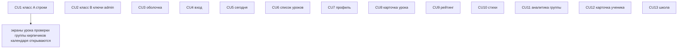

# P09 — Фиксы соответствия UI прототипу

**Тип:** Phase Description  
**Статус:** Canonical  
**Прогресс фазы:** документы готовы (2026-10-20); код не начат.  
**Версия:** 1.0  
**Дата:** 2026-10-20  
**Волна:** после P08  
**Зависит от:** [`P08_phase_description.md`](./P08_phase_description.md) (DoD), [`ui_prototype_fidelity_2026-10-20.md`](../audits/ui_prototype_fidelity_2026-10-20.md), [`project_quality_profile.md`](../../../meta/project_quality_profile.md) (lean)  
**Связанные документы:** [`P09_tasks.md`](../tasks/P09_tasks.md), [`sunday_school_prototype.html`](../../../prototypes/sunday_school_prototype.html), [`responsive_navigation_contract.md`](../../../design/responsive_navigation_contract.md), [`global_shell_spec.md`](../specs/global_shell_spec.md), [`access_and_registration_spec.md`](../specs/access_and_registration_spec.md)

---

## Purpose

Вернуть уже существующие экраны MVP к прототипу там, где аудит 2026-10-20 зафиксировал `blocker` или `deviation`. Новых сценариев фаза не добавляет. Числа и имена seed в работу не входят.

Источник расхождений — только [`ui_prototype_fidelity_2026-10-20.md`](../audits/ui_prototype_fidelity_2026-10-20.md). Состав секций, который аудит не перечислил, не додумывается.

---

## Agent context budget

**MUST read (≤ 8):**

| # | Документ | Зачем |
|---|----------|-------|
| 1 | [`P09_tasks.md`](../tasks/P09_tasks.md) | Чек-лист и CU |
| 2 | [`ui_prototype_fidelity_2026-10-20.md`](../audits/ui_prototype_fidelity_2026-10-20.md) | Единственный список работ |
| 3 | [`sunday_school_prototype.html`](../../../prototypes/sunday_school_prototype.html) | Визуальный эталон ключей из аудита |
| 4 | [`responsive_navigation_contract.md`](../../../design/responsive_navigation_contract.md) §4–§6 | Оболочка |
| 5 | [`global_shell_spec.md`](../specs/global_shell_spec.md) §6 | Drawer и пояснения пунктов |
| 6 | [`access_and_registration_spec.md`](../specs/access_and_registration_spec.md) §6, §9 | Вход и профиль |
| 7 | Этот файл §4 | Что именно совпадает с прототипом и что сознательно не копируется |
| 8 | Контракт экрана задачи (`analytics_screens_spec`, `homework_check_flow_spec` или экранные требования P03/P05) | Данные и права не переписывать |

**MUST NOT read** другие `P*_phase_description.md`, кроме ссылки на DoD P08.

---

## Scope / Out of scope

### In scope

| Область | Результат |
|---------|-----------|
| Класс A | На границу сервер → клиент уходят строки, не функции словаря. Маршруты аудита открываются без «Something went wrong» |
| Класс B | В `en/admin.json` и `ru/admin.json` есть подписи категорий `achievement_award`, `penalty`, `recitation_attempt`. Перечисленные admin-маршруты открываются |
| Оболочка, вход, дом учителя, карточка урока, рейтинг, стихи, аналитика, ученик, школа | Секции из §4 на ширинах аудита |

### Out of scope

- Находки `data` и любые правки seed.
- Post-MVP сценарии: достижения, штрафы, семья, голосовая практика, родительские экраны. Блок «Кого отметить в классе» на `/today` — режим достижений, задачей не становится. Строка «Голосовая практика» в «На этой неделе» не добавляется.
- Пункт «Достижения и штрафы»: [`responsive_navigation_contract.md`](../../../design/responsive_navigation_contract.md) §5.2 его не требует.
- Переключатель роли из прототипа (radio в шапке и в drawer) в продукт не копируется. Dev-переключатель `APP_ENV=dev` (ОК-5) не трогаем.
- Колонки рейтинга «Бонус», «Достижений», «Штрафов» — post-MVP ([P05](./P05_phase_description.md) §`/rating`).
- На карточке ученика не появляются «Семья», «Штрафы», «Достижения».
- Подпись «Ученики и семьи» не создаёт маршрут семьи.
- `/privacy` без эталона в прототипе; ссылка с входа остаётся ([`access_and_registration_spec.md`](../specs/access_and_registration_spec.md) §6). Подпись «Тестовое окружение» при `APP_ENV=dev` остаётся.
- `/register`, `/pending`, `/design-system`, смена языка — вне аудита.

---

## 4. Экранные требования

Ширины аудита: **390**, **768** (drawer), **1024** (topnav). Где аудит смотрел не все три — указано в задаче. Роли: учитель (первый экран `/today`), администратор (первый экран `/school`).

Общий исход каждого маршрута: страница открывается, текста «Something went wrong» нет.

### 4.1 Класс A — строки вместо функций

Маршруты и функции — таблица аудита «Класс A». Шаблоны подставляются на сервере или чистой функцией клиентского модуля, не полем объекта, пришедшего с сервера.

| Маршруты | Строки, которые перестают быть функциями в props |
|----------|---------------------------------------------------|
| `/lessons/new`, `/lessons/[id]/edit` | `editTitle` |
| `/lessons/[id]/table`, `/check`, `/lessons/[id]/check` | `finishedProgress` |
| `/group` | `selectPupil` |
| `/bricks` (учитель и админ) | `issueDialogTitle` |
| `/calendar` (учитель и админ) | `pageSubtitle` |

Если аргумента шаблона нет, в клиент уходит строка, экран не падает границей ошибки. Права не меняются: учитель видит свою группу (AZ-21, AZ-30, AZ-32, AZ-33, AZ-40, AZ-42), чужая группа — 404; аноним — `/login`.

Визуальных секций у этих экранов аудит не снял (они падали). Отдельной сверки состава с прототипом в этом CU нет.

### 4.2 Класс B — ключи категорий admin

В оба словаря `admin.json` добавить подписи категорий `achievement_award`, `penalty`, `recitation_attempt`. Одного ключа недостаточно: цикл берёт следующий отсутствующий.

Маршруты, все три ширины, роль admin: `/audit`, `/approvals`, `/users`, `/users/[id]`, `/people`, `/deletions`, `/groups`, `/groups/[id]`, `/year`, `/settings`. Профиль пользователя и карточка группы открываются прямым заходом, не только из списка.

Teacher на эти маршруты по-прежнему получает 403 (AZ-01, AZ-02, AZ-07, AZ-08, AZ-10, AZ-12, AZ-15, AZ-20). Новых экранов достижений, штрафов и семьи нет: ключи только подписи категорий журнала удалений.

### 4.3 Оболочка

Учитель и админ, 390, 768 и 1024.

- С `lg` (1024) в слоте бренда — «Воскресная школа». Ниже 1024 в этом слоте заголовок экрана и «имя · роль».
- Drawer ниже 1024: нет видимого заголовка «Меню» и нет отдельного пункта «Профиль». Внизу — имя (переход на `/profile`) и «Выйти».
- В раскрытой группе topnav у пункта есть короткое пояснение ([`global_shell_spec.md`](../specs/global_shell_spec.md) §6.1).
- Подписи: «Заявки на доступ», «Ученики и семьи», «Аналитика групп». Пункта «Достижения и штрафы» нет.
- `/lessons` на 390 и 768: в drawer пункт «Все уроки» с `aria-current="page"`.

### 4.4 Вход

`/login`, аноним, 390, 768, 1024.

- Заголовок «Вход для учителей и родителей», подзаголовок «Подтвердите вход в Telegram — пароль не нужен.»
- Свёрнутый и раскрытый блок называется «Вход для администратора»; рядом текст «Пароль нужен только администратору.»
- Ссылка «Согласие на обработку данных» остаётся. «Тестовое окружение» остаётся при `APP_ENV=dev` и отсутствует в prod.

### 4.5 Сегодня

`/today`, учитель, 390, 768, 1024.

- Заголовок — приветствие, не «Сегодня».
- Одна залитая кнопка «Продолжить проверку»; «Новый урок» не залита.
- Дата урока не в виде ГГГГ-ММ-ДД; нет типа «Обычный» и подписи «Проверка ДЗ» на карточке.
- Секция «На этой неделе» есть. Блока «Кого отметить в классе» нет. Строки «Голосовая практика» нет.

### 4.6 Список уроков

`/lessons`, учитель, 390, 768, 1024. Строка урока: крупная дата, «урок N», стихи, «Проверено n/n». Не набор «дата, тип, учитель, статус» как единственное содержимое строки.

### 4.7 Профиль

`/profile`, учитель, 390, 768, 1024. Секции spec §9 остаются: ФИО, согласие, язык, способы входа, удаление. «Сохранить» — единственная залитая кнопка; «Подключить» не залита. Удаление — красная кнопка (`danger`), не залитая primary. Заголовок вкладки «Профиль — Воскресная школа», не «Profile». Поле причины в диалоге удаления остаётся (spec §9): аудит отметил его как отличие макета, канон spec его сохраняет.

### 4.8 Карточка урока

`/lessons/[id]`, учитель, 390, 768, 1024.

- Заголовок темы и строка «Урок N · дата», дата не ГГГГ-ММ-ДД.
- Блок проверки: «Проверка домашнего задания», главная кнопка «Продолжить проверку» (или «Начать проверку», если не начата), рядом «Сводная таблица».
- «Правка» — белая (контур), не залитая.
- Удаление на карточке есть.
- Два блока «Задано» и «Рассказывают», не один «Золотые стихи». Подписи «Проверка ДЗ» на карточке нет.

### 4.9 Рейтинг

- Учитель, `/rating`, 390, 768, 1024: заголовок «Рейтинг группы» и рабочее пояснение («кому нужна помощь и кого отметить»), не подзаголовок только с именем группы.
- Админ, 390 и 1024: выбор группы чипами, без пары `select` + «Показать».
- Колонки «Бонус», «Достижений», «Штрафов» не добавляются.

### 4.10 Золотые стихи

- Учитель, `/verses`, 390, 768, 1024: подпись библиотеки, поле поиска, кнопка «Добавить стих».
- Админ, 390 и 1024: та же библиотека, не выбор группы и «Показать».
- Ссылка на урок не дублирует «Урок N · Урок N». В ссылке стиха нет сырых `^^` (пример аудита: «Пс 22:1»).
- «Добавить стих» открывает уже существующий выбор книги → глава → диапазон из формы урока (P03). Новой сущности и нового endpoint нет. Пустой поиск показывает «Ничего не найдено».

### 4.11 Аналитика группы

`/analytics`.

- Учитель, 390: нет горизонтальной прокрутки страницы (окно 390 не уже содержимого).
- Учитель, 390, 768, 1024: подзаголовок с «N уроков»; период — чипы, не отдельный фильтр с «Показать»; в плитках есть «основной выборки»; состав не сокращён до букв; графики не короткие и не четыре залитые кнопки «График»; «Кто какие уроки провёл» не стоит перед годом рождения; «По году рождения» содержит таблицу; «Как мы считали» — не один абзац вместо секции методологии spec §8.
- Админ, 390 и 1024: чипы группы, не `select` + «Показать»; есть строка про удалённые дубли (spec §5.1).

Порядок и правила данных — [`analytics_screens_spec.md`](../specs/analytics_screens_spec.md) §5. Фаза меняет подачу, не формулы.

### 4.12 Карточка ученика

`/analytics/pupils/[id]`, учитель.

- 390: нет горизонтальной прокрутки страницы.
- Все три ширины: в шапке год рождения и «активен»; плитки не называются «Средняя явка» и «Стихи» вместо ряда явка / стихи / тест / тетрадь; динамика идёт перед присутствием и графиками; у графика «Тест» нет заглушки «Пока мало данных», когда данные урока есть; нет трёх залитых «График».
- В таблице уроков у прошедшей проверенной строки есть «Исправить» — переход в уже существующую правку проверки (AZ-34), не новая мутация.
- Секций «Семья», «Штрафы», «Достижения» нет.

### 4.13 Школа

`/school`, админ, 390, 768, 1024.

- «Требует внимания» не единственный пункт в начале страницы в том виде, как зафиксировал аудит (блок не подменяет сводку).
- Подзаголовок — не только «2026–2027» плюс фильтр периода.
- Нет колонки «Ср. тест» вместо средних spec §7; явка с тем же округлением, что остальные проценты экрана.
- График посещаемости до трёх групп, не кнопка «Показать» вместо графика.
- Нет лишних блоков «Кто какие уроки провёл» сверх одного блока spec §5.4 / §7.

---

## UI Catalog (эта фаза)

| Действие | Компонент | Примечание |
|----------|-----------|------------|
| **USE** | существующие `PageHeader`, `Button`, `Card`, `Table`, `SegmentedControl`, графики аналитики | новых цветов нет |
| **EXTEND** | оболочка, строки урока, карточка урока, чипы периода и группы | только состав и подписи §4 |
| **MUST NOT** | экраны `/achievements`, семьи, штрафов; переключатель роли прототипа; импорт `@/components/design-lab/**` | |

---

## Cross-phase dependencies

| Зависимость | Блокирует? | Примечание |
|-------------|-----------|------------|
| P01…P08 | Да | фаза чинит существующие экраны |
| Контракты данных и AZ | Да | права и формулы не ослаблять |

Новых таблиц и кодов мутаций нет.

---

## Implementation sequence

CU3…CU13 друг от друга не зависят. CU1 закрывает падения своих маршрутов до ручной сверки этих URL.

---

## Happy path smoke

Учитель и админ, ширины из §4: маршруты CU открываются без «Something went wrong» и совпадают с §4.

## Negative path smoke

| Сценарий | Ожидаемо |
|----------|----------|
| В props клиента класса A попала бы функция | на экране строка, границы «Something went wrong» нет |
| В admin-словаре нет одного из трёх ключей категорий | до закрытия CU2 маршруты §4.2 падают; после — открываются |
| Поиск стихов без совпадений | «Ничего не найдено» |
| `APP_ENV=prod` | на `/login` нет «Тестовое окружение» |

## Security smoke

| Проверка | Ожидаемо |
|----------|----------|
| Аноним на маршруте оболочки | `/login` |
| Teacher на `/users`, `/people`, `/audit` | 403 |
| Teacher и чужая группа / ученик | 404 |
| Ключи категорий | не добавляют экраны достижений, штрафов, семьи |
| Переключатель роли прототипа | отсутствует в DOM |

## Concurrency & race check

Новых мутаций и гонок нет. «Исправить» и «Добавить стих» только входят в уже существующие операции.

---

## Drift risks & guards

| Риск | Guard |
|------|-------|
| Фаза копирует post-MVP блоки прототипа | Out of scope; review CU |
| Класс A снова кладёт функцию в props | CU1 Acceptance |
| Класс B добавляет один ключ из трёх | CU2: все три в en и ru |
| Подпись «Ученики и семьи» заводит экран семьи | UX-02 §5.2; маршрута семьи нет |
| Рейтинг получает колонки достижений | §4.9 запрещает |

---

## Definition of done

- [ ] Все CU закоммичены; у CU1 и CU2 trace `Review: reviewer`, у остальных `Review: diff-only`
- [ ] `typecheck` · `lint` · `test` зелёные
- [ ] Маршруты §4.1 и §4.2 открываются на ширинах аудита без «Something went wrong»
- [ ] Секции §4.3–§4.13 совпадают с формулировками задач
- [ ] Post-MVP блоки из Out of scope в DOM не появились

---

## Open questions фазы

| ID | Вопрос | Предложение | Блокирует |
|----|--------|-------------|-----------|
| — | — | — | — |

---

## Related documents

| Document | Relationship |
|----------|--------------|
| [`P09_tasks.md`](../tasks/P09_tasks.md) | Чек-лист |
| [`ui_prototype_fidelity_2026-10-20.md`](../audits/ui_prototype_fidelity_2026-10-20.md) | Вход фазы |

## Agent notes

- Не заводить достижения, штрафы, семью, голосовую практику и пункт «Достижения и штрафы».
- Не копировать radio роли.
- Не менять права и формулы аналитики.
- Пароли dev-учёток не писать в документы и логи.
- Числа seed из аудита не использовать как ожидаемые значения.

## Acceptance criteria

- [ ] Happy, negative и security smoke по таблицам выше
- [ ] Каждый маршрут задачи открыт на указанных ширинах без «Something went wrong»

## Change log

| Date | Change |
|------|--------|
| 2026-10-20 | v1.0 — Canonical: фаза фиксов `blocker` и `deviation` аудита UI, без новых сценариев |
