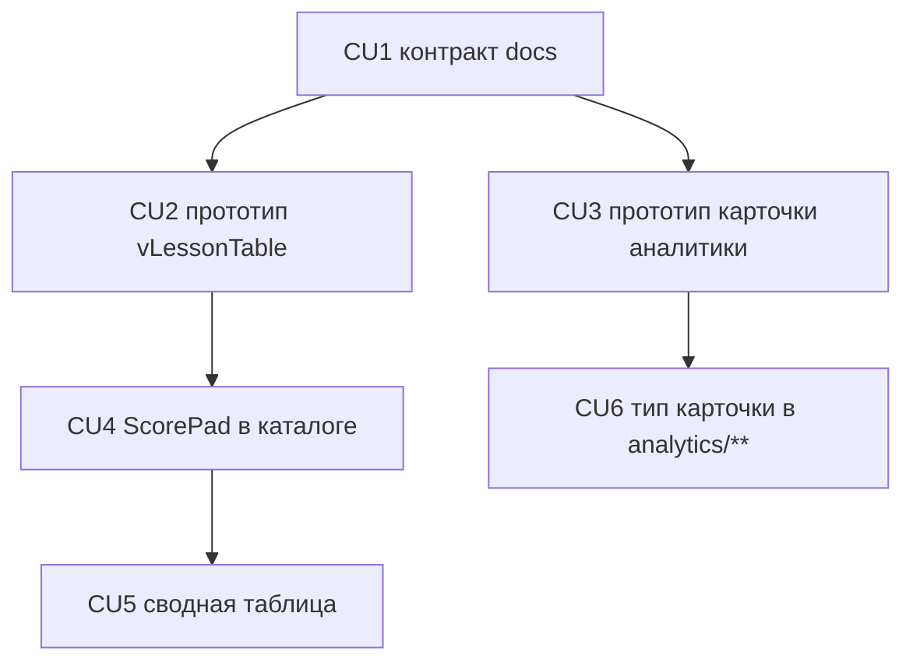

# P11 — Панель оценок сводной таблицы и тип карточки аналитики

**Тип:** Phase Description  
**Статус:** Canonical  
**Прогресс фазы:** документы готовы (spec §7.1–§7.3, тип карточки §4.1); прототип и код не начаты (2026-10-21).  
**Версия:** 1.0  
**Дата:** 2026-10-21  
**Волна:** post-P10  
**Зависит от:** [`homework_check_flow_spec.md`](../specs/homework_check_flow_spec.md) v1.2, [`analytics_screens_spec.md`](../specs/analytics_screens_spec.md) v1.4, [`design_system_lab_spec.md`](../specs/design_system_lab_spec.md) v1.1, [`typography_text_guidelines.md`](../../../guidelines/typography_text_guidelines.md), [`project_quality_profile.md`](../../../meta/project_quality_profile.md) (lean)  
**Связанные документы:** [`P11_tasks.md`](../tasks/P11_tasks.md), [`homework_check_contract.md`](../contracts/homework_check_contract.md) §5.4 / §5.6, [`sunday_school_prototype.html`](../../../prototypes/sunday_school_prototype.html)

---

## Purpose

Заменить выпадающий список оценок на сводной таблице урока **тихой ячейкой и панелью** (`ScorePad`): стихи сразу `— 0 1 2`, тест и тетрадь — цифра/`—` плюс сетка 0–10. Уплотнить **карточки аналитики** в 1.5 раза (не 2×): тело `text-[1.3125rem]`, padding `p-3`, зазоры `gap-3`. Мутации, DAL, domain и последовательная проверка (§5.3) не меняются. P10-CU9 зафиксировал `<select>`; эта фаза — **новый контракт**, не продолжение визуального прохода.

---

## Agent context budget

**MUST read (≤ 8):**

| # | Документ | Зачем |
|---|----------|-------|
| 1 | [`P11_tasks.md`](../tasks/P11_tasks.md) | Чек-лист и CU |
| 2 | [`homework_check_flow_spec.md`](../specs/homework_check_flow_spec.md) §7.1–§7.3, §9–§11, §14 | Панель, H/N/S; **не** переписывать §5.3 |
| 3 | [`analytics_screens_spec.md`](../specs/analytics_screens_spec.md) §4.1 | Тип карточки |
| 4 | [`design_system_lab_spec.md`](../specs/design_system_lab_spec.md) §5.3 строка `ScorePad` | Каталог |
| 5 | [`typography_text_guidelines.md`](../../../guidelines/typography_text_guidelines.md) | Исключение analytics cards |
| 6 | [`sunday_school_prototype.html`](../../../prototypes/sunday_school_prototype.html) | `vLessonTable` (`data-tbl`); `vAnalytics`, `vPupil`, `vRating`, `vSchool` |
| 7 | [`homework_check_contract.md`](../contracts/homework_check_contract.md) §5.4, §5.6 | `savePartialCheck` / `correctCheck` без изменений |
| 8 | Этот файл §Scope | Границы: нет рефактора `ScoreGroup`, нет правки `NumberDisplay` / `BarChart` / `CARD` |

**MUST NOT read** другие `P*_phase_description.md` и Pulse `P11_*`.

---

## Scope / Out of scope

### In scope

| Область | Результат |
|---------|-----------|
| Контракт таблицы | §7 без `select` оценок; NULL ≠ 0; одна панель; клавиатура §7.3 |
| Прототип таблицы | `vLessonTable` / `data-tbl`: стихи inline, панель 0–10, карточка-стек |
| Прототип аналитики | плотность карточек в `vAnalytics`, `vPupil`, `vRating`, `vSchool` |
| Каталог | `ScorePad`, `score-cell`, `ChoiceMatrix`; секция Lab до маршрута |
| Сводная таблица | `LessonCheckTable`, `LessonCheckTableRow`, новые `LessonCheckTableCards` |
| Карточки аналитики | тип §4.1 в `components/analytics/**` |

### Out of scope

- Последовательная проверка: `ScoreGroup`, `ScoreSelector`, `/check`, spec §5.3.
- Новые операции, коды ошибок, DAL, domain, политика.
- Глобальный `Card` Lab (`p-4 sm:p-5`), константа `CARD` прототипа, оболочка, экраны уроков кроме сводной таблицы.
- `NumberDisplay`, `BarChart`, атом `ContentText`, таблицы `lg+`, подписи осей графиков.
- Новая зависимость (Popover уже в `@base-ui/react` 1.9.0).

---

## UI Catalog (эта фаза)

| Действие | Компонент | Примечание |
|----------|-----------|------------|
| **CREATE** | `ScorePad`, `score-cell`, `ChoiceMatrix` | Lab-first (CU4) до CU5 |
| **USE** | `ScoreSelector`, `ScoreGroup`, `Popover` | без рефактора teacher/`ScoreGroup.tsx` |
| **EXTEND** | `RecordCard` / карточки `analytics/**` | только тип §4.1 |
| **MUST NOT** | импорт `@/components/design-lab/**`; новые цвета; `<select>` оценок | |

---

## Cross-phase dependencies

| Зависимость | Блокирует? | Примечание |
|-------------|-----------|------------|
| **P04** сводная таблица, `savePartialCheck` / `correctCheck` | Да | те же мутации |
| **P05 / P08** экраны аналитики | Да | только плотность карточек |
| **P10-CU9** `<select>` | Нет | P11 заменяет контракт, не откатывает P10 целиком |

---

## Implementation sequence

---

## Happy path smoke

1. `/lessons/[id]/table`, ≥ `md`: ячейка теста показывает цифру или «—»; нажатие — панель под ячейкой; выбор 7 — ячейка 7, панель закрыта, success toast нет.
2. Стих: сразу `— 0 1 2`; «—» пишет `NULL`.
3. 390 px: карточка-стек, имя на экране при открытой сетке, нет карандаша; «Открыть» есть только на `md+`.
4. `/analytics` (и карточки ученика / школы / рейтинга): тело карточки ~22 px, `p-3`, `gap-3`; KPI и заголовок прежние.

## Negative path smoke

| Сценарий | Ожидаемо |
|----------|----------|
| Escape / клик снаружи / повторное нажатие | панель закрыта, мутации нет |
| Backspace | «—» (`NULL`), не 0 |
| Значение вне 0–10 | не отправляется |
| Отказ мутации | `toast.error`, откат ячейки |

## Security smoke

| Проверка | Ожидаемо |
|----------|----------|
| Аноним | `/login` |
| Teacher и чужой урок | 404 |
| Закрытый год teacher | таблица без записи |
| Та же ячейка | `savePartialCheck` / `correctCheck` (AZ-33, AZ-34, S-7) |

## Concurrency & race check

| Сценарий | Ожидаемо |
|----------|----------|
| Две ячейки подряд | одна открытая панель; запросы независимы |
| `CONFLICT` | откат + «Запись изменилась» |

---

## Drift risks & guards

| Риск | Guard |
|------|-------|
| Вернуть `<select>` оценок | grep; acceptance §7 |
| NULL = 0 | R-1, R-9, INV-11 |
| Рефактор `ScoreGroup` | Out of scope; CU4 Files |
| Увеличить KPI / глобальный `CARD` | §4.1 вне scope |
| Новая зависимость Popover | пакет уже 1.9.0 |

---

## Definition of done

- [ ] Все CU закоммичены; trace `Review: …`
- [ ] `typecheck` · `lint` · `test` зелёные
- [ ] В сводной таблице нет `select` оценок; NULL ≠ 0
- [ ] Карточки аналитики: `1.3125rem`, `p-3`, `gap-3`; KPI без изменений
- [ ] `ScoreGroup` / §5.3 без регрессии
- [ ] Docs sync в CU1; прототип CU2–CU3

---

## Open questions фазы

Нет. Решения панели и типа карточки зафиксированы 2026-10-21 (spec Q-06 закрыт).

---

## Related documents

| Document | Relationship |
|----------|--------------|
| [`P11_tasks.md`](../tasks/P11_tasks.md) | Чек-лист |
| [`homework_check_flow_spec.md`](../specs/homework_check_flow_spec.md) | Панель таблицы |
| [`analytics_screens_spec.md`](../specs/analytics_screens_spec.md) | Тип карточки |

**Registry:** [`documentation_creation_registry.md`](../../../meta/documentation_creation_registry.md)

## Agent notes

- Не копировать Pulse P11.
- Не переписывать §5.3.
- Не добавлять npm-пакет для Popover.
- Пароли dev-учёток не писать в документы.

## Acceptance criteria

- [ ] Happy + negative + security smoke (CU5–CU6, deferred к концу фазы)
- [ ] §7 без `select` оценок; analytics spec содержит `1.3125rem` и `p-3` / `gap-3`

## Change log

| Date | Change |
|------|--------|
| 2026-10-21 | v1.0 — Canonical: панель оценок сводной таблицы + тип карточки аналитики |
