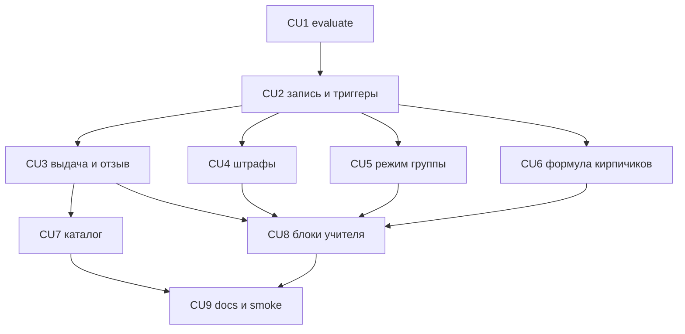

# P12 — Достижения и штрафы

**Тип:** Phase Description  
**Статус:** Canonical  
**Прогресс фазы:** документы готовы (ADR-012, контракт, экранная спецификация, AZ-52…AZ-57); код не начат (2026-10-22).  
**Версия:** 1.0  
**Дата:** 2026-10-22  
**Волна:** W11-17  
**Зависит от:** [`adr_012_achievements_and_penalties.md`](../../../prds/07_governance/adr_012_achievements_and_penalties.md), [`achievements_and_penalties_contract.md`](../contracts/achievements_and_penalties_contract.md), [`achievements_screens_spec.md`](../specs/achievements_screens_spec.md), [`bricks_ledger_contract.md`](../contracts/bricks_ledger_contract.md) §3, [`project_quality_profile.md`](../../../meta/project_quality_profile.md) (lean, D4, D6)  
**Связанные документы:** [`P12_tasks.md`](../tasks/P12_tasks.md), [`achievements_spec.md`](../../../my_specs/achievements_spec.md) §7.3 и §9, [`sunday_school_prototype.html`](../../../prototypes/sunday_school_prototype.html)

---

## Purpose

Включить волну 1 за флагом `features.achievements`: пересчёт достижений после проверки, ручную выдачу и отзыв, штрафы, режим группы и вклад в «набрано». Экраны совпадают с прототипом. Пока флаг выключен, поведение MVP не меняется.

Функционал внутри фазы **одной поставкой**: правила → запись → экраны. Включение флага в prod остаётся действием владельца ([`post_mvp_deferrals.md`](../../../prds/01_product_scope/post_mvp_deferrals.md) §3.1).

---

## Agent context budget

**MUST read (≤ 8):**

| # | Документ | Зачем |
|---|----------|-------|
| 1 | [`P12_tasks.md`](../tasks/P12_tasks.md) | Чек-лист и CU |
| 2 | [`achievements_and_penalties_contract.md`](../contracts/achievements_and_penalties_contract.md) | Операции, коды, гонки |
| 3 | [`achievements_screens_spec.md`](../specs/achievements_screens_spec.md) | Экраны и визуальный эталон |
| 4 | [`adr_012_achievements_and_penalties.md`](../../../prds/07_governance/adr_012_achievements_and_penalties.md) | Флаг, транзакция, режим существующих групп |
| 5 | [`sunday_school_prototype.html`](../../../prototypes/sunday_school_prototype.html) | `vAchievements`, `achDialog`, `penCatDialog`, `achModeCard`, `achModeOffDialog`, `vToday` (кого отметить), `awardDialog`, `awardList`, `revokeDialog`, `penaltyDialog`, `penOffDialog`, `vBricks`, `vRating`, `vPupil` |
| 6 | [`authorization_matrix.md`](../../../prds/04_authorization_privacy/authorization_matrix.md) §7.8 (AZ-52…AZ-57) | Доступ |
| 7 | [`bricks_ledger_contract.md`](../contracts/bricks_ledger_contract.md) §3 | Формула «набрано» |
| 8 | [`ui-prototype-fidelity.mdc`](../../../../.cursor/rules/ui-prototype-fidelity.mdc) | Обязательная сверка UI |

**MUST NOT read** другие `P*_phase_description.md`. Правила ДС и ШТ — в контракте; полный текст спеки открывать только для теста §7.3 и каталога §9.

---

## Scope / Out of scope

### In scope

| Область | Результат |
|---------|-----------|
| Домен | `evaluate` и тесты спеки §7.3; коды `ACHIEVEMENT_` / `PENALTY_` |
| Запись | интерактивная транзакция, блокировка ученика, доказательства, флаг |
| Триггеры | завершение проверки, правка, ручная оценка стиха, включение режима, закрытие года, кнопка admin |
| Ручные действия | выдача, отзыв, штраф, снятие, режим группы |
| Кирпичики | бонус и штрафы в «набрано» без строки `brick_ledger` |
| UI | каталог `/achievements`, блоки teacher, строка кирпичиков, колонка рейтинга; Lab-first |
| Навигация | пункт admin только при флаге; при выключенном флаге блоков нет |

### Out of scope

- Роль `parent`, `/child`, `/family`, дайджест, голосовая проверка, достижение `practice` (остаётся выключенным).
- Повторный сид каталога §9: он уже в `packages/db/src/seed/reference/achievement-catalog.ts`.
- Выдачи и штрафы в prod-seed.
- Массовое включение режима группам, созданным до флага (ADR-012 §4 п. 6).
- Включение флага в prod.

---

## UI Catalog (эта фаза)

| Действие | Компонент | Примечание |
|----------|-----------|------------|
| **USE** | `Card`, `Button`, `Dialog`, `Switch` или переключатель каталога, `PageHeader`, `EmptyState`, `Banner`, `Input`, `Select` | существующие, токены UX-03 |
| **CREATE** (L3/L4) | карточка режима, список выдач, блок «кого отметить», строка каталога с уровнем | Lab-first, якоря — функции прототипа §3 спеки |
| **MUST NOT** | новые цвета; красный для штрафа; фразы про родителя; импорт design-lab в маршрутах | штраф — `penalty` и слово «Штраф» |

---

## UX/UI verification loop (обязательно для UI-CU: CU7 и CU8)

Требование владельца (2026-10-22), [ADR-012](../../../prds/07_governance/adr_012_achievements_and_penalties.md) §4 п. 7 и [`achievements_screens_spec.md`](../specs/achievements_screens_spec.md) §4. Агент **сам** проверяет интерфейс против прототипа и исправляет расхождения до review и коммита. Это явный запрос владельца на runtime-проверку (`next-dev-loop`, dual-view) и исключение из правила «runtime-проверка только по запросу» в `AGENTS.md` — действует **только для UI-CU P12**. Lab PSI не входит в цикл.

**Учётные данные (dev):** `TEACHER_EMAIL` / `TEACHER_PASSWORD` и `FIRST_ADMIN_EMAIL` / `ADMIN_PASSWORD` — из `.env` или git-ignored `.local/dev-secrets.json`. Пароли не копируются в документацию, код, коммиты, логи и чат.

**Данные:** dev-БД после `npm run db:seed:dev`. На время проверки флаг `features.achievements` включают в dev. Выдачи создают через интерфейс, не сидом. После проверки prod-значение флага не меняют.

**Цикл (повторять до нулевых расхождений):**

1. Запустить `next dev`, войти под нужной ролью.
2. Открыть ту же функцию прототипа и тот же сценарий в приложении.
3. Сверить структуру, порядок, тексты ru (кроме фраз про родителя), состояния, токены `penalty` и `tier-1..3`, ширины **390 px, `md`, `lg`**, консоль без ошибок.
4. Под **teacher** — своя группа: режим, «кого отметить», выдача, штраф; каталог и отзыв недоступны. Под **admin** — каталог, пересчёт, отзыв.
5. При выключенном флаге — пунктов и блоков нет, `/achievements` отвечает 404.
6. Расхождение чинится в коде, затем шаги 2–4 повторяются.
7. В trace CU строка: `UI-verify: <экраны>, <роли>, <viewport>, расхождений 0`.

**Критерий приёмки UI-CU:** без этой строки CU не коммитится.

---

## Cross-phase dependencies

| Зависимость | Блокирует? | Примечание |
|-------------|-----------|------------|
| P04 (`completeLessonCheck`, `correctCheck`, `overrideVerseScore`) | Да | триггеры пересчёта |
| P05 (баланс кирпичиков) | Да | формула «набрано» |
| P02 (`closeYear`, настройки группы) | Да | триггер закрытия года и режим |
| P01 (каталог в сиде, флаг) | Нет | уже есть |
| Условие §3.1 для prod-флага | Нет для кода за флагом | включает владелец |

---

## Implementation sequence

---

## Happy path smoke

1. Флаг выключен: завершение проверки не создаёт выдачу; меню без пункта достижений.
2. Флаг включён в dev, режим группы включён: завершение проверки показывает «кого отметить»; бонус виден в кирпичиках.
3. Admin отзывает выдачу: баллы уходят из «набрано», повторный пересчёт ту же выдачу не создаёт.
4. Teacher выставляет штраф: в кирпичиках строка «штрафы», оценки урока те же. Снятие возвращает баллы.

## Negative path smoke

| Сценарий | Ожидаемо |
|----------|----------|
| Повторный пересчёт | новых выдач нет |
| Баллы выше каталога | отказ, форма на месте |
| Второй штраф на тот же урок | отказ |
| Режим выключен | ручная выдача и штраф недоступны; уроки периода — пропуск |
| Группа, созданная до флага | после включения флага автовыдач нет, пока режим не включён |

## Security smoke

| Проверка | Ожидаемо |
|----------|----------|
| Teacher открывает `/achievements` | «Нет доступа» |
| Teacher и чужой ученик | 404 |
| Teacher отзывает выдачу | действия нет |
| Флаг выключен, вызов мутации | `ACHIEVEMENT_FLAG_OFF`, данных нет |
| Журнал | ссылки, без ФИО |

## Concurrency & race check

| Сценарий | Ожидаемо |
|----------|----------|
| Два пересчёта одного ученика | одна выдача |
| Два штрафа на один урок | один `ACTIVE` |

---

## Drift risks & guards

| Риск | Guard |
|------|-------|
| Пересчёт при выключенном флаге | тест ADR-012 |
| Бонус в `brick_ledger` или в рейтинге | тест контракта §10 |
| UI разошёлся с прототипом | UX/UI verification loop |
| Фразы про родителя | спека §4; review |
| Чтение таблиц семьи или голоса | PKG-03 |
| Повторный сид каталога | вне scope |

---

## Definition of done

- [ ] Все CU закоммичены; у runtime-CU с `Paths: S` trace `Review: …`; у CU7 и CU8 trace `UI-verify: …, расхождений 0`
- [ ] `typecheck` · `lint` · `test` зелёные
- [ ] Тесты `evaluate` §7.3 зелёные
- [ ] При выключенном флаге MVP-поведение проверок и кирпичиков прежнее
- [ ] Teacher не открывает каталог и не отзывает; чужой ученик — 404
- [ ] Docs sync (CU9); `/achievements` перенесён в `canonical_routes.md` §4

---

## Open questions фазы

| ID | Вопрос | Предложение | Блокирует |
|----|--------|-------------|-----------|
| — | — | — | — |

---

## Related documents

| Document | Relationship |
|----------|--------------|
| [`P12_tasks.md`](../tasks/P12_tasks.md) | Чек-лист |
| [`post_mvp_deferrals.md`](../../../prds/01_product_scope/post_mvp_deferrals.md) | Условие prod-флага |

**Registry:** [`documentation_creation_registry.md`](../../../meta/documentation_creation_registry.md) — wave W11-17

## Agent notes

- Одна сессия реализации = задачи P12, не волны 2–3.
- Не включать режим всем старым группам при включении флага.
- Не писать бонус в журнал кирпичиков.
- Не коммитить UI-CU без `UI-verify`.
- Прототип — визуальный эталон. Конфликт прототипа с контрактом решает контракт: фразы про родителя не переносятся.

## Acceptance criteria

- [ ] Happy, negative и security smoke пройдены; отчёт в `P12_tasks.md` (CU9)
- [ ] UI-verify под teacher и admin записан для CU7 и CU8

## Change log

| Date | Change |
|------|--------|
| 2026-10-22 | v1.0 — Canonical (W11-17) |
