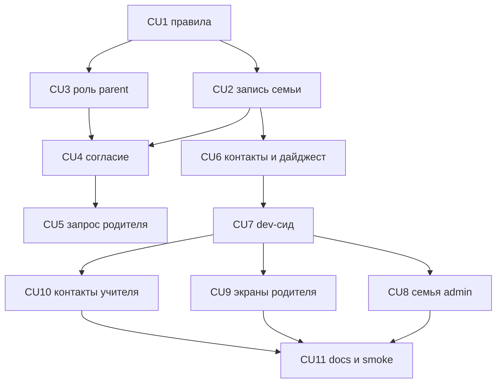

# P13 — Семьи и родители

**Тип:** Phase Description  
**Статус:** Canonical  
**Прогресс фазы:** документы готовы (ADR-013, контракт, экранная спецификация, AZ-58…AZ-64); код не начат (2026-10-23).  
**Версия:** 1.0  
**Дата:** 2026-10-23  
**Волна:** W11-19  
**Зависит от:** [`adr_013_families_and_parents.md`](../../../prds/07_governance/adr_013_families_and_parents.md), [`families_and_parents_contract.md`](../contracts/families_and_parents_contract.md), [`families_and_parents_screens_spec.md`](../specs/families_and_parents_screens_spec.md), [`seed_data_spec.md`](../../../prds/03_data_model/seed_data_spec.md) §8.4, [`project_quality_profile.md`](../../../meta/project_quality_profile.md) (lean, D4, D6)  
**Связанные документы:** [`P13_tasks.md`](../tasks/P13_tasks.md), [`sunday_school_prototype.html`](../../../prototypes/sunday_school_prototype.html)

---

## Purpose

Включить волну 2 за флагом `features.parents`: семьи, роль родителя, электронное согласие, запрос на удаление данных ребёнка, контакты у учителя и дайджест в интерфейсе. Экраны совпадают с прототипом. Пока флаг выключен, поведение MVP не меняется.

Перед любым UI-CU dev-БД получает набор семей и учётку родителя (CU7). Писем нет.

---

## Agent context budget

**MUST read (≤ 8):**

| # | Документ | Зачем |
|---|----------|-------|
| 1 | [`P13_tasks.md`](../tasks/P13_tasks.md) | Чек-лист и CU |
| 2 | [`families_and_parents_contract.md`](../contracts/families_and_parents_contract.md) | Операции, коды, гонки |
| 3 | [`families_and_parents_screens_spec.md`](../specs/families_and_parents_screens_spec.md) | Экраны и визуальный эталон |
| 4 | [`adr_013_families_and_parents.md`](../../../prds/07_governance/adr_013_families_and_parents.md) | Флаг, дайджест, сид до UI |
| 5 | [`sunday_school_prototype.html`](../../../prototypes/sunday_school_prototype.html) | `vFamily`, `vChild`, `vChildData`, `vChildConsent` |
| 6 | [`authorization_matrix.md`](../../../prds/04_authorization_privacy/authorization_matrix.md) §7.9 | Доступ |
| 7 | [`seed_data_spec.md`](../../../prds/03_data_model/seed_data_spec.md) §8.4 | Состав dev-набора |
| 8 | [`ui-prototype-fidelity.mdc`](../../../../.cursor/rules/ui-prototype-fidelity.mdc) | Сверка UI |

**MUST NOT read** другие `P*_phase_description.md`. Полный текст спеки открывать только для СМ, СО и УД, на которые ссылается задача.

---

## Scope / Out of scope

### In scope

| Область | Результат |
|---------|-----------|
| Домен | правила семьи и коды `FAMILY_` / `CONSENT_` |
| Семья | запись admin: взрослые, дети, объединение, перенос |
| Доступ | одобрение заявки с `PARENT` |
| Согласие | электронное; отзыв последнего создаёт запрос |
| Удаление | родитель создаёт и отменяет запрос своего ребёнка |
| Учитель | контакты без адреса |
| Дайджест | ленивая строка, `sent_at` пуст |
| Dev-данные | семьи, родитель, согласия, дайджест, флаг в dev — до UI |
| UI | `/family`, `/child`, `/child/data`, `/child/consent`, календарь, карточка ученика |

### Out of scope

- `/verse*`, голос, `practice`.
- Письма и cron.
- Медицинские поля.
- Включение флага в prod.
- Выполнение запроса на удаление (уже есть у admin).

---

## UI Catalog

| Действие | Компонент | Примечание |
|----------|-----------|------------|
| **USE** | `Card`, `Button`, `Dialog`, `PageHeader`, `EmptyState`, `Banner`, `Input`, `Select` | токены UX-03 |
| **CREATE** (L3/L4) | карточка семьи, список взрослых, секция дайджеста, экран согласия | Lab-first |
| **MUST NOT** | новые цвета; блок голоса; фразы про письмо родителю | дайджест — секция на странице |

---

## UX/UI verification loop (обязательно для UI-CU: CU8, CU9, CU10)

Требование владельца (2026-10-23), [ADR-013](../../../prds/07_governance/adr_013_families_and_parents.md) §4 п. 7 и [`families_and_parents_screens_spec.md`](../specs/families_and_parents_screens_spec.md) §4. Агент проверяет интерфейс против прототипа до review и коммита. Это явный запрос на runtime-проверку для UI-CU P13. Lab PSI не входит в цикл.

**Предусловие:** CU7 закоммичен, в dev выполнен `npm run db:seed:dev -- --replace`. В базе есть семьи, взрослые, связанный родитель, дети, бумажное и электронное согласие, строка дайджеста, `features.parents = true`. Без этого UI-CU не начинается.

**Учётные данные (dev):** `PARENT_EMAIL` / `PARENT_PASSWORD`, `TEACHER_EMAIL` / `TEACHER_PASSWORD`, `FIRST_ADMIN_EMAIL` / `ADMIN_PASSWORD` — из `.env` или git-ignored `.local/dev-secrets.json`. Пароли не копируются в документацию, код, коммиты, логи и чат.

**Цикл (повторять до нулевых расхождений):**

1. Запустить `next dev`, войти под нужной ролью.
2. Открыть ту же функцию прототипа и тот же сценарий.
3. Сверить структуру, тексты ru, ширины **390 px, `md`, `lg`**, консоль без `error` и `unhandledrejection`.
4. Под **parent** — свои дети, согласие, дайджест, календарь. Под **admin** — страница семьи. Под **teacher** — контакты на карточке своего ученика, без адреса.
5. При выключенном флаге — пунктов нет, маршруты волны отвечают 404.
6. Расхождение чинится на всей странице, затем шаги 2–4 повторяются.
7. В trace CU строка: `UI-verify: <экраны>, <роли>, <viewport>, расхождений 0, консоль чистая`.

**Критерий приёмки UI-CU:** без этой строки CU не коммитится.

---

## Cross-phase dependencies

| Зависимость | Блокирует? | Примечание |
|-------------|-----------|------------|
| P01 (заявки, роли) | Да | одобрение `PARENT` |
| P02 (ученики, бумажное согласие) | Да | `family_id`, СО-3 |
| P06 (запросы на удаление) | Да | выполнение остаётся у admin |
| P12 (достижения) | Нет | секция на `/child` только если флаг достижений включён |
| Условие §3.2 для prod-флага | Нет для кода за флагом | включает владелец |
| CU7 сид | Да для CU8–CU10 | данные до вёрстки |

---

## Implementation sequence

---

## Happy path smoke

1. Флаг выключен: заявка с ролью родителя не создаёт семью; меню без пунктов parent.
2. После `seed:dev` флаг в dev включён: родитель входит и видит своего ребёнка, согласие и дайджест.
3. Admin открывает семью фикстуры и видит взрослых и детей.
4. Teacher на карточке своего ученика видит телефоны взрослых и не видит адрес.

## Negative path smoke

| Сценарий | Ожидаемо |
|----------|----------|
| Вторая мать в семье | отказ |
| Ребёнок уже в семье, вариант «создать» | отказ |
| Повтор дайджеста за неделю | одна строка, `sent_at` пуст |
| Отзыв последнего согласия без подтверждения | запрос не создан |

## Security smoke

| Проверка | Ожидаемо |
|----------|----------|
| Parent и чужой ребёнок | 404 |
| Teacher открывает `/family` | «Нет доступа» |
| Флаг выключен, маршрут `/child` | 404 |
| Журнал семьи | ссылки, без ФИО и телефонов |

## Concurrency & race check

| Сценарий | Ожидаемо |
|----------|----------|
| Два прикрепления одного ребёнка | одна семья |
| Два открытия дайджеста | одна строка |

---

## Drift risks & guards

| Риск | Guard |
|------|-------|
| UI начат без сида | порядок CU: сид перед UI |
| Письмо или `sent_at` | ADR-013, тест контракта §10 |
| Голос на `/child` | спека §2 |
| MVP читает `family` | PKG-03 |
| Флаг включён справочным сидом | seed_data_spec §8.4 |

---

## Definition of done

- [ ] Все CU закоммичены; у CU2–CU10 trace `Review: …`; у CU8–CU10 trace `UI-verify: …, расхождений 0, консоль чистая`
- [ ] CU7 выполнен раньше CU8–CU10
- [ ] `typecheck` · `lint` · `test` зелёные
- [ ] При выключенном флаге одобрение `PARENT` ведёт себя как в MVP
- [ ] Parent не видит чужого ребёнка; учитель не видит адрес
- [ ] Docs sync (CU11); маршруты волны 2 перенесены в `canonical_routes.md` §4

---

## Open questions фазы

| ID | Вопрос | Предложение | Блокирует |
|----|--------|-------------|-----------|
| — | — | — | — |

---

## Related documents

| Document | Relationship |
|----------|--------------|
| [`P13_tasks.md`](../tasks/P13_tasks.md) | Чек-лист |
| [`post_mvp_deferrals.md`](../../../prds/01_product_scope/post_mvp_deferrals.md) | Условие prod-флага |

**Registry:** [`documentation_creation_registry.md`](../../../meta/documentation_creation_registry.md) — wave W11-19

## Change log

| Date | Change |
|------|--------|
| 2026-10-23 | v1.0 — Canonical (W11-19): документы; код не начат |
