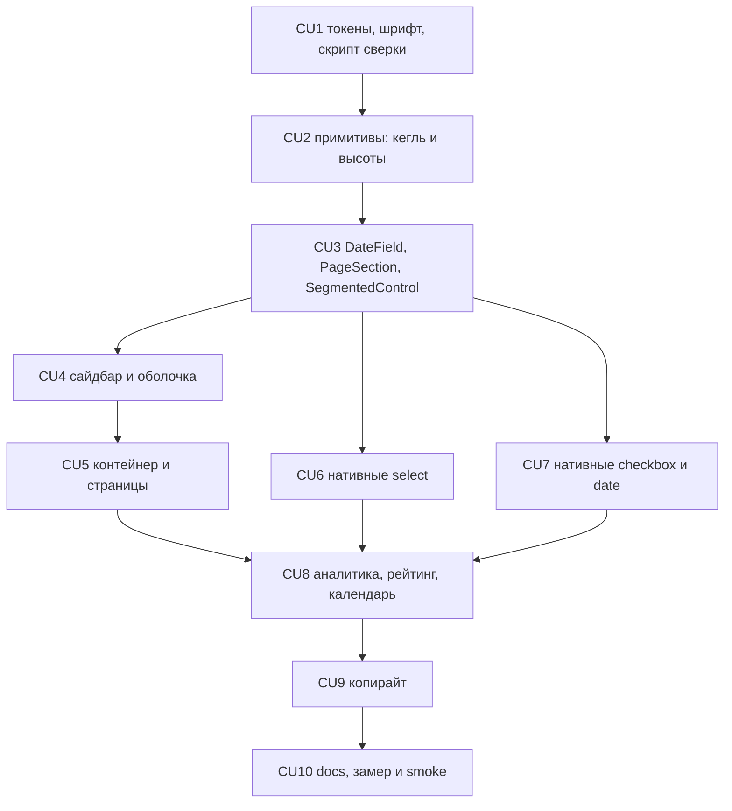

# P14 — Редизайн v2: шрифт, шкала, оболочка, контролы

**Тип:** Phase Description  
**Статус:** Canonical  
**Прогресс фазы:** документы готовы (ADR-014, UX-03 v2.0, UX-02 v2.0, `redesign_v2_ui_spec`, `prototype_class_parity_spec`, аудит); прототип обновлён; код не начат (2026-10-24).  
**Версия:** 1.0  
**Дата:** 2026-10-24  
**Волна:** W12-04  
**Зависит от:** [`adr_014_app_redesign_v2.md`](../../../prds/07_governance/adr_014_app_redesign_v2.md), [`visual_identity_contract.md`](../../../design/visual_identity_contract.md) (UX-03 v2.0), [`responsive_navigation_contract.md`](../../../design/responsive_navigation_contract.md) (UX-02 v2.0), [`redesign_v2_ui_spec.md`](../../../design/redesign_v2_ui_spec.md), [`prototype_class_parity_spec.md`](../specs/prototype_class_parity_spec.md), [`global_shell_spec.md`](../specs/global_shell_spec.md), [`design_system_lab_spec.md`](../specs/design_system_lab_spec.md), [`project_quality_profile.md`](../../../meta/project_quality_profile.md) (lean, D4, D6)  
**Связанные документы:** [`P14_tasks.md`](../tasks/P14_tasks.md), [`ui_redesign_audit_2026-10-24.md`](../audits/ui_redesign_audit_2026-10-24.md), [`sunday_school_prototype.html`](../../../prototypes/sunday_school_prototype.html)

---

## Purpose

Привести интерфейс к редизайну v2 без изменения поведения: основной текст на Source Sans 3 при базе 18 px и полом метаданных 15.75 px; единый контейнер и один вид выбранного чипа; шкала высот контролов; `Select`, `Checkbox`, `DateField` вместо нативных; левый сайдбар на `lg+`; рамка фокуса `main` убрана; копирайт аудита исправлен. Палитра, маршруты, права и данные не меняются.

Результат фазы проверяется сверкой классов прототипа и компонентов по [`prototype_class_parity_spec.md`](../specs/prototype_class_parity_spec.md) и замером [`redesign_v2_ui_spec.md`](../../../design/redesign_v2_ui_spec.md) §5.1.

---

## Agent context budget

**MUST read (≤ 8):**

| # | Документ | Зачем |
|---|----------|-------|
| 1 | [`P14_tasks.md`](../tasks/P14_tasks.md) | Чек-лист и CU |
| 2 | [`redesign_v2_ui_spec.md`](../../../design/redesign_v2_ui_spec.md) | Матрица «файл → что менять» (§3 по CU) |
| 3 | [`prototype_class_parity_spec.md`](../specs/prototype_class_parity_spec.md) | Строки P-NN и протокол сверки |
| 4 | [`adr_014_app_redesign_v2.md`](../../../prds/07_governance/adr_014_app_redesign_v2.md) | Решения R-1…R-12 |
| 5 | [`visual_identity_contract.md`](../../../design/visual_identity_contract.md) | Рецепты §8, шкала §6, D-9…D-13 |
| 6 | [`responsive_navigation_contract.md`](../../../design/responsive_navigation_contract.md) | Сайдбар, фокус `main` (CU4) |
| 7 | [`sunday_school_prototype.html`](../../../prototypes/sunday_school_prototype.html) | Эталон: читать константы по символам из parity-spec §7 |
| 8 | [`ui-prototype-fidelity.mdc`](../../../../.cursor/rules/ui-prototype-fidelity.mdc) | Сверка UI |

**MUST NOT read** другие `P*_phase_description.md`. Полный текст прототипа не открывать — только символы и функции из parity-spec §7.

---

## Scope / Out of scope

### In scope

| Область | Результат |
|---------|-----------|
| Токены и шрифты | Source Sans 3, `html` 112.5%, `--control-h*`, фокус `main` |
| Примитивы | `Button`, `Input`, `Label`, `Field`, `Select`, `Checkbox`, `SegmentedControl` (режим `toggle`, размер `compact`), `Table`, `Card`, новые `DateField`, `PageSection` |
| Оболочка | `SidebarNav`, `NavLinkRow`, `AppShell`, `ShellHeader`, `UserMenu` с «Смотреть как», удаление `TopNav` |
| Нативные контролы | 19 `select`, 8 `checkbox`, 15 `date` → компоненты каталога |
| Экраны | ширины `PageSection`, миграция `text-sm`/`text-xs`, рейтинг, календарь, аналитика, `/groups`, `/groups/[id]`, `/year`, `/profile`, `/settings`, `/achievements`, `/school` |
| Копирайт | исправления аудита в `ru.ts` и `en.ts` |
| Инструмент | `scripts/check-prototype-parity.mjs` |

### Out of scope

- Палитра, радиусы, глубина, тёмная тема.
- Маршруты ([`canonical_routes.md`](../../../design/canonical_routes.md) не меняется), права, данные, Zod-схемы, мутации.
- Новые функции продукта и новые экраны.
- Lab PSI и runtime `next-dev-loop` — только по явному запросу (кроме UI-verify ниже).

---

## UI Catalog

| Действие | Компонент | Примечание |
|----------|-----------|------------|
| **USE** | `Button`, `Input`, `Textarea`, `Card`, `Dialog`, `Sheet`, `Table`, `Badge`, `CountBadge`, `PageHeader`, `EmptyState`, `Banner`, `Heading` | токены UX-03 v2.0 |
| **CREATE** (L2/L3) | `DateField`, `PageSection`, `SidebarNav`; расширение `SegmentedControl` | Lab-first (C-2) |
| **CHANGE** | `Select` (доводка), `Checkbox`, `Label`, `Field`, `Table`, `NavLinkRow`, `UserMenu`, `AppShell`, `ShellHeader` | классы по матрице §3 |
| **MUST NOT** | нативные `select` / `checkbox` / `date`; `text-xs` вне бейджей; `text-[0.9375rem]`; `max-w-*`/`mx-auto` на странице; `bg-ink` как «выбрано»; новые цвета | UX-03 §10 |

---

## UX/UI verification loop (обязательно для UI-CU: CU2…CU8)

Явный запрос владельца 2026-10-24: для UI-CU P14 агент **сам** проверяет интерфейс в запущенном приложении против прототипа и против замера §5.1. Lab PSI не входит в цикл.

**Предусловие:** `next dev` запущен, доступны учётные записи admin и teacher (dev: `FIRST_ADMIN_EMAIL` / `ADMIN_PASSWORD`, `TEACHER_EMAIL` / `TEACHER_PASSWORD` из `.env` или git-ignored `.local/dev-secrets.json`; пароли не копируются в документацию, код, коммиты, логи и чат). Для CU без UI (CU1) цикл не требуется.

**Цикл (повторять до нулевых расхождений):**

1. Войти под нужной ролью и открыть экран из задачи.
2. Открыть ту же функцию прототипа (`v*` по [`prototype_route_mapping.md`](../../../design/prototype_route_mapping.md)) и сверить структуру и ru-тексты.
3. Ширины **390 px, 768 px, 1024 px, 1280 px**; консоль без `error` и `unhandledrejection`.
4. Выполнить замер [`redesign_v2_ui_spec.md`](../../../design/redesign_v2_ui_spec.md) §5.1: `html: "18px"`, `smallText: []`, `mainOutline: "none"`, `nativeControls: 0`, `controlHeights ⊂ {41, 45, 50}`.
5. Выполнить протокол [`prototype_class_parity_spec.md`](../specs/prototype_class_parity_spec.md) §4 для каждого изменённого компонента: `node scripts/check-prototype-parity.mjs --component <id>` для строк `auto`, чтение по §4 для `manual`.
6. Расхождение чинится на всей странице и во всех экранах-потребителях компонента, затем шаги 2–5 повторяются.
7. В trace CU две строки: `UI-verify: <экраны>, <роли>, <ширины>, расхождений 0, консоль чистая` и `Parity: <N> строк сверено, расхождений 0`.

**Критерий приёмки UI-CU:** без обеих строк CU не коммитится. В `reviewer` (проход 2b) строка таблицы «UI-компонент → parity-spec §7» входит в ожидаемую форму ([`ai_code_review_protocol.md`](../../../guidelines/ai_code_review_protocol.md)).

---

## Cross-phase dependencies

| Зависимость | Блокирует? | Примечание |
|-------------|-----------|------------|
| P06 (Design Lab), P09–P11 (оболочка, аналитика, проверка ДЗ) | Да | меняются их компоненты |
| P12 (достижения), P13 (семьи) | Да | `/achievements`, `/family`, `/child*` получают те же примитивы; их экраны — в CU6/CU7 по списку файлов |
| Новый пакет календаря | Нет | `react-day-picker` — решение Q-01 [`redesign_v2_ui_spec.md`](../../../design/redesign_v2_ui_spec.md) §6; отдельная T2-задача внутри CU3, `npm run deps:check` |
| CU1 (токены, скрипт) | Да для CU2…CU10 | шрифт и скрипт сверки нужны всем следующим |
| CU3 (`DateField`, `PageSection`, `SegmentedControl`) | Да для CU5, CU7, CU8 | примитивы раньше использования |
| CU4 (сайдбар) | Нет для CU5 (контейнер в `main`) | порядок CU4 → CU5 удобнее: ширина считается после сайдбара |

---

## Implementation sequence

---

## Happy path smoke

1. admin на 1280 px: слева сайдбар, контент справа не шире 1400 px и прижат влево; «Смотреть как» — в меню пользователя (dev).
2. `/groups/[id]`: язык и учитель — `Select`, оценивание — чекбоксы каталога, кнопки одной высоты.
3. `/year`: даты вводятся в `DateField`, «Закрыть год» — контурная кнопка.
4. `/rating`: места одним кеглем, строки равной высоты, имя чёрное, cobalt на наведении.
5. `/analytics`: чипы группы, периода и года выбираются одним стилем `cobalt-soft`.
6. На 390 px сайдбара нет, работает drawer; горизонтальной прокрутки нет.

## Negative path smoke

| Сценарий | Ожидаемо |
|----------|----------|
| Поле даты: ввод `31.02.2027` | ошибка поля (текст + иконка), значение не теряется (F6) |
| Select в серверной форме без выбора | валидация сервера, ошибка поля |
| Нативный `<select>` в новом коде | lint/grep падает (CU DoD CU10) |
| Фокус `main` после перехода | рамки нет; Tab по кнопке рисует `:focus-visible` |
| Текст < 15.75 px в `main` (кроме бейджа) | замер §5.1 даёт непустой `smallText` — CU не закрыт |

## Security smoke

| Проверка | Ожидаемо |
|----------|----------|
| Переключатель «Смотреть как» в prod-сборке | отсутствует в бандле (ОК-5, проверка строки `dev-role-switcher`) |
| «Смотреть как» не повышает права на сервере | операции проверяются по ролям БД (как сейчас) |
| Пункт, недоступный роли | не рендерится в сайдбаре на сервере (UX-02 §8 S) |
| В скрытых полях `Select`/`DateField` | только значения формы, без ПД в атрибутах `title`/`aria-label` |

## Concurrency & race check

| Сценарий | Ожидаемо |
|----------|----------|
| Быстрая смена ширины 1023 → 1024 → 1023 | сайдбар и drawer не открыты одновременно, фокус не теряется |
| Двойной клик по чипу `toggle` | состояние чётное/нечётное, без рассинхрона `aria-pressed` |

---

## Drift risks & guards

| Риск | Guard |
|------|-------|
| Класс в компоненте расходится с прототипом | parity-spec §4 и скрипт; blocker «drift» в review |
| Массовая замена `text-sm` ломает мету | таблица ролей redesign spec §3.6; замер §5.1 |
| `top-nav` или выпадашки возвращаются | grep `top-nav\|shellTopNavTriggerClass` пуст (CU10) |
| Нативные контролы вернулись | grep `<select\|type="checkbox"\|type="date"` в `apps/web/src` пуст (CU10) |
| Шрифт Source Sans 3 шире — переполнение на 390 px | UI-verify на 390 px, запас +30% (ЛК-8); таблицы с `min-w-*` |
| Прототип правится без контракта | прототип подчинён UX-03 (§10 anti-patterns); правка строки parity-spec в том же CU |

---

## Definition of done

- [ ] Все CU закоммичены; у CU1…CU9 trace `Review: …`; у UI-CU (CU2…CU8) trace `UI-verify: …, расхождений 0, консоль чистая` и `Parity: …, расхождений 0`
- [ ] CU1 выполнен раньше CU2…CU10; CU3 раньше CU5, CU6, CU7, CU8
- [ ] `typecheck` · `lint` · `test` · `rules:check` · `deps:check` зелёные
- [ ] Замер §5.1 по 13 экранам: `html: "18px"`, `smallText: []`, `mainOutline: "none"`, `nativeControls: 0`
- [ ] Повторный замер записан в [`ui_redesign_audit_2026-10-24.md`](../audits/ui_redesign_audit_2026-10-24.md) §5
- [ ] Docs sync (CU10): индексы, `prototype_route_mapping.md`, строки статуса

---

## Open questions фазы

| ID | Вопрос | Предложение | Блокирует |
|----|--------|-------------|-----------|
| Q-01 | Библиотека календаря для `DateField` | `react-day-picker` через `next/dynamic`; версия — `npm view`, `deps:check` | CU3 |
| Q-02 | Список часовых поясов в `/settings` | Base UI `Combobox`, иначе `Input` + `Select` | CU7 |

Оба вопроса не блокируют CU1…CU2; решаются в соответствующем CU (T2-задача внутри CU) без возврата в документы, кроме записи результата в [`redesign_v2_ui_spec.md`](../../../design/redesign_v2_ui_spec.md) §6.

---

## Related documents

| Document | Relationship |
|----------|--------------|
| [`P14_tasks.md`](../tasks/P14_tasks.md) | Чек-лист |
| [`redesign_v2_ui_spec.md`](../../../design/redesign_v2_ui_spec.md) | Матрица изменений |
| [`prototype_class_parity_spec.md`](../specs/prototype_class_parity_spec.md) | Сверка классов |
| [`ui_redesign_audit_2026-10-24.md`](../audits/ui_redesign_audit_2026-10-24.md) | Вход и повторный замер |

**Registry:** [`documentation_creation_registry.md`](../../../meta/documentation_creation_registry.md) — wave W12-04

## Change log

| Date | Change |
|------|--------|
| 2026-10-24 | v1.0 — Canonical (W12-04): документы и прототип готовы; код не начат |
