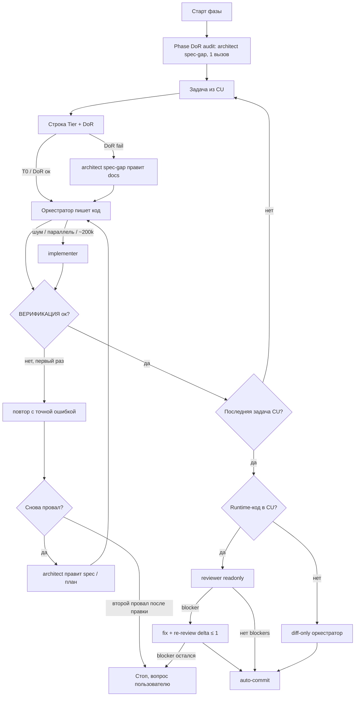

# Маршрутизация моделей и делегирование

**Тип:** Guide  
**Статус:** Canonical  
**Версия:** 2.0  
**Дата:** 2026-10-10  
**Зависит от:** [`ai_first_project_methodology.md`](./ai_first_project_methodology.md) §2.2–§2.5, [`.cursor/rules/model-routing.mdc`](../../.cursor/rules/model-routing.mdc), [`documentation_creation_registry.md`](./documentation_creation_registry.md) §2.3.2a / §2.3.6  
**Связанные документы:** [`AGENTS.md`](../../AGENTS.md), [`phase_tasks.template.md`](./phase_tasks.template.md), [`docs/guidelines/ai_code_review_protocol.md`](../guidelines/ai_code_review_protocol.md)

---

## Purpose

Контракт определяет, **кто** в сессии Cursor пишет код, **какой моделью** и **когда коммитить**. Принцип: код готовой задачи пишет оркестратор. Дорогая модель подключается только в двух случаях: документация не готова (spec-gap) или нужна независимая проверка (review commit unit).

Читают оркестратор и человек, который выбирает модель в пикере. Исполнение в каждой сессии — [`.cursor/rules/model-routing.mdc`](../../.cursor/rules/model-routing.mdc) (`alwaysApply`). При расхождении побеждает `.mdc`; этот файл обновляется в том же изменении.

**Runtime продукта:** **Next.js 16.4** (App Router, Vercel). Точный patch — в `apps/web/package.json`, без каретки. Snapshot Pulse (`docs/examples/pulse/`) может оставаться на своём пине; корневые Rules и Guidelines важнее.

## Scope / Out of scope

**In scope:** классификация T0–T3, Definition of Ready, spec-gap, commit units, выбор субагента, review-гейт CU, auto-commit, эскалация, лимиты контекста и моделей.

**Out of scope:**

- Bugbot и skill `review-bugbot` (платный контур; в репозитории запрещён);
- Security Review (`review-security`) — только по явной просьбе пользователя; это не субагент `reviewer`;
- выбор продуктовых фич и процесс ADR (процесс — [`decision_process.template.md`](../prds/07_governance/decision_process.template.md)).

**Две оси с одним именем «tier».** T0–T2 в [`.cursor/rules/README.md`](../../.cursor/rules/README.md) — это **когда копировать Cursor Rules** (bootstrap / implementation / Design Lab). T0–T3 в этом файле — **как дёшево выполнить задачу**. Не смешивать.

Cursor **Agent Review** (панель IDE, `/agent-review`, Quick/Deep) — отдельный локальный пайплайн. Он не заменяет субагента `reviewer`.

## Definitions

| Термин | Значение |
|--------|----------|
| Оркестратор | Чат. Классифицирует, проверяет DoR, **пишет код готовых задач**, делегирует, собирает результат. Отдельного субагента-«роутера» нет. |
| DoR | Definition of Ready — чеклист готовности задачи к реализации (§ DoR). |
| Spec-gap | Режим `architect`: исправить документы (spec / contract / ADR / PRD) так, чтобы задача прошла DoR. Код не пишет. |
| Phase DoR audit | Один вызов `architect` spec-gap на все задачи фазы до старта реализации. |
| Commit unit (CU) | Группа задач = один логический коммит; планируется заранее в `P{N}_tasks.md` § Commit plan. |
| `architect` | Субагент документов и планов: spec-gap и `.cursor/plans/<task-slug>.md`. |
| `implementer` | Субагент правок. Только для изоляции контекста или параллельных шагов. |
| `reviewer` | Единственный review-гейт CU с runtime-кодом. Только чтение. |
| Explore | Встроенный поиск по коду. Не `architect`. |

Модели закрепляются во frontmatter [`.cursor/agents/*.md`](../../.cursor/agents/), не в тексте промпта оркестратора.

## Requirements

1. **MUST** — первая строка ответа на задачу с кодом: `Tier: T0|T1|T2|T3 — <причина ≤ 10 слов> · CU: P{N}-CU{k}|none`.
2. **MUST** — карта моделей (не переопределять в промпте):

   | Роль | Модель | Когда |
   |------|--------|--------|
   | Оркестратор | Composer 2.5, не fast (пикер чата) | Вся сессия; пишет код T0 / T1 и T2 после spec-gap. |
   | `implementer` | `composer-2.5[fast=false]` | Только изоляция: шум > ~20k токенов, параллельные шаги, контекст около ~200k. |
   | `architect` | `grok-4.7[effort=high,fast=false]` | DoR не пройден (spec-gap), Phase DoR audit, план T2, эскалация. |
   | `reviewer` | `grok-4.7[effort=high,fast=false]`, `readonly: true` | Граница CU с runtime-кодом; standalone «проверь diff». |
   | Поиск | Explore | Поиск по репозиторию. |

3. **MUST** — оставаться в пуле Cursor: Grok 4.x и Composer 2.5. Сторонние модели не выбирать.
4. **MUST** — при сомнении между двумя тирами брать **нижний**; эскалация поправит. Исключение: задача с признаком S не опускается ниже T3.
5. **MUST** — вопрос без правки кода отвечать самому, без субагента.
6. **MUST** — DoR проверяется чтением только связанных разделов. Не пройден → spec-gap до кода. Код по непроверенной спецификации запрещён.
7. **MUST NOT** — делегировать `implementer` задачу, которая помещается в контекст оркестратора: та же модель, лишний холодный старт.
8. **MUST NOT** — субагент на T0; дробление последовательных шагов в одних и тех же файлах; задача, которая закрывается ≤ 3 вызовами инструментов.
9. **MUST** — параллелить субагентов только если списки `Files` не пересекаются.
10. **MUST** — шаг плана T2 содержит `Goal`, `Files`, `Acceptance`, `Tier` (по умолчанию T1). Делегату передавать путь плана и номера шагов. Ответ субагента ≤ 15 строк.
11. **MUST** — эскалация: один повтор с точной ошибкой → `architect` правит spec / план и не пишет код → повторное применение → стоп и вопрос пользователю. Цикл повторов запрещён.
12. **MUST** — задачи фазы сгруппированы в CU заранее (§ Commit units). Задача вне CU не коммитится отдельно.
13. **MUST** — на границе CU: ВЕРИФИКАЦИЯ → review (`reviewer` или `diff-only`) → auto-commit по [`agent-commit-pipeline.mdc`](../../.cursor/rules/agent-commit-pipeline.mdc).
14. **MUST NOT** — варианты `-fast`, effort `xhigh` и контекст 500k, пока пользователь явно не попросил.
15. **MUST** — один контекст держать ниже ~200k токенов (выше этого Grok 4.7 тарифицируется с множителем 2). Дальше — новый чат или делегирование. Читать файлы по пути, не перечитывать уже известное, править точечно. Когда задача закрыта или контекст устарел — предложить новый чат.

### Классификация задачи

| Тир | Сигнал | Код пишет | Субагент |
|-----|--------|-----------|----------|
| T0 | 1–2 файла, до ~40 строк, намерение однозначно, вне sensitive zones | Оркестратор | — |
| T1 | DoR пройден | Оркестратор | `implementer` только по правилу изоляции |
| T2 | DoR не пройден; новая фича без плана; новая зависимость; контракт данных или API; неочевидный баг после одной неудачной попытки | Оркестратор, **после** правки документов | `architect` spec-gap / план |
| T3 | Auth, платежи, права, секреты, миграция по живым данным, разрушительные операции, ломающий публичный API, **любой признак S** | Как T1 / T2 | `reviewer` обязателен; задача — отдельный CU |

Sensitive zones — единый список в [`agent-code-review-subagent.mdc`](../../.cursor/rules/agent-code-review-subagent.mdc) § Sensitive zones (`proxy.ts`, `packages/policy/**`, `packages/db/**`, миграции, env, `next.config.*`, `**/auth/**`, `**/api/**`). Доменные инварианты из `AGENTS.md` добавляются по мере заполнения W3/W4.

## DoR

Задача готова к реализации, если выполнены **все** пункты:

1. **Ссылки на разделы:** spec / contract / ADR / PRD указаны как `§N.M`, ссылки открываются.
2. **Acceptance проверяема:** у каждого пункта есть способ проверки и ожидаемый исход.
3. **Files / area:** названы пути или globs.
4. **Нет неопределённости:** в связанных разделах нет `TBD`; `Open questions` пуст или не блокирует эту задачу.
5. **Версии:** API библиотек сверено с пином — поле `Проверено по` в документе совпадает с `package.json`.
6. **Пути H / N / S** описаны там, где их требуют признаки. **Канон признаков** — [`documentation_creation_registry.md` §2.3.2a](./documentation_creation_registry.md#232a-критерии-применимости-путей-h--n--s-канон); здесь не копировать. Задача пишет `Paths: H [§] · N [§] · S [§]` или `Paths: n/a — <причина из списка освобождений>`.

Документы, созданные по registry §2.3.6 (DoR-ready checklist), дают DoR без spec-gap. DoR — приёмка задачи, §2.3.6 — приёмка документа; это одни и те же критерии с двух сторон.

**Phase DoR audit.** До первой задачи фазы — один вызов `architect` spec-gap: проверить DoR по всем задачам `P{N}_tasks.md`, дописать недостающее в документы, отметить секцию `Phase DoR audit`. Пакетная проверка дешевле, чем холодный старт на каждую задачу.

## Commit units

Канон формата — [`phase_tasks.template.md`](./phase_tasks.template.md). Commit plan пишется **при планировании фазы** (registry §6.7), а не в момент коммита.

| Правило | Значение |
|---------|----------|
| Состав | Несколько T0 / T1 одной темы **или** одна T2 |
| T3 | Всегда отдельный CU |
| Размер | Ориентир ≤ ~400 hand-written строк; больше — делить при планировании |
| Заголовок | `type(scope): subject` — subject коммита; `Review: reviewer \| diff-only` |
| Вне CU | Мелкая задача не коммитится отдельно; ждёт границы CU или явного запроса |
| Docs sync | Правки docs (product-docs-alignment) — в том же CU, что код, или отдельным docs-CU фазы |

## Flows

Цикл методологии:

`КОНТЕКСТ → TIER/DoR → ФАЗА → КОНТРАКТ → ЗАДАЧИ (CU) → [SPEC-GAP] → РЕАЛИЗАЦИЯ → ВЕРИФИКАЦИЯ → REVIEW (CU) → COMMIT`

Lint не заменяет `reviewer`. `reviewer` не заменяет `npm run typecheck` и `npm run lint`. Runtime dual-view и lab PSI по-прежнему только по явной просьбе пользователя.

## Review и commit (не Bugbot)

Один гейт на CU — [`agent-code-review-subagent.mdc`](../../.cursor/rules/agent-code-review-subagent.mdc), HOW — [`ai_code_review_protocol.md`](../guidelines/ai_code_review_protocol.md):

| Содержимое CU | Review | Кто |
|---------------|--------|-----|
| ≤ 10 строк вне zones (ad-hoc, по явному запросу коммита) | `skip` | — |
| Docs / `.mdc` / tests / tooling, без runtime-кода | `diff-only` | оркестратор |
| Есть runtime-код | `reviewer` | `.cursor/agents/reviewer.md`, модель из frontmatter |

Вход `reviewer`: задачи CU из `P{N}_tasks.md` (2a) + `git diff --staged`; Paths H / N / S — ожидаемая форма (2b). Не передаётся summary автора и черновик commit message. Bugbot не вызывать; `reviewer` не правит код; re-review — только delta, не более одного раза.

**Auto-commit** ([`agent-commit-pipeline.mdc`](../../.cursor/rules/agent-commit-pipeline.mdc)): CU объявлен в tasks, ВЕРИФИКАЦИЯ зелёная, review без blockers → коммит без вопроса пользователю. Запрещено: push, `--amend`, `--no-verify`, stage `.env*` / секретов. Blocker остался после re-review → не коммитить, доложить.

## Acceptance criteria

- [ ] Оркестратор печатает строку `Tier … · CU …` до делегирования и до правок.
- [ ] T0 и T1 с пройденным DoR закрыты оркестратором без субагента.
- [ ] Задача с проваленным DoR начинается со spec-gap; код пишется после правки документов.
- [ ] Перед фазой отмечен Phase DoR audit.
- [ ] Задача с признаком S — T3 и отдельный CU.
- [ ] Каждый CU с runtime-кодом прошёл `reviewer`; trace `Review: …` в ответе.
- [ ] Коммиты появляются только на границах CU (или по явному запросу), без push / amend / no-verify.
- [ ] Проваленный шаг не зациклен: один повтор, затем правка spec / плана, затем стоп.
- [ ] Модель субагента задана файлом `.cursor/agents/*.md`, не фразой в промпте.

## Drift risks

| Риск | Следствие | Страж |
|------|-----------|--------|
| `.mdc` и этот файл разошлись | Агент следует always-applied тексту, документ врёт | Править оба в одном изменении; приоритет у `.mdc` |
| DoR пройден формально, spec устарел | Код по старому API | Поле `Проверено по` + сверка с `package.json`; несовпадение = DoR fail |
| Критерии H / N / S скопированы в несколько файлов | Расхождение формулировок | Канон — registry §2.3.2a; остальные ссылаются (в `.mdc` — только краткий список признаков) |
| CU не размечены в tasks | Auto-commit не срабатывает или коммитит случайный объём | Phase DoR audit проверяет наличие Commit plan |
| Нет `.cursor/agents/*.md` в **корне** репозитория | Субагент наследует модель чата; pin не работает. Копии в `docs/examples/pulse/.cursor/agents/` не действуют | `architect.md`, `implementer.md`, `reviewer.md` в `/.cursor/agents/` |
| `model-routing.mdc` не в tier-manifest и не в `.claude/rules/` | Bootstrap и Claude Code правило не видят | Строка в `.cursor/rules/README.md` §T0, копия в `tiers/t0-always/`, `npm run rules:sync` |
| Имя T0–T2 у Cursor Rules и у задач | Агент путает «скопировать UI-rule» и «не звать субагента» | В тексте писать «task tier» или «rule tier» |
| Документы стека на 16.3.3 в Pulse snapshot | Агент читает устаревший пин из `docs/examples/pulse/` | Корневые Rules / Guidelines override snapshot |

## Related documents

| Документ | Роль |
|----------|------|
| [`.cursor/rules/model-routing.mdc`](../../.cursor/rules/model-routing.mdc) | Runtime-копия, always applied |
| [`documentation_creation_registry.md`](./documentation_creation_registry.md) | §2.3.2a признаки H / N / S, §2.3.6 DoR-ready документы, §6.7 phase tasks |
| [`phase_tasks.template.md`](./phase_tasks.template.md) | Формат CU, задач, Phase DoR audit |
| [`ai_first_project_methodology.md`](./ai_first_project_methodology.md) | Цикл КОНТЕКСТ → TIER/DoR → … → COMMIT |
| [`agent-code-review-subagent.mdc`](../../.cursor/rules/agent-code-review-subagent.mdc) | Review-гейт CU, sensitive zones |
| [`agent-commit-pipeline.mdc`](../../.cursor/rules/agent-commit-pipeline.mdc) | Auto-commit на границе CU |
| [`ai_code_review_protocol.md`](../guidelines/ai_code_review_protocol.md) | HOW трёх проходов и prompt `reviewer` |
| [Subagents](https://cursor.com/docs/agent/subagents) | Формат `.cursor/agents/*.md` |

## Agent notes

- Роутинг — выбор `architect` / `implementer` / `reviewer` / Explore. По умолчанию — никого: код пишет оркестратор.
- Субагент начинает с пустого контекста и заново читает файлы. Лишнее дробление дороже, чем один вызов.
- Пробел в документации чинится в документе (spec-gap), а не комментарием в коде или «known drift».
- `reviewer` не чинит код. Находки возвращаются оркестратору; если это новый дизайн — через `architect`.
- Вопросы «как устроено» и поиск по коду не повышать до T2.
- Не просить `-fast`, даже если в списке моделей Cursor он есть.
