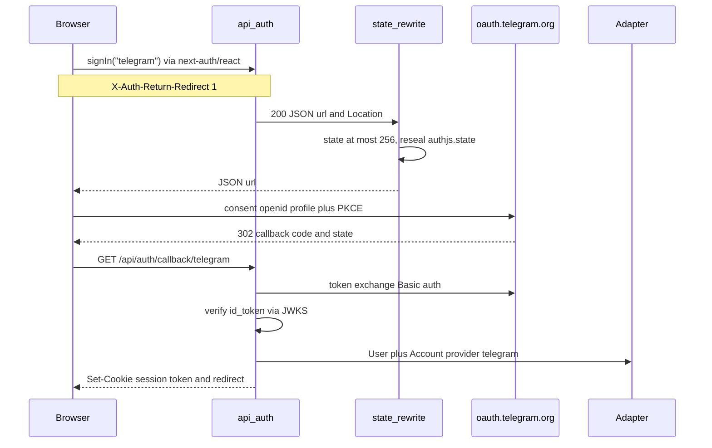

# Telegram OpenID Connect с Auth.js v5

Самодостаточное руководство: его можно перенести в другой Next.js-проект и поднять вход через Telegram, не открывая остальную документацию и не копируя продуктовые маршруты.

Стек: Auth.js v5 (`next-auth`) · Next.js App Router · JWT-сессия · опционально PrismaAdapter.

Официальные источники:

- Auth.js custom OAuth/OIDC: https://authjs.dev/guides/configuring-oauth-providers
- Auth.js installation / Route Handler: https://authjs.dev/getting-started/installation
- Env inference v5: https://authjs.dev/getting-started/migrating-to-v5
- `OIDCConfig` / `customFetch`: https://authjs.dev/reference/core/providers
- Telegram Login / OIDC: https://core.telegram.org/bots/telegram-login
- Discovery: `https://oauth.telegram.org/.well-known/openid-configuration`

Текст ниже — рабочий путь, который уже проходит в проде: клиентский `signIn()`, укорочение OAuth `state` до 256 символов, синтетический `userinfo_endpoint` в discovery. Без этих двух правок authorize или callback у Telegram не завершаются.

---

## 1. Какой механизм входа использовать

Для веб-приложения на Auth.js — **OpenID Connect Authorization Code + PKCE + `state`**, full-page redirect на `https://oauth.telegram.org`.

| Механизм | Доказательство | Для Auth.js web login |
|----------|----------------|------------------------|
| OIDC ID token + JWKS (`oauth.telegram.org`) | RS256 JWT, `iss` / `aud` / `exp` | Да |
| Legacy Login Widget (HMAC) | HMAC-SHA256 от `SHA256(bot_token)` | Нет. Это Credentials/`authorize()`, не OIDC |
| Mini App `initData` | HMAC с ключом `WebAppData` | Нет. Другой продукт (WebApp) |
| Popup `oauth.telegram.org/js/telegram-login.js` | JS widget | Нет как основной путь: ломается на `Cross-Origin-Opener-Policy: same-origin` |

Почему OIDC:

1. Auth.js уже умеет `type: "oidc"`: discovery, PKCE, обмен кода, JWKS.
2. Сервер проверяет ID token криптографически.
3. UX тот же, что у Google: redirect → consent → callback.
4. Один адаптер и один JWT-контур на все провайдеры.

Секреты не смешивать:

- `AUTH_TELEGRAM_ID` / `AUTH_TELEGRAM_SECRET` — OIDC Client ID и Secret из BotFather **Web Login**.
- `TELEGRAM_BOT_TOKEN` — Bot API (`sendMessage`). Как `clientSecret` его использовать нельзя.

---

## 2. BotFather

`AUTH_TELEGRAM_ID` и `AUTH_TELEGRAM_SECRET` — Client ID и Client Secret из BotFather для OpenID Connect. Это не токен бота.

1. Откройте в Telegram [@BotFather](https://t.me/BotFather). Создайте бота командой `/newbot` или выберите существующего через `/mybots`. Для локальной разработки — отдельный бот, не тот, что будет в проде. Имя и аватар видны на экране согласия.
2. В карточке бота откройте **Login Widget** (в текущем BotFather это также **Web Login**) и выберите **Switch to OpenID Connect Login**.
3. Зарегистрируйте два адреса. `http://localhost` Telegram часто отклоняет, поэтому локально нужен HTTPS-туннель (Cloudflare Tunnel, ngrok) или стабильный preview.
   - **Trusted Origin** — корень приложения, например `https://your-tunnel.example.com`.
   - **Redirect URI** — ровно `{origin}/api/auth/callback/telegram`. Сегмент `telegram` равен `id` провайдера в Auth.js.
4. Скопируйте **Client ID** и **Client Secret** в `.env` (не в репозиторий):

```env
AUTH_TELEGRAM_ID=     # Client ID
AUTH_TELEGRAM_SECRET= # Client Secret
AUTH_URL=https://your-tunnel.example.com
```

`AUTH_URL` должен совпадать с origin, указанным в BotFather. После смены origin, redirect или `.env` перезапустите приложение.

5. Эфемерные preview-URL: либо стабильный preview-хост в allowlist, либо Telegram на них не включать.

Auth.js v5 собирает callback как `/api/auth/callback/{providerId}`. Если сменить `id`, меняется и URI в BotFather.

---

## 3. Переменные окружения

Auth.js v5 читает секреты по шаблону `AUTH_{PROVIDER}_{ID|SECRET}` ([миграция v5](https://authjs.dev/getting-started/migrating-to-v5)):

```env
AUTH_SECRET=          # openssl rand -base64 32; обязателен в production
AUTH_TELEGRAM_ID=     # OIDC Client ID
AUTH_TELEGRAM_SECRET= # OIDC Client Secret

# За reverse-proxy (Netlify, nginx):
AUTH_TRUST_HOST=true
# AUTH_URL=https://app.example.com   # если host нельзя надёжно взять из заголовков
```

`NEXTAUTH_SECRET` и `NEXTAUTH_URL` остаются алиасами. Rewrite `state` читает `AUTH_SECRET ?? NEXTAUTH_SECRET`.

`AUTH_REDIRECT_PROXY_URL` и `redirectProxyUrl` не включать, пока не пересмотрен rewrite `state`. Дефолтный JWE Auth.js кладёт в `state` поле `origin` как раз для proxy-hop; после укорочения эта семантика теряется.

---

## 4. Конфигурация провайдера

`customFetch` — **Symbol** из пакета `next-auth`. Импортируйте его оттуда же, откуда создаёте `NextAuth`. Вторая копия `@auth/core` даст другой Symbol, и хук молча не сработает.

```ts
// auth.config.ts — без адаптера и без Node-only импортов
import { customFetch, type NextAuthConfig } from "next-auth";
import { fetchTelegramOidcWithSyntheticUserinfo } from "./lib/auth/telegram-oidc-discovery-fetch";

const TELEGRAM_OIDC_ISSUER = "https://oauth.telegram.org";

export default {
  trustHost: true,
  providers: [
    {
      id: "telegram",
      name: "Telegram",
      type: "oidc",
      issuer: TELEGRAM_OIDC_ISSUER,
      clientId: process.env.AUTH_TELEGRAM_ID,
      clientSecret: process.env.AUTH_TELEGRAM_SECRET,
      authorization: { params: { scope: "openid profile" } },
      // Профиль только из ID token. UserInfo не вызывается.
      idToken: true,
      // В discovery Telegram нет userinfo_endpoint — см. §6.
      [customFetch]: fetchTelegramOidcWithSyntheticUserinfo,
      checks: ["pkce", "state"],
      allowDangerousEmailAccountLinking: false,
      profile(profile) {
        return {
          id: String(profile.sub ?? profile.id),
          name: profile.name ?? undefined,
          image: profile.picture ?? undefined,
          email: null,
        };
      },
    },
  ],
  pages: {
    signIn: "/",
    error: "/",
  },
} satisfies NextAuthConfig;
```

| Поле | Значение | Зачем |
|------|----------|--------|
| `type` | `"oidc"` | Discovery, ID token, JWKS |
| `issuer` | `https://oauth.telegram.org` | Auth.js сам читает `/.well-known/openid-configuration` |
| `authorization.params.scope` | `openid profile` | Без `phone` и без bot-scope, пока продукт их не требует. **Sunday School:** `openid` only (`sub` → `provider_account_id`; без bot-scope) — [`auth_runtime_spec.md`](../prds/05_runtime/auth_runtime_spec.md) §4.1, ADR-003 v1.2 |
| `idToken` | `true` | Claims из ID token |
| `checks` | `["pkce", "state"]` | CSRF и PKCE |
| `allowDangerousEmailAccountLinking` | `false` | У Telegram обычно нет email; автослияние по email опасно |
| `profile().email` | `null` | Email не выдумывать |
| `profile().id` | `String(sub ?? id)` | Стабильный Telegram user id, строка |

Не отключайте discovery ручными `token.url` / `userinfo.url`: пропадёт `jwks_uri`, и проверка ID token сломается.

---

## 5. Auth.js: сессия и Route Handler

```ts
// auth.ts — Node runtime
import NextAuth from "next-auth";
import { PrismaAdapter } from "@auth/prisma-adapter";
import { PrismaClient } from "@prisma/client";
import authConfig from "./auth.config";

const prisma = new PrismaClient();

export const { auth, handlers, signIn, signOut } = NextAuth({
  adapter: PrismaAdapter(prisma),
  session: { strategy: "jwt", maxAge: 60 * 60 },
  ...authConfig,
  callbacks: {
    async jwt({ token, user }) {
      if (user?.id) token.sub = user.id;
      return token;
    },
    async session({ session, token }) {
      if (session.user && token.sub) {
        session.user.id = token.sub;
      }
      return session;
    },
  },
});
```

JWT + adapter: адаптер создаёт или находит `User` и `Account` при входе. Сессия живёт в JWT-cookie, строк `Session` в рантайме нет.

Обычный `export const { GET, POST } = handlers` для Telegram недостаточен. Оборачивайте оба метода — §6.

```ts
// app/api/auth/[...nextauth]/route.ts
import type { NextRequest } from "next/server";
import { handlers } from "@/auth";
import { rewriteTelegramOAuthAuthorizeState } from "@/lib/auth/telegram-oauth-state-rewrite";

async function withTelegramOAuthStateRewrite(
  handle: (request: NextRequest) => Promise<Response>,
  request: NextRequest,
): Promise<Response> {
  const response = await handle(request);
  try {
    return await rewriteTelegramOAuthAuthorizeState(response);
  } catch (error) {
    console.error("auth.telegram.oauth-state-rewrite", error);
    return new Response("Authentication request failed", { status: 500 });
  }
}

export function GET(request: NextRequest): Promise<Response> {
  return withTelegramOAuthStateRewrite(handlers.GET, request);
}

export function POST(request: NextRequest): Promise<Response> {
  return withTelegramOAuthStateRewrite(handlers.POST, request);
}
```

---

## 6. Два обязательных обхода

### 6.1 `state` длиннее 256 символов

`oauth.telegram.org` отвечает plain-text `state too long`, если `state` длиннее **256** символов.

Auth.js `@auth/core` кодирует OAuth `state` дефолтным JWE `encode` (~430–450 символов). Кастомный `jwt.encode` в `NextAuth({ jwt })` на этот путь не влияет.

Рабочий обход: после handler, если `Location` или JSON `{ url }` ведёт на `https://oauth.telegram.org/` и `state.length > 256`:

1. Сгенерировать короткий opaque token (32 байта `base64url`, около 43 символов).
2. Подменить `state` в URL.
3. Перепечатать cookie `authjs.state` / `__Secure-authjs.state` тем же `encode` из `@auth/core/jwt` (`salt` = имя cookie, `token: { value: shortState, provider: "telegram" }`, TTL 15 минут, как у Auth.js). `@auth/core` 0.41.3 сверяет `provider` с id провайдера callback и отклоняет cookie без этого поля (`InvalidCheck`). CSRF остаётся: `value` совпадает с query `state`.
4. Обновить и заголовок `Location`, и JSON `{ url }`. Body у `200` JSON не удалять.
5. Остальные `Set-Cookie` сохранить. Если cookie `state` нет — падать, а не отдавать длинный `state`.

Клиентский `signIn()` из `next-auth/react` ставит `X-Auth-Return-Redirect: 1` и читает JSON `{ url }`. Пустое тело даёт `SyntaxError: Unexpected end of JSON input`.

```ts
// lib/auth/telegram-oauth-state-rewrite.ts
import { randomBytes } from "node:crypto";
import { encode } from "@auth/core/jwt";

const TELEGRAM_OAUTH_STATE_MAX_LENGTH = 256;
const TELEGRAM_AUTHORIZE_URL_PREFIX = "https://oauth.telegram.org/";
const STATE_COOKIE_MAX_AGE_SEC = 60 * 15;

function generateShortOAuthState(): string {
  return randomBytes(32).toString("base64url");
}

function isAuthJsStateCookieName(cookieName: string): boolean {
  return cookieName === "authjs.state" || cookieName === "__Secure-authjs.state";
}

function isTelegramAuthorizeUrl(value: string | null | undefined): value is string {
  return typeof value === "string" && value.startsWith(TELEGRAM_AUTHORIZE_URL_PREFIX);
}

function isRecord(value: unknown): value is Record<string, unknown> {
  return typeof value === "object" && value !== null && !Array.isArray(value);
}

function readSetCookieHeaders(headers: Headers): string[] {
  if (typeof headers.getSetCookie !== "function") {
    throw new Error("Headers.getSetCookie is required to rewrite Telegram OAuth state cookies");
  }
  return headers.getSetCookie();
}

function splitSetCookieNameValue(setCookieHeader: string): {
  cookieName: string;
  cookieValue: string;
  attributes: string;
} | null {
  const semicolonIndex = setCookieHeader.indexOf(";");
  const nameValuePair =
    semicolonIndex === -1 ? setCookieHeader : setCookieHeader.slice(0, semicolonIndex);
  const attributes = semicolonIndex === -1 ? "" : setCookieHeader.slice(semicolonIndex);
  const equalsIndex = nameValuePair.indexOf("=");
  if (equalsIndex <= 0) return null;
  return {
    cookieName: nameValuePair.slice(0, equalsIndex),
    cookieValue: nameValuePair.slice(equalsIndex + 1),
    attributes,
  };
}

async function sealShortStateCookieValue(params: {
  cookieName: string;
  shortState: string;
  secret: string;
}): Promise<string> {
  return encode({
    secret: params.secret,
    salt: params.cookieName,
    maxAge: STATE_COOKIE_MAX_AGE_SEC,
    token: { value: params.shortState, provider: "telegram" },
  });
}

async function readAuthJsReturnRedirectJson(
  response: Response,
): Promise<Record<string, unknown> | null> {
  const contentType = response.headers.get("content-type") ?? "";
  if (!contentType.toLowerCase().includes("application/json")) return null;
  try {
    const parsed: unknown = await response.clone().json();
    if (!isRecord(parsed) || typeof parsed.url !== "string") return null;
    return parsed;
  } catch {
    return null;
  }
}

async function rewriteAuthJsStateSetCookies(params: {
  setCookieHeaders: string[];
  shortState: string;
  secret: string;
}): Promise<string[]> {
  const rewrittenSetCookies: string[] = [];
  let stateCookieRewritten = false;

  for (const setCookieHeader of params.setCookieHeaders) {
    const parsed = splitSetCookieNameValue(setCookieHeader);
    if (!parsed || !isAuthJsStateCookieName(parsed.cookieName)) {
      rewrittenSetCookies.push(setCookieHeader);
      continue;
    }
    const sealedShortState = await sealShortStateCookieValue({
      cookieName: parsed.cookieName,
      shortState: params.shortState,
      secret: params.secret,
    });
    rewrittenSetCookies.push(
      `${parsed.cookieName}=${sealedShortState}${parsed.attributes}`,
    );
    stateCookieRewritten = true;
  }

  if (!stateCookieRewritten) {
    throw new Error(
      "Auth.js state cookie missing on Telegram authorize redirect; cannot shorten OAuth state",
    );
  }
  return rewrittenSetCookies;
}

export async function rewriteTelegramOAuthAuthorizeState(
  response: Response,
): Promise<Response> {
  const location = response.headers.get("location");
  const returnRedirectJson = await readAuthJsReturnRedirectJson(response);
  const jsonAuthorizeUrl =
    typeof returnRedirectJson?.url === "string" ? returnRedirectJson.url : null;

  const authorizeUrlSource = isTelegramAuthorizeUrl(location)
    ? location
    : isTelegramAuthorizeUrl(jsonAuthorizeUrl)
      ? jsonAuthorizeUrl
      : null;
  if (!authorizeUrlSource) return response;

  let authorizeUrl: URL;
  try {
    authorizeUrl = new URL(authorizeUrlSource);
  } catch {
    return response;
  }

  const currentState = authorizeUrl.searchParams.get("state");
  if (!currentState || currentState.length <= TELEGRAM_OAUTH_STATE_MAX_LENGTH) {
    return response;
  }

  const secret = process.env.AUTH_SECRET ?? process.env.NEXTAUTH_SECRET;
  if (!secret) {
    throw new Error(
      "AUTH_SECRET is required to rewrite Telegram OAuth state for the 256-char limit",
    );
  }

  const shortState = generateShortOAuthState();
  authorizeUrl.searchParams.set("state", shortState);
  const shortenedAuthorizeUrl = authorizeUrl.toString();

  const rewrittenSetCookies = await rewriteAuthJsStateSetCookies({
    setCookieHeaders: readSetCookieHeaders(response.headers),
    shortState,
    secret,
  });

  const headers = new Headers(response.headers);
  headers.delete("content-length");
  if (isTelegramAuthorizeUrl(location)) {
    headers.delete("location");
    headers.set("location", shortenedAuthorizeUrl);
  }
  headers.delete("set-cookie");
  for (const setCookieHeader of rewrittenSetCookies) {
    headers.append("set-cookie", setCookieHeader);
  }

  if (!returnRedirectJson) {
    return new Response(null, {
      status: response.status,
      statusText: response.statusText,
      headers,
    });
  }

  const rewrittenJson = {
    ...returnRedirectJson,
    ...(isTelegramAuthorizeUrl(jsonAuthorizeUrl) ? { url: shortenedAuthorizeUrl } : {}),
  };
  return new Response(JSON.stringify(rewrittenJson), {
    status: response.status,
    statusText: response.statusText,
    headers,
  });
}
```

### 6.2 В discovery нет `userinfo_endpoint`

`https://oauth.telegram.org/.well-known/openid-configuration` содержит `authorization_endpoint`, `token_endpoint`, `jwks_uri` и не содержит `userinfo_endpoint`.

Authorize при этом работает. На callback Auth.js `@auth/core` обращается к `userinfo_endpoint` до проверки `idToken: true`. Это `TypeError`, не AuthError, и пользователь получает `/?error=Configuration`.

`customFetch` на провайдере подставляет placeholder только в JSON discovery. С `idToken: true` Auth.js на этот URL не ходит.

```ts
// lib/auth/telegram-oidc-discovery-fetch.ts
const TELEGRAM_OIDC_ISSUER = "https://oauth.telegram.org";
const TELEGRAM_OIDC_SYNTHETIC_USERINFO_ENDPOINT = "https://oauth.telegram.org/userinfo";
const TELEGRAM_OIDC_DISCOVERY_PATH = "/.well-known/openid-configuration";

function isRecord(value: unknown): value is Record<string, unknown> {
  return typeof value === "object" && value !== null && !Array.isArray(value);
}

function readFetchUrl(input: RequestInfo | URL): string {
  if (typeof input === "string") return input;
  if (input instanceof URL) return input.href;
  return input.url;
}

function isTelegramOidcDiscoveryUrl(urlString: string): boolean {
  try {
    const url = new URL(urlString);
    return (
      url.origin === TELEGRAM_OIDC_ISSUER &&
      url.pathname === TELEGRAM_OIDC_DISCOVERY_PATH
    );
  } catch {
    return false;
  }
}

export async function fetchTelegramOidcWithSyntheticUserinfo(
  input: RequestInfo | URL,
  init?: RequestInit,
): Promise<Response> {
  const response = await fetch(input, init);
  if (!isTelegramOidcDiscoveryUrl(readFetchUrl(input)) || !response.ok) {
    return response;
  }

  let metadata: unknown;
  try {
    metadata = await response.clone().json();
  } catch {
    return response;
  }
  if (!isRecord(metadata)) return response;

  const existingUserinfoEndpoint = metadata.userinfo_endpoint;
  if (
    typeof existingUserinfoEndpoint === "string" &&
    existingUserinfoEndpoint.trim().length > 0
  ) {
    return response;
  }

  return Response.json({
    ...metadata,
    userinfo_endpoint: TELEGRAM_OIDC_SYNTHETIC_USERINFO_ENDPOINT,
  });
}
```

---

## 7. Клиентский вход

Кнопка вызывает `signIn` из `next-auth/react`, не Server Action. Иначе нет заголовка `X-Auth-Return-Redirect`, и rewrite из §6.1 не попадает в URL, который реально открывает браузер.

```ts
import { signIn } from "next-auth/react";

await signIn("telegram", { callbackUrl: "/app" });
```

`callbackUrl` — куда вернуть пользователя после успешного callback (домашняя страница, invite, настройки). Auth.js сам проверяет, что это внутренний путь.

Поток:



Шаги:

1. UI вызывает `signIn("telegram", { callbackUrl })`.
2. Auth.js строит authorize URL (`response_type=code`, `code_challenge`, длинный `state`).
3. Обёртка укорачивает `state` и перепечатывает cookie.
4. Пользователь подтверждает доступ в Telegram.
5. Callback: обмен `code`, проверка ID token (`iss` = `https://oauth.telegram.org`, `aud` = Client ID, `exp`, подпись JWKS).
6. `profile()` → `id` = Telegram user id (строка), `name`, `picture`, `email: null`.
7. Adapter: find-or-create `User` + `Account(provider, providerAccountId)`.
8. `jwt` / `session` кладут `sub` в JWT.
9. Браузер получает httpOnly cookie `authjs.session-token` или `__Secure-authjs.session-token`.

Повторный вход с тем же Telegram id находит того же `User` по `(provider, providerAccountId)`. Два независимых первых входа (Google и Telegram) создают двух пользователей, пока человек явно не привяжет второй провайдер под сессией.

Типичные отказы. Auth.js глотает OIDC-исключения и редиректит на `pages.error` (`/?error=`). В Sentry они попадают только если подписаться на `logger.error`.

| Симптом | Причина |
|---------|---------|
| `Configuration` | Нет `userinfo_endpoint` в discovery (§6.2) или неверный issuer |
| `state too long` на oauth.telegram.org | Не сработал rewrite §6.1 |
| `OAuthCallback` / `OAuthCallbackError` | Отмена consent или сбой callback (неверный Redirect URI, token, JWKS) |
| `AccessDenied` | `signIn` callback вернул `false` (например, удалённый пользователь). Это не «пользователь нажал отмену» |
| `OAuthAccountNotLinked` | Этот Telegram id уже принадлежит другому пользователю. Автослияние выключено |
| `SyntaxError: Unexpected end of JSON input` в `signIn()` | Обёртка съела JSON `{ url }` |

Пользовательский текст на `/?error=`:

- `OAuthCallback` и `OAuthCallbackError` — «вход отменён, можно повторить».
- `OAuthAccountNotLinked` — конфликт привязки, без деталей чужого аккаунта.
- Остальные коды, включая `AccessDenied` и `Configuration` — общее «не удалось войти».

---

## 8. Явная привязка второго провайдера

Первый вход не сливает аккаунты. Привязка — отдельное действие уже вошедшего пользователя.

1. `userId` только из `auth()`. С клиента `userId` и `providerAccountId` не принимать.
2. Если этот провайдер уже есть у того же пользователя — не начинать OIDC, показать успех (идемпотентно).
3. Иначе тот же клиентский `signIn("telegram", { callbackUrl })` из `next-auth/react`, `callbackUrl` — страница настроек. Серверный `signIn()` из Server Action собирает authorize URL внутри экшена и не проходит обёртку route handler, поэтому укорочение `state` (§6.1) на этом пути не выполняется.
4. Если `(telegram, id)` уже у другого пользователя, Auth.js вернёт `OAuthAccountNotLinked`. Запись не создавать и пользователей не сливать.
5. Отвязка удаляет строку только этого пользователя. Если провайдер последний — отказать. Перед удалением заблокировать строки аккаунта (`SELECT … FOR UPDATE`), чтобы два параллельных unlink не оставили ноль способов входа.
6. В UI отвязка — после подтверждения, без оптимистичного удаления.

`allowDangerousEmailAccountLinking` для Telegram остаётся `false`.

---

## 9. Схема Account

Если адаптер Prisma:

- `Account.provider` = `"telegram"`
- `Account.providerAccountId` = стабильный Telegram user id (строка)
- Первичный ключ `(provider, providerAccountId)`
- `User.email` — nullable
- Удаление пользователя каскадом снимает все `Account`

Таблица `Session` при стратегии JWT в рантайме не используется. Адаптер всё равно пишет `Account`.

---

## 10. Безопасность

- `checks: ["pkce", "state"]` не отключать.
- После rewrite cookie `authjs.state` содержит тот же opaque `value`, что query `state`, и `provider: "telegram"`.
- В BotFather только HTTPS origins.
- `clientSecret` и `AUTH_SECRET` только на сервере, не в `NEXT_PUBLIC_*`.
- Не доверять профилю или hash, которые клиент постит мимо callback Auth.js.
- Ошибки пользователю — без токенов, JWKS и секретов.
- Периметр (`proxy.ts` / middleware) проверяет JWT. Мутации всё равно вызывают `auth()` в handler.

---

## 11. Файлы и приёмка

```
src/auth.config.ts
src/auth.ts
src/app/api/auth/[...nextauth]/route.ts
src/lib/auth/telegram-oidc-discovery-fetch.ts
src/lib/auth/telegram-oauth-state-rewrite.ts
```

- [ ] BotFather: OIDC включён, Trusted Origin и Redirect URI совпадают с деплоем.
- [ ] `AUTH_TELEGRAM_*` не равны `TELEGRAM_BOT_TOKEN`.
- [ ] Кнопка вызывает `signIn("telegram")` из `next-auth/react`.
- [ ] Authorize URL на `https://oauth.telegram.org/auth` имеет `state.length <= 256`.
- [ ] После согласия есть httpOnly session cookie.
- [ ] Повторный вход того же Telegram id находит того же пользователя.
- [ ] Нет автослияния с другим провайдером по отсутствующему email.
- [ ] `customFetch` импортирован из `next-auth`.
- [ ] `signIn()` не падает на пустом JSON.
- [ ] Отмена consent показывает восстановимое сообщение, без stack trace.
- [ ] Привязка чужого Telegram id не переносит аккаунт.
- [ ] Последний способ входа отвязать нельзя.
