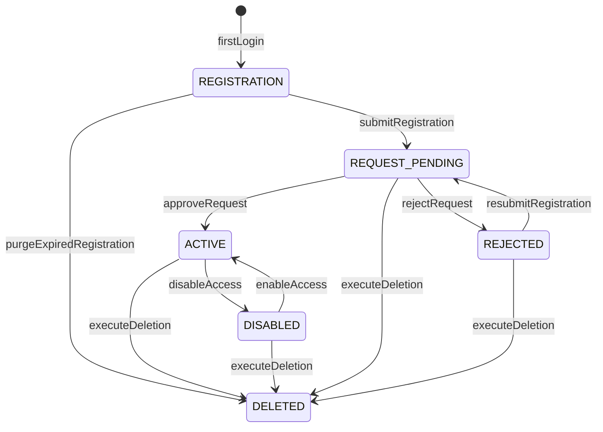
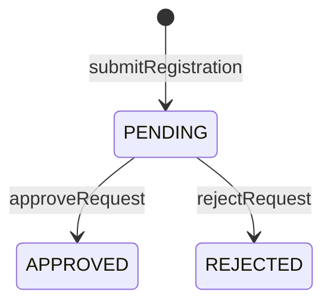
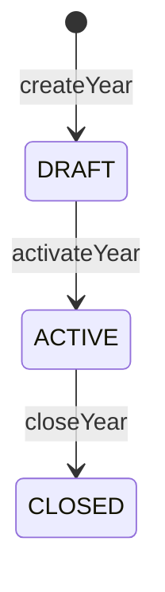
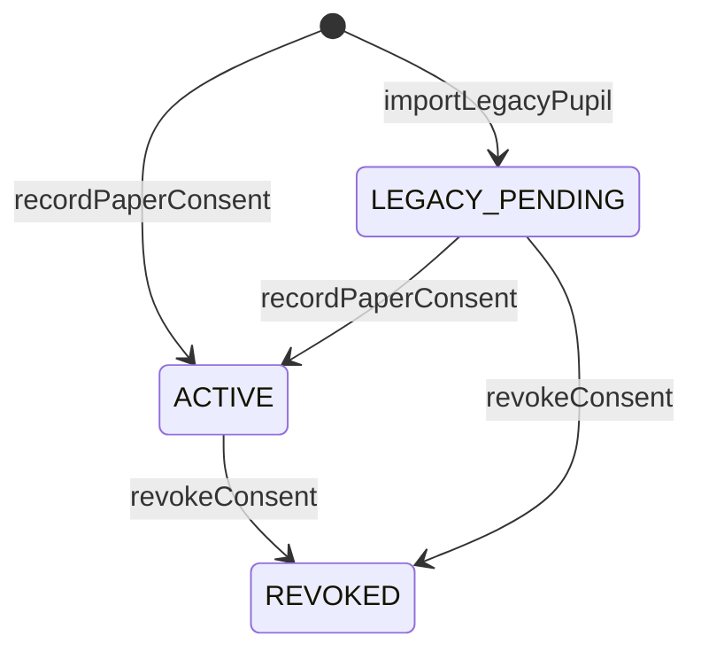
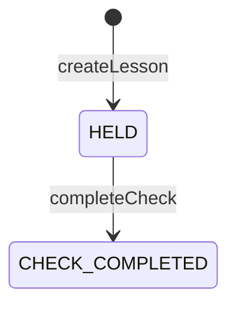
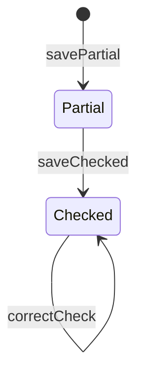
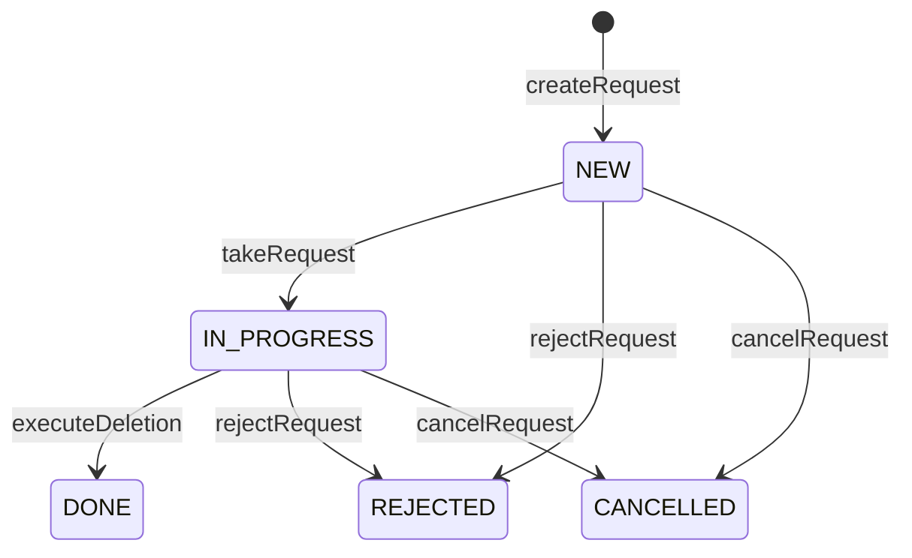
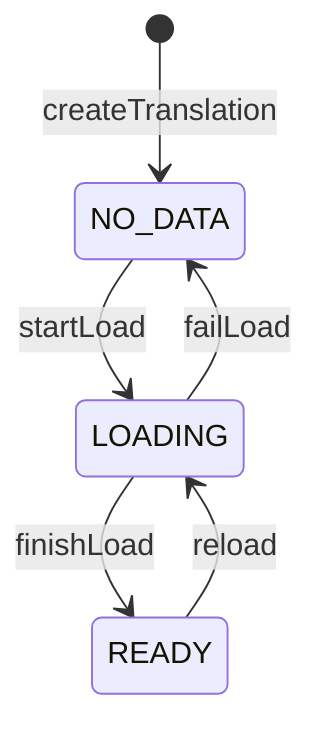

# Lifecycle models — Sunday School MVP

**Тип:** PRD  
**Статус:** Canonical  
**Версия:** 1.0  
**Дата:** 2026-10-10  
**Волна:** W3-02  
**Зависит от:** [`mvp_scope.md`](../01_product_scope/mvp_scope.md), [`database_schema_v1.md`](../03_data_model/database_schema_v1.md), [`admin_flow.md`](../01_product_scope/user_flows/users_mvp/admin_flow.md), [`teacher_flow.md`](../01_product_scope/user_flows/users_mvp/teacher_flow.md), [`sunday_school_data_analytics_spec.md`](../../my_specs/sunday_school_data_analytics_spec.md) §2.4–2.6, §3, §5  
**Связанные документы:** [`domain_invariants.md`](./domain_invariants.md), [`architecture_master_index.md`](../architecture_master_index.md), [`post_mvp_deferrals.md`](../01_product_scope/post_mvp_deferrals.md)  
**Проверено по:** не применимо (нет runtime-библиотек; enum-ы — из `database_schema_v1.md` §4)

---

## 1. Purpose

Канон **state machines** домена MVP: допустимые статусы, переходы, акторы, предусловия и последствия. Источник для `@sunschool/domain` и контрактов W8. Читают: авторы contracts, исполнители задач, reviewer.

## 2. Scope / Out of scope

**В scope:** учётная запись, заявка на доступ, учебный год, зачисление, согласие на данные ребёнка, урок, запись проверки ДЗ, журнал кирпичиков, запрос на удаление, перевод Библии.  
**Вне scope:** достижения, штрафы, голосовые попытки, семьи (post-MVP — [`post_mvp_deferrals.md`](../01_product_scope/post_mvp_deferrals.md)); права доступа (`authorization_matrix`, W5-02); физические ограничения БД (схема).

## 3. Definitions

| Термин | Значение / источник |
|--------|---------------------|
| `ACCOUNT_STATUS` | `REGISTRATION`, `REQUEST_PENDING`, `REJECTED`, `ACTIVE`, `DISABLED`, `DELETED` |
| `ACCESS_REQUEST_STATUS` | `PENDING`, `APPROVED`, `REJECTED` |
| `ACADEMIC_YEAR_STATUS` | `DRAFT`, `ACTIVE`, `CLOSED` |
| `LESSON_STATUS` | `HELD`, `CHECK_COMPLETED` |
| `CONSENT_STATUS` | `ACTIVE`, `REVOKED` |
| `DELETION_REQUEST_STATUS` | `NEW`, `IN_PROGRESS`, `DONE`, `REJECTED`, `CANCELLED` |
| `BIBLE_TRANSLATION_STATUS` | `NO_DATA`, `LOADING`, `READY` |
| Акторы | `ADMIN`, `TEACHER`, `USER` (владелец учётной записи), `SYSTEM` (только ленивая очистка, §4.1) |

Литералы **MUST** совпадать со схемой и `@sunschool/domain`; inline-строки запрещены.

## 4. Общие правила (все lifecycles)

1. **MUST** — переход статуса только через именованный use-case; прямой `UPDATE status` из UI или DAL-помощника запрещён.
2. **MUST** — каждая смена статуса, роли или доступа пишется в `audit_log` (актор, субъект, действие, причина) — БП-8.
3. **MUST** — недопустимый переход возвращает domain-ошибку; молчаливое «ничего не сделали» запрещено.
4. **MUST** — переход и его побочные записи — в одной транзакции.
5. **SHOULD** — повторный вызов того же перехода идемпотентен (возвращает текущее состояние).
6. **MUST NOT** — фоновые задачи и cron в MVP (ADR-001, инвариант 4). Очистка по сроку — **ленивая**: выполняется при обращении (§5.1 п. 3); актор `SYSTEM`, запись в журнале.

## 5. Lifecycles

### 5.1 Учётная запись (`ACCOUNT_STATUS`)

| Статус | Значение |
|--------|----------|
| `REGISTRATION` | Первый вход выполнен, форма регистрации не отправлена |
| `REQUEST_PENDING` | Форма отправлена, заявка ждёт решения |
| `REJECTED` | Заявка отклонена, причина видна пользователю |
| `ACTIVE` | Заявка одобрена, роли назначены |
| `DISABLED` | Доступ отключён admin, данные сохранены |
| `DELETED` | Данные удалены или обезличены (§5.9) |

| Из → в | Use-case | Актор | Предусловия | Последствия |
|--------|----------|-------|-------------|-------------|
| `∅ → REGISTRATION` | `firstLogin` | `USER` | вход через Google или Telegram; провайдер подтвердил личность | создан `app_user`, `login_identity` |
| `REGISTRATION → REQUEST_PENDING` | `submitRegistration` | `USER` | ФИО валидно (РГ-3), отмечено согласие на ПД (РГ-2) | созданы `privacy_consent`, `access_request` (`PENDING`) |
| `REQUEST_PENDING → ACTIVE` | `approveRequest` | `ADMIN` | выбрана ≥ 1 роль из `ADMIN`, `TEACHER`; для `TEACHER` группы года желательны (без них — предупреждение `NO_GROUPS`, решено 2026-10-11) | записаны `user_role`, `teacher_assignment` (если выбраны); заявка `APPROVED` |
| `REQUEST_PENDING → REJECTED` | `rejectRequest` | `ADMIN` | причина обязательна | заявка `REJECTED` |
| `REJECTED → REQUEST_PENDING` | `resubmitRegistration` | `USER` | ограничений нет (решение 2026-10-10) | новая `access_request` |
| `ACTIVE → DISABLED` | `disableAccess` | `ADMIN` | не последний `ADMIN`; не себя при роли `ADMIN` | вход блокируется |
| `DISABLED → ACTIVE` | `enableAccess` | `ADMIN` | — | вход разрешён |
| `REGISTRATION → DELETED` | `purgeExpiredRegistration` | `SYSTEM` | согласие не дано, с первого входа прошло > 30 дней (РГ-6) | запись удалена; в журнале системная запись |
| `* → DELETED` | `executeDeletion` | `ADMIN` | выполняется запрос на удаление (§5.9) | данные по УД-7 |

**Ленивая очистка (п. 3):** `purgeExpiredRegistration` вызывается (а) при открытии admin экранов «Заявки на доступ» и «Пользователи» — по всем просроченным записям, (б) при попытке входа этого же пользователя. Запись может прожить дольше 30 дней, пока никто не обратился.

**Invalid transitions:** `REGISTRATION → ACTIVE` (минуя заявку); `ACTIVE → REGISTRATION`; `DELETED → *`; повторное `approveRequest` для не-`PENDING` заявки.  
**Races:** два admin одновременно одобряют / отклоняют одну заявку — побеждает первый, второй получает «уже решена» (блокировка строки заявки); одновременное снятие роли `ADMIN` у двух последних — не оставляет ноль admin (схема R-8).  
**S:** `approveRequest`, `disableAccess`, назначение ролей — только `ADMIN`; роль `PARENT` в MVP недоступна: заявка с ней отклоняется с причиной «доступ родителей откроется позже» ([`mvp_scope.md`](../01_product_scope/mvp_scope.md) §4).

### 5.2 Заявка на доступ (`ACCESS_REQUEST_STATUS`)

| Из → в | Use-case | Актор | Предусловия |
|--------|----------|-------|-------------|
| `∅ → PENDING` | `submitRegistration` | `USER` | у пользователя нет другой `PENDING` |
| `PENDING → APPROVED` | `approveRequest` | `ADMIN` | см. §5.1 |
| `PENDING → REJECTED` | `rejectRequest` | `ADMIN` | причина |

**Invalid:** любой выход из `APPROVED` / `REJECTED` — заявка неизменна; повторная подача — **новая** заявка. До решения пользователь может править ФИО (РГ-4), заявка не меняется.

### 5.3 Учебный год (`ACADEMIC_YEAR_STATUS`)

| Из → в | Use-case | Актор | Предусловия | Последствия |
|--------|----------|-------|-------------|-------------|
| `∅ → DRAFT` | `createYear` | `ADMIN` | даты не пересекаются с другим годом | настройки оценивания и назначения копируются из прошлого года (admin правит) |
| `DRAFT → ACTIVE` | `activateYear` | `ADMIN` | нет другого `ACTIVE` (R-1) | уроки можно создавать |
| `ACTIVE → CLOSED` | `closeYear` | `ADMIN` | — | зачисления и назначения получают дату окончания; данные года — только чтение для `TEACHER`; admin правит с причиной и записью в журнале; выдача кирпичиков за год остаётся доступной (БП-6) |

**Invalid:** `CLOSED → ACTIVE` (год не переоткрывается — Q-01); два `ACTIVE`; создание урока вне `ACTIVE`.  
**Races:** два admin активируют разные годы одновременно — partial unique index отклоняет второго.

### 5.4 Зачисление в группу

Не статус, а интервал `starts_on … ends_on`: активное — `ends_on IS NULL`.

| Операция | Use-case | Актор | Предусловия | Последствия |
|----------|----------|-------|-------------|-------------|
| Зачислить | `enrollPupil` | `ADMIN`, `TEACHER` (своя группа) | у ученика нет активного зачисления; есть действующее согласие на данные ребёнка (R-5, СО-4) | создана запись |
| Исключить | `unenrollPupil` | `ADMIN`, `TEACHER` (своя группа) | активное зачисление есть | `ends_on` = дата; ученик «без группы»; история проверок остаётся (БП-7) |
| Перевести | `transferPupil` | `ADMIN` | активное зачисление есть | закрытие и создание новой записи в одной транзакции |

**Invalid:** второе активное зачисление; зачисление без согласия; операция в закрытом году для `TEACHER`.  
**Races:** параллельные перевод и исключение — второй получает отказ «зачисление уже изменено».

### 5.5 Согласие на данные ребёнка (`CONSENT_STATUS`)

В MVP — только бумажное (СО-3); электронное — post-MVP.

| Из → в | Use-case | Актор | Предусловия | Последствия |
|--------|----------|-------|-------------|-------------|
| `∅ → LEGACY_PENDING` | `importLegacyPupil` | импорт владельца (вне проекта) | ребёнок перенесён из действующего приложения без согласия ([ADR-011](../07_governance/adr_011_transitional_child_consent.md)) | зачисление сохранено; работа не блокируется; общий срок `legacy_consent_deadline_on` |
| `∅ → ACTIVE` | `recordPaperConsent` | `ADMIN` | указаны подписант (текстом), дата, версия текста, место хранения | ребёнка можно зачислить |
| `LEGACY_PENDING → ACTIVE` | `recordPaperConsent` | `ADMIN` | те же поля | перенесённый ребёнок получает действующее согласие |
| `ACTIVE` / `LEGACY_PENDING` → `REVOKED` | `revokeConsent` | `ADMIN` (по обращению) | если действующих согласий не остаётся — admin создаёт запрос на удаление данных ребёнка (СО-6) | зачисление блокируется |

**Invalid:** `REVOKED → ACTIVE` (новое согласие — новая запись).

### 5.6 Урок (`LESSON_STATUS`)

| Из → в | Use-case | Актор | Предусловия | Последствия |
|--------|----------|-------|-------------|-------------|
| `∅ → HELD` | `createLesson` | `TEACHER` (своя группа), `ADMIN` | год `ACTIVE`, дата в границах; ведущий назначен на группу (УЧ-1); обзорный — без стихов и теста; стихов ≤ лимита группы | создан урок, порядковый номер в году |
| `HELD → CHECK_COMPLETED` | `completeCheck` | `TEACHER` (своя группа), `ADMIN` | отметка учителя: посещаемость и ДЗ внесены | урок считается проверенным (БП-1); запускает пересчёты в post-MVP |
| — | `changeLeadTeacher` | `TEACHER`, `ADMIN` | новый ведущий назначен на группу | запись в журнале (УЧ-4) |
| — | `deleteLesson` | `TEACHER` (без проверок), `ADMIN` (с записью в журнале) | у урока нет проверок — иначе только `ADMIN` | урок удалён |

**Invalid:** `CHECK_COMPLETED → HELD`; удаление проверенного урока `TEACHER`; создание урока в `CLOSED` году.  
**Корректировка** проверенного урока не меняет статус урока; она меняет записи проверки (§5.7).  
**Отмена урока** — событие календаря, урока в этом случае нет.

### 5.7 Запись проверки ДЗ (`homework_check`)

Одна запись — один ученик на одном уроке. Статуса-enum нет; состояние определяется полями.

| Состояние | Признак |
|-----------|---------|
| Не начата | записи нет |
| Сохранена частично | запись есть, `homework_checked = false` |
| Проверена | `homework_checked = true`, баллы заморожены (`points_total`, `scoring_snapshot`) |
| Скорректирована | изменена после проверки; в `audit_log` есть правка (БП-12) |

| Переход | Use-case | Актор | Предусловия | Последствия |
|---------|----------|-------|-------------|-------------|
| `∅ → Partial`, `Partial → Partial` | `savePartialCheck` | `TEACHER` (своя группа), `ADMIN` | год `ACTIVE` | оценки сохранены с датой и автором выставления |
| `Partial → Checked` | `saveChecked` | `TEACHER` (своя группа), `ADMIN` | отмечено присутствие | `homework_checked = true`; рассчитаны и **заморожены** `points_total` и `scoring_snapshot` (БП-5 вариант А) |
| `Checked → Checked` | `correctCheck` | `TEACHER` (своя группа, год `ACTIVE`), `ADMIN` (любой год; в `CLOSED` — с причиной) | запись существует или создаётся для ученика, добавленного позже | эта запись пересчитывается по **текущим** весам; новый снимок; запись в журнале; «сдано позже» вычисляется по дате выставления **в поясе школы** ([ADR-004](../07_governance/adr_004_timezone_scheduling_model.md)) |

**Правила значений:** «не оценивалось» = `NULL`, не 0 (БП-4); присутствие не влияет на баллы (БП-10); присутствие задним числом из-за поздней сдачи не меняется (БП-12); оценка относится к дате урока, а не к дате сдачи.  
**Invalid:** правка записи в `CLOSED` году `TEACHER`; правка без изменения; сохранение оценок вне диапазона (стихи 0–2, тест и тетрадь 0–10).  
**Races:** два учителя правят одну запись — оптимистичная блокировка по `updated_at`; проигравший получает «запись изменена, обновите».

### 5.8 Журнал кирпичиков

Таблица только добавления; состояние «остаток» **вычисляется**: набрано − выдано (БП-11).

| Операция | Use-case | Актор | Предусловия | Последствия |
|----------|----------|-------|-------------|-------------|
| Выдать | `issueBricks` | `TEACHER` (своя группа), `ADMIN` | количество — целое > 0; не больше остатка | запись в журнале |
| Исправить | `compensateBricks` | `TEACHER`, `ADMIN` | количество < 0; примечание обязательно | компенсирующая запись; исходная остаётся |

**Invalid:** `UPDATE` или `DELETE` записи журнала приложением (исключение — полное удаление данных ребёнка, УД-7); нулевое количество; выдача сверх остатка.  
**Races:** параллельные выдачи одному ученику — блокировка строк ученика и года, проверка остатка внутри транзакции (схема R-7).  
**Видимость:** отрицательный остаток (баллы уменьшились после выдачи) видят только `TEACHER` и `ADMIN` с пометкой «требует внимания».

### 5.9 Запрос на удаление (`DELETION_REQUEST_STATUS`)

| Из → в | Use-case | Актор | Предусловия | Последствия |
|--------|----------|-------|-------------|-------------|
| `∅ → NEW` | `createRequest` | `USER` (свою учётную запись), `ADMIN` (данные ребёнка по обращению опекуна, УД-1) | нет открытого запроса на того же субъекта; `due_on` = дата + 15 календарных дней | запись |
| `NEW → IN_PROGRESS` | `takeRequest` | `ADMIN` | — | назначен исполнитель |
| `IN_PROGRESS → DONE` | `executeDeletion` | `ADMIN` | показан план (сколько удалено / обезличено); подтверждение вводом слова «удалить» (УД-8); не последний admin (УД-9) | данные по УД-7; запрос остаётся в обезличенном виде |
| `NEW\|IN_PROGRESS → REJECTED` | `rejectRequest` | `ADMIN` | причина обязательна (УД-6) | автор видит причину |
| `NEW\|IN_PROGRESS → CANCELLED` | `cancelRequest` | автор | запрос не выполнен | запись в журнале |

**Invalid:** выход из `DONE`, `REJECTED`, `CANCELLED`; второй открытый запрос на субъект; собственный запрос admin выполняет **другой** admin (если admin один — с отдельным подтверждением, УД-9).  
**Пока запрос открыт:** учётная запись и данные работают как обычно (УД-4).  
**Срок:** просрочка (`due_on` < сегодня) подсвечивается, статус не меняется автоматически.

### 5.10 Перевод Библии (`BIBLE_TRANSLATION_STATUS`)

| Из → в | Use-case | Актор | Предусловия | Последствия |
|--------|----------|-------|-------------|-------------|
| `NO_DATA → LOADING` | `startLoad` | скрипт загрузки | — | загрузка идемпотентна (upsert) |
| `LOADING → READY` | `finishLoad` | скрипт загрузки | число книг, глав, стихов совпало с ожидаемым; карта нумерации полна (ADR-009) | язык доступен группам (ЯГ-3) |
| `LOADING → NO_DATA` | `failLoad` | скрипт загрузки | сверка не прошла | язык недоступен |

**Invalid:** назначение языка группе при статусе не `READY`; правка текстов стихов через интерфейс (ПБ-2). Запуск скрипта — запись в журнале.

### 5.11 Вне MVP

Достижения (`achievement_award`), штрафы (`penalty`), голосовые попытки (`recitation_attempt`), семьи — lifecycles описываются при старте соответствующей волны ([`post_mvp_deferrals.md`](../01_product_scope/post_mvp_deferrals.md)).

## 6. Paths (H / N / S)

| Путь | Описание | Исход |
|------|----------|-------|
| **H** | Каждый переход §5 с выполненными предусловиями | Состояние изменено, запись в журнале |
| **N** | Недопустимый переход, нарушенное предусловие | Domain-ошибка; состояние и данные не меняются |
| **S** | Переходы ролей, доступа, ПД, удаления | Только актор из таблицы; проверка на сервере; запись в журнале |
| **Races** | §5.1, 5.3, 5.4, 5.7, 5.8 | Побеждает первый; второй получает ошибку, не частичное состояние |

## 7. Acceptance criteria

- [ ] Все литералы статусов совпадают с `database_schema_v1.md` §4 — исход: сверка скриптом даёт пустую разницу.
- [ ] Для каждого lifecycle есть диаграмма (где есть enum), таблица переходов и invalid transitions — исход: нет lifecycle без трёх элементов.
- [ ] Каждый переход имеет актора и предусловие — исход: нет пустых ячеек.
- [ ] Ленивая очистка не требует cron — исход: нет упоминания расписания в §5.1.

## 8. Open questions

| ID | Вопрос | Владелец | Блокирует |
|----|--------|----------|-----------|
| Q-01 | Нужна ли возможность переоткрыть закрытый год (сейчас: нет, правка admin с причиной) | владелец | `school_year_and_groups_contract` |
| Q-02 | БП-4 для старых данных: 0 за тетрадь считать оценкой (12.2 п. 16) | владелец | `homework_check_contract`, импорт владельца |
| Q-03 | Что показывать пользователю, чья `REGISTRATION` удалена лениво, при следующем входе (новая регистрация) | владелец | `access_and_registration_spec` |

## 9. Related documents

| Document | Relationship |
|----------|--------------|
| [`domain_invariants.md`](./domain_invariants.md) | Неизменяемые правила |
| [`database_schema_v1.md`](../03_data_model/database_schema_v1.md) | Enum-ы и ограничения |
| [`authorization_matrix.md`](../04_authorization_privacy/authorization_matrix.md) | Права актора (W5-02) |
| Контракты W8: [`access_requests_and_roles`](../../implementation/mvp/contracts/access_requests_and_roles_contract.md), [`school_year_and_groups`](../../implementation/mvp/contracts/school_year_and_groups_contract.md), [`homework_check`](../../implementation/mvp/contracts/homework_check_contract.md), [`bricks_ledger`](../../implementation/mvp/contracts/bricks_ledger_contract.md), [`deletion_requests`](../../implementation/mvp/contracts/deletion_requests_contract.md), [`bible_seed`](../../implementation/mvp/contracts/bible_seed_contract.md) | Реализация переходов |

**Registry:** [`documentation_creation_registry.md`](../../meta/documentation_creation_registry.md) — wave W3-02

## 10. Agent notes

- Не добавлять статусы и переходы вне таблиц; новый — сначала правка здесь и в схеме.
- Не реализовывать cron для очистки регистраций.
- «Корректировка» — не статус урока и не новый статус записи.
- Присутствие и баллы — независимы (БП-10).

## Change log

| Date | Change |
|------|--------|
| 2026-10-10 | v1.0 — Canonical (W3-02) |
