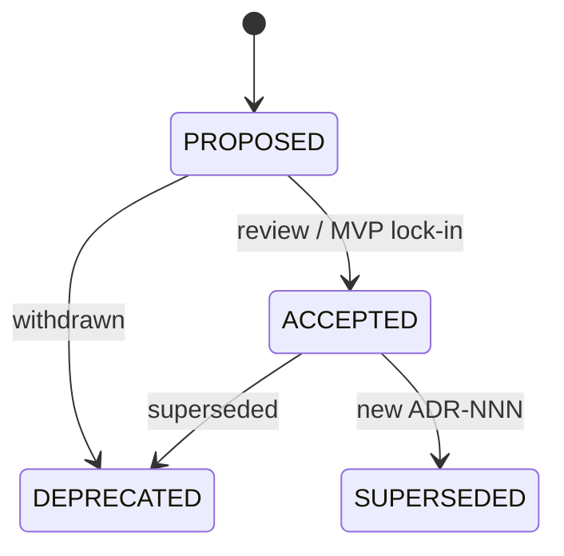

# Architecture Decision Process — template

**Статус:** TEMPLATE — после волны W1 (`documentation_creation_registry.md` → W1-02) скопировать в `decision_process.md` и заполнить проект.  
**Зависит от:** `adr_index.md` (W1-01) должен существовать первым.

**Проект:** {{PROJECT_NAME}}  
**Owner:** Architecture

**Methodology:** [`docs/meta/ai_first_project_methodology.md`](../../meta/ai_first_project_methodology.md)

Канон SoT: [`.cursor/rules/tiers/t0-always/project-context.template.mdc`](../../../.cursor/rules/tiers/t0-always/project-context.template.mdc) (после bootstrap: `project-context.mdc`).

---

## Purpose

Фиксирует **когда** и **как** команда и AI-агенты создают, обновляют и принимают ADR в {{PROJECT_NAME}}. Цель — предотвратить «тихие» архитектурные изменения в коде без записи решения и без учёта ADR-001/002 и реестра документации.

---

## Scope / Out of scope

**In scope:** триггеры ADR, шаблон документа, статусы, связь с contracts/PRD, процесс backlinks, верификация Context7 для runtime/auth/data.

**Out of scope:** code review policy, sprint planning, выбор продуктовых фич (см. PRD `mvp_scope.md`, после создания в волне W1).

---

## When to write an ADR

| Trigger | Example | Action |
|---------|---------|--------|
| Новый внешний сервис | Замена почтового провайдера (например Resend → SES) | Новый ADR + update ADR-001 consequences |
| Изменение границ пакетов | Policy-проверки в `proxy.ts` вместо `packages/policy/server` | ADR или правка ADR-002 + contract |
| Auth/session model | OAuth вместо Credentials | Новый ADR; deprecate prior auth ADR section |
| Product-domain scope boundary | Функциональность вынесена за MVP (например платежи) | ADR amendment — «отклонено для MVP», ссылка на domain ADR |
| Jobs / idempotency | Очередь вместо Vercel Cron | ADR-001 amendment + jobs ADR |
| Pin major framework | Next.js 17 | Новый ADR; supersede ADR-002 |

**MAY** — локальное решение в одном модуле без cross-package impact — достаточно contract или guideline, без ADR.

**MUST NOT** — менять ACCEPTED ADR «молча» в коде; либо новый ADR с supersede, либо bump ADR version + Change log.

---

## ADR document template

Каждый ADR **MUST** использовать структуру:

```markdown
# ADR-NNN: Title

**Дата:** YYYY-MM-DD
**Статус:** PROPOSED | ACCEPTED | DEPRECATED | SUPERSEDED
**Проект:** {{PROJECT_NAME}}
**Проверено по:** <lib>@<pin> — Context7, YYYY-MM-DD   <!-- runtime/auth/db ADR -->

## 1. Context
## 2. Decision
## 3. Rationale / Consequences
## 4. Security consequences      <!-- MUST при признаке S (registry §2.3.2a); иначе «N/A — <причина>» -->
## 5. Rejected alternatives
## 6. Affected documents         <!-- contract / spec / PRD § → что меняется; правятся в том же изменении -->
## 7. Open questions             <!-- «—», если пусто; PROPOSED ADR с вопросами блокирует DoR зависимых задач -->
## 8. Related documents
## 9. Agent checklist
```

Для security/auth ADR **MUST** включать rejected alternatives и agent checklist (см. registry §2.3.3).

**Affected documents** — мост от решения к реализации: задачи фазы ссылаются на правленые разделы contract / spec, а не на ADR целиком. ADR без этой секции или с несинхронизированными документами не проходит DoR-ready checklist (registry §2.3.6).

---

## Status lifecycle



| Status | Meaning for agents |
|--------|-------------------|
| **PROPOSED** | Не блокировать эксперимент в ветке, но **не** считать каноном для production checklist |
| **ACCEPTED** | Обязателен к соблюдению; конфликт с кодом = баг |
| **DEPRECATED** | Не применять; ссылка на замену |
| **SUPERSEDED** | Читать только исторический контекст; follow replacement ADR |

MVP lock-in (ADR-001, ADR-002) — сразу **ACCEPTED** без ожидания post-MVP review.

---

## Workflow (agent + human)

1. **READ** [`adr_index.md`](./adr_index.md) и зависимые ADR.
2. **CHECK** Pulse reference — [`pulse_project_reference.md`](../../reference/pulse_project_reference.md); адаптировать под домен {{PROJECT_NAME}} и ADR-001, **не** копировать формулировки дословно.
3. **Context7** (обязательно для runtime/auth/db ADR): Next.js `/vercel/next.js`, Auth.js `/websites/authjs_dev`, Prisma `/websites/prisma_io` — см. registry §2.7.
4. **DRAFT** `adr_NNN_*.md` в `docs/prds/07_governance/`.
5. **UPDATE** [`adr_index.md`](./adr_index.md) — строка в registry + Change log.
6. **BACKLINKS** — `architecture_master_index.md`, затронутые PRD/contracts (planned → link).
7. **SYNC** — правки из § Affected documents внесены в те же изменения (не «known drift»).
8. **VERIFY** checklist § Acceptance criteria и registry §2.3.6 (пункты 1, 2, 6, 7).

Одна сессия: **один ADR** или правка одного ACCEPTED ADR (не пакет из W4 без запроса).

---

## Relationship to other document types

| Type | When ADR wins | When contract/PRD wins |
|------|---------------|------------------------|
| **ADR** | Stack, hosting, framework pin, cross-cutting policy | — |
| **Contract** | — | Module I/O, idempotency, policy touchpoints |
| **PRD** | — | User-visible behavior, MVP scope |
| **Cursor Rules** | — | Enforcement в коде; не дублировать ADR текстом |

Иерархия при конфликте: см. [`.cursor/rules/tiers/t0-always/project-context.template.mdc`](../../../.cursor/rules/tiers/t0-always/project-context.template.mdc) § Source-of-truth order (после bootstrap: `project-context.mdc`). **ADR выше interim `default_docs/`**, ниже contracts для module behavior.

---

## Requirements

1. **MUST** — после создания ADR обновить `adr_index.md` в той же сессии.
2. **MUST** — material change: bump **Версия** в front matter ADR + Change log.
3. **SHOULD** — PROPOSED ADR помечать в phase description как blocker, если фаза зависит от решения.
4. **MUST NOT** — принимать решение против ACCEPTED ADR без нового ADR или explicit user override в задаче.
5. **MUST** — секция Affected documents заполнена, перечисленные contract / spec / PRD обновлены в том же изменении.

---

## Acceptance criteria

- [ ] Триггеры ADR перечислены и однозначны
- [ ] Шаблон и статусы согласованы с ADR-001/002
- [ ] Указана интеграция с registry waves и Context7
- [ ] `adr_index.md` и methodology ссылаются на этот процесс
- [ ] Шаблон содержит Affected documents, Security consequences, Open questions

---

## Related documents

| Document | Relationship |
|----------|--------------|
| [`adr_index.md`](./adr_index.md) | ADR registry |
| [`ai_first_project_methodology.md`](../../meta/ai_first_project_methodology.md) | AI-first cycle; doc hierarchy |
| [`documentation_creation_registry.md`](../../meta/documentation_creation_registry.md) | Planned ADR waves (W1, W4) |
| [`adr_002_nextjs_vercel_runtime_policy.template.md`](./adr_002_nextjs_vercel_runtime_policy.template.md) | Boilerplate ACCEPTED-ready ADR example |
| Pulse snapshot (illustration only, not canon): [`decision_process.md`](../../examples/pulse/docs/prds/07_governance/decision_process.md) | Worked example on the same default stack |

**Registry:** [`documentation_creation_registry.md`](../../meta/documentation_creation_registry.md) — wave W1-02

---

## Agent notes

- `proxy.ts` в новом коде без migration ticket вместо `middleware.ts` — нарушение ADR-002, не повод для нового ADR, если можно исправить код.
- Доменные ADR Pulse (auth roles, booking, timezone, i18n) — **иллюстрация процесса**, не источник решений для {{PROJECT_NAME}}; копировать структуру, не содержимое.
- Post-MVP фичи — не новый ADR на MVP без явного scope change; см. `post_mvp_deferrals.md` (после создания в волне W1).
